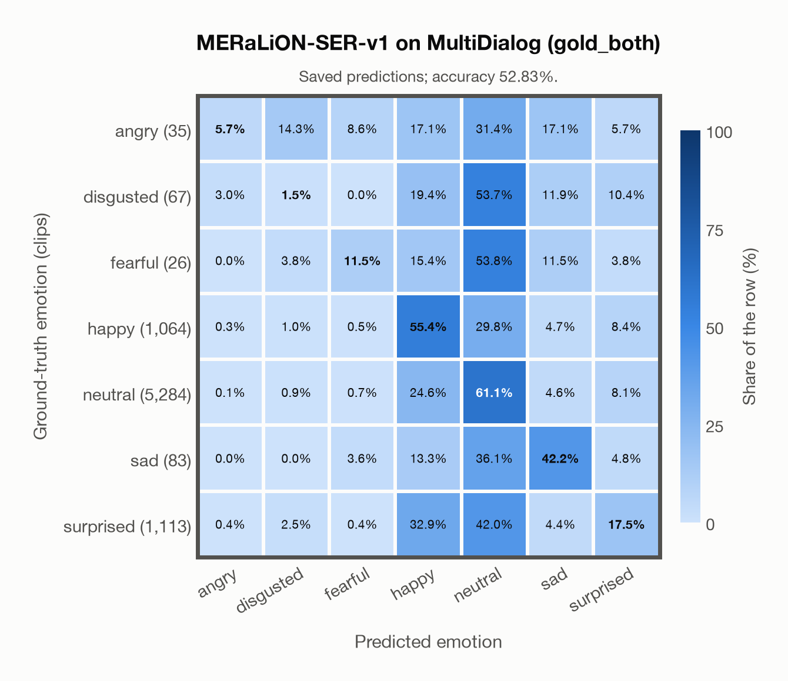

# MERaLiON-SER-v1 on MultiDialog (gold_both)

Regenerated offline from saved CSV/JSON by `scripts/evaluation/refresh_reports.py`. This refresh performs no model inference or API requests.

## Summary

| Metric | Recomputed value |
|---|---:|
| Clips | 7,672 |
| Accuracy: acted emotion | 52.83% |
| UAR: mean ground-truth-row recall | 27.84% |
| Macro F1 | 22.36% |
| Weighted F1: true-support weighted | 55.55% |
| Accuracy: all model classes | 52.83% |

## Imported run and verification

- Source: [prediction CSV](../../outputs/meralion_ser_v1/multidialog_predictions.csv) and [metadata JSON](../../outputs/meralion_ser_v1/multidialog_predictions.json); both remain byte-for-byte unchanged.
- Original execution date recorded in JSON: `2026-11-10`.
- Dataset scope recorded in JSON: **MultiDialog (gold_both)**, English; 7,672 / 7,672 clips.
- Ground-truth column: `acted_emotion`. Candidate classes: angry, disgusted, fearful, happy, neutral, sad, surprised.
- Row counts, unique audio paths, correctness flags and saved metrics were checked against the CSV. Metric agreement tolerance is 0.000001 (six-decimal metadata).
- Weighted F1 weights each class's F1 by its true support, using the same resolved truth as macro F1; invalid answers remain errors. New metrics absent from the source JSON are recorded in the offline audit and summaries; the source JSON is preserved.
- Original execution/client runtime metadata (reported by the imported run, not measured by this refresh): `{"device": "mps", "hardware": "Apple M3 Pro", "seconds": 3453.7, "ms_per_clip": 450.2, "on_cpu": 0}`.

## Results per emotion

| Ground-truth emotion | Clips | Recall | Acted-or-listener recall |
|---|---:|---:|---:|
| angry | 35 | 5.71% | — |
| disgusted | 67 | 1.49% | — |
| fearful | 26 | 11.54% | — |
| happy | 1,064 | 55.36% | — |
| neutral | 5,284 | 61.09% | — |
| sad | 83 | 42.17% | — |
| surprised | 1,113 | 17.52% | — |

Precision/F1 use the same resolved-truth convention as the evaluation script. Weighted F1 uses the resolved-truth clip counts below as weights.

| Predicted emotion | Resolved-truth clips | Precision | Recall | F1 |
|---|---:|---:|---:|---:|
| angry | 35 | 12.50% | 5.71% | 7.84% |
| disgusted | 67 | 1.08% | 1.49% | 1.25% |
| fearful | 26 | 5.66% | 11.54% | 7.59% |
| happy | 1,064 | 25.73% | 55.36% | 35.13% |
| neutral | 5,284 | 78.67% | 61.09% | 68.78% |
| sad | 83 | 8.88% | 42.17% | 14.68% |
| surprised | 1,113 | 26.93% | 17.52% | 21.23% |

## Confusion matrix: acted emotion

| Ground truth \ Predicted | angry | disgusted | fearful | happy | neutral | sad | surprised |
|---|---|---|---|---|---|---|---|
| angry (35) | **5.7%** | 14.3% | 8.6% | 17.1% | 31.4% | 17.1% | 5.7% |
| disgusted (67) | 3.0% | **1.5%** | 0.0% | 19.4% | 53.7% | 11.9% | 10.4% |
| fearful (26) | 0.0% | 3.8% | **11.5%** | 15.4% | 53.8% | 11.5% | 3.8% |
| happy (1,064) | 0.3% | 1.0% | 0.5% | **55.4%** | 29.8% | 4.7% | 8.4% |
| neutral (5,284) | 0.1% | 0.9% | 0.7% | 24.6% | **61.1%** | 4.6% | 8.1% |
| sad (83) | 0.0% | 0.0% | 3.6% | 13.3% | 36.1% | **42.2%** | 4.8% |
| surprised (1,113) | 0.4% | 2.5% | 0.4% | 32.9% | 42.0% | 4.4% | **17.5%** |

## Caveats

- **Training involvement for MERaLiON-SER-v1: No corpus-specific evidence**. Source: SER training on CREMA-D, ESD, MELD, M3ED and Singaporean speech; retained Whisper-medium pretraining sources are incompletely disclosed; upstream seed/base teacher use is counted as seen. Direct use and upstream teacher use both count as training involvement. No pattern: no corpus-specific evidence, not verified unseen. Corpus use is not test-clip leakage.
- Internal CSV/JSON consistency does not authenticate the original model or remote request logs.

[Offline validation audit](multidialog_offline_audit.json)
