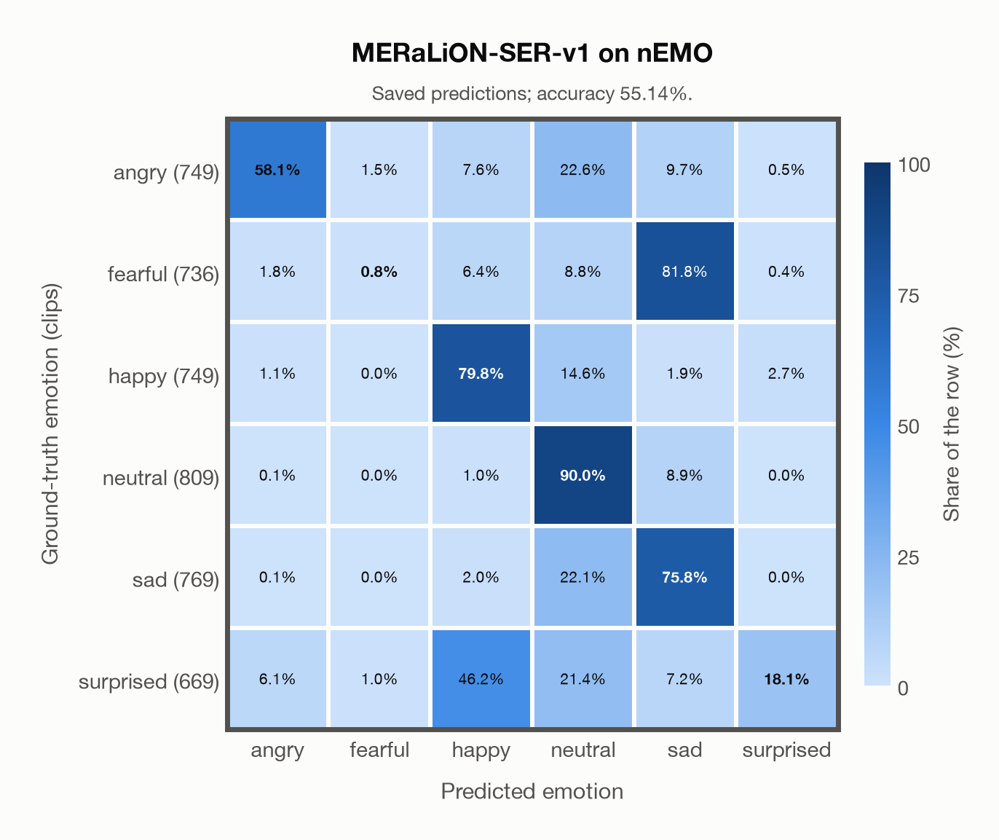

# MERaLiON-SER-v1 on nEMO

Generated by `scripts/evaluation/evaluate.py` on 2026-11-06.

## Summary

| Metric | Value |
|---|---|
| Clips evaluated | 4,481 (Polish) |
| **Accuracy: prediction matches the acted emotion** | **55.1%** |
| Unweighted accuracy (mean recall of the 6 acted emotions) | 53.8% |
| Macro F1 (acted emotion) | 48.1% |
| Accuracy, all 7 model classes (acted emotion) | 55.0% |
| Chance level (6 emotions) | 16.7% |

## Setup

- **Model**: MERaLiON-SER-v1 (`MERaLiON/MERaLiON-SER-v1`) as released (no fine-tuning), transformers 5.18.0, loaded by `scripts/models/meralion_ser.py`. Each clip becomes Whisper log-mel features padded with silence to 30 s (as in the model card); the model ignores attention masks and pools over the whole 30 s window, padding included, which is its official behaviour. float32 on every device, as released.
- **Data**: 4,481 clips of nEMO (Polish) from `data/nemo/`.
- **Ground truth (acted emotion)**: the emotion each speaker was asked to portray (`emotion`).
- Label mapping: anger = angry, fear = fearful, happiness = happy, sadness = sad, surprised = surprised, neutral = neutral.
- **6 emotions**: the prediction is the most probable of the 6 emotions in this dataset (angry, fearful, happy, neutral, sad, surprised); the model's other classes (`disgusted`) are ignored. **All 7 model classes**: the prediction is the most probable of all 7 model classes, so choosing a class that the dataset does not have counts as wrong.
- **Hardware**: Apple M4 Max, device `mps`, PyTorch 2.7.1. Inference took 19.5 min (262 ms per clip).
- **Per-clip predictions**: `outputs/meralion_ser_v1/nemo_predictions.csv` (in git, so the results can be checked clip by clip). The JSON file next to it describes the columns.

## Results per emotion

Rows: acted emotion. Precision, recall and F1 compare the prediction with the acted emotion.

| Emotion | Clips | Precision | Recall | F1 |
|---|---|---|---|---|
| angry | 749 | 87.2% | 58.1% | 69.7% |
| fearful | 736 | 25.0% | 0.8% | 1.6% |
| happy | 749 | 57.8% | 79.8% | 67.1% |
| neutral | 809 | 52.6% | 90.0% | 66.4% |
| sad | 769 | 41.9% | 75.8% | 54.0% |
| surprised | 669 | 81.8% | 18.1% | 29.6% |

## Confusion matrix: acted emotion

The same numbers as a table. Rows: acted emotion. Columns: predicted emotion. Each row adds up to 100%.

| Acted \ Predicted | angry | fearful | happy | neutral | sad | surprised |
|---|---|---|---|---|---|---|
| angry (749) | **58.1%** | 1.5% | 7.6% | 22.6% | 9.7% | 0.5% |
| fearful (736) | 1.8% | **0.8%** | 6.4% | 8.8% | 81.8% | 0.4% |
| happy (749) | 1.1% | 0.0% | **79.8%** | 14.6% | 1.9% | 2.7% |
| neutral (809) | 0.1% | 0.0% | 1.0% | **90.0%** | 8.9% | 0.0% |
| sad (769) | 0.1% | 0.0% | 2.0% | 22.1% | **75.8%** | 0.0% |
| surprised (669) | 6.1% | 1.0% | 46.2% | 21.4% | 7.2% | **18.1%** |

Most frequent confusions: fearful predicted as sad (81.8%), surprised predicted as happy (46.2%), angry predicted as neutral (22.6%).

## Predictions outside the 6 emotions

With all 7 model classes, the model chose a class that this dataset does not have for 16 clips (0.4%): `disgusted` 16.

## Caveats

- **Training involvement for MERaLiON-SER-v1: No corpus-specific evidence**. Source: SER training on CREMA-D, ESD, MELD, M3ED and Singaporean speech; retained Whisper-medium pretraining sources are incompletely disclosed; upstream seed/base teacher use is counted as seen. Direct use and upstream teacher use both count as training involvement. No pattern: no corpus-specific evidence, not verified unseen. Corpus use is not test-clip leakage.
- No listeners' labels are published: listeners only screened the recordings, so there is one way of counting a prediction as correct.
- Recorded at home (24 kHz); only 3 of the 9 speakers are professional voice actors.
