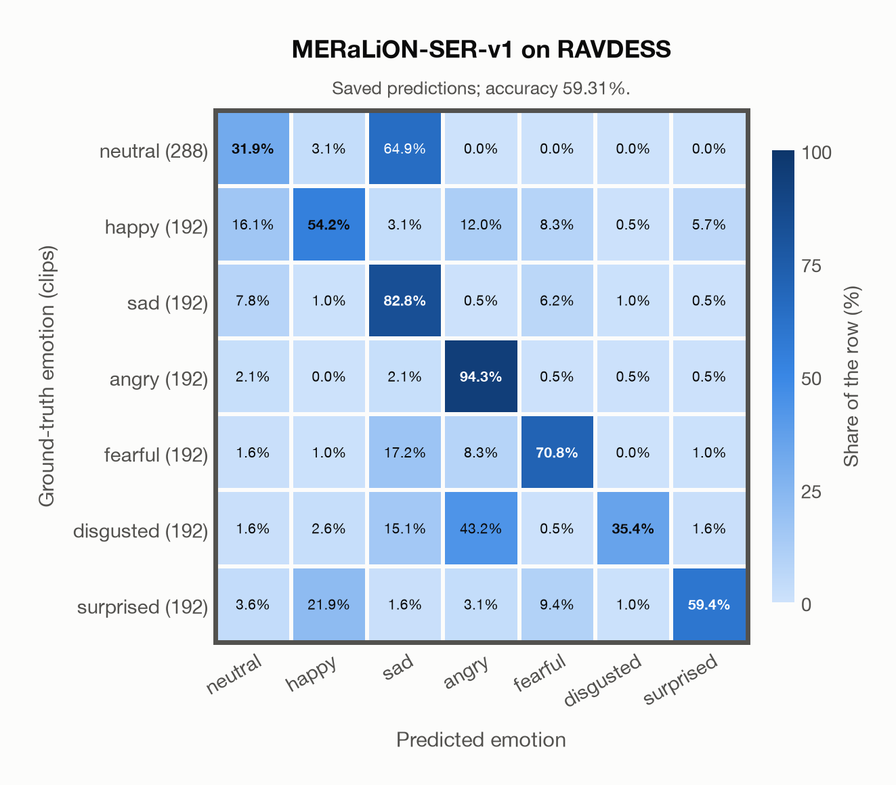

# MERaLiON-SER-v1 on RAVDESS

Regenerated offline from saved CSV/JSON by `scripts/evaluation/refresh_reports.py`. This refresh performs no model inference or API requests.

## Summary

| Metric | Recomputed value |
|---|---:|
| Clips | 1,440 |
| Accuracy: acted emotion | 59.31% |
| UAR: mean ground-truth-row recall | 61.26% |
| Macro F1 | 59.68% |
| Weighted F1: true-support weighted | 58.47% |
| Accuracy: all model classes | 59.31% |

## Imported run and verification

- Source: [prediction CSV](../../outputs/meralion_ser_v1/ravdess_predictions.csv) and [metadata JSON](../../outputs/meralion_ser_v1/ravdess_predictions.json); both remain byte-for-byte unchanged.
- Original execution date recorded in JSON: `2026-10-29`.
- Dataset scope recorded in JSON: **RAVDESS**, English; 1,440 / 1,440 clips.
- Ground-truth column: `acted_emotion`. Candidate classes: neutral, happy, sad, angry, fearful, disgusted, surprised.
- Row counts, unique audio paths, correctness flags and saved metrics were checked against the CSV. Metric agreement tolerance is 0.000001 (six-decimal metadata).
- Weighted F1 weights each class's F1 by its true support, using the same resolved truth as macro F1; invalid answers remain errors. New metrics absent from the source JSON are recorded in the offline audit and summaries; the source JSON is preserved.
- Original execution/client runtime metadata (reported by the imported run, not measured by this refresh): `{"device": "mps", "hardware": "Apple M4 Max", "seconds": 365.3, "ms_per_clip": 253.6, "on_cpu": 0}`.

## Results per emotion

| Ground-truth emotion | Clips | Recall | Acted-or-listener recall |
|---|---:|---:|---:|
| neutral | 288 | 31.94% | — |
| happy | 192 | 54.17% | — |
| sad | 192 | 82.81% | — |
| angry | 192 | 94.27% | — |
| fearful | 192 | 70.83% | — |
| disgusted | 192 | 35.42% | — |
| surprised | 192 | 59.38% | — |

Precision/F1 use the same resolved-truth convention as the evaluation script. Weighted F1 uses the resolved-truth clip counts below as weights.

| Predicted emotion | Resolved-truth clips | Precision | Recall | F1 |
|---|---:|---:|---:|---:|
| neutral | 288 | 59.35% | 31.94% | 41.53% |
| happy | 192 | 63.41% | 54.17% | 58.43% |
| sad | 192 | 37.77% | 82.81% | 51.88% |
| angry | 192 | 58.39% | 94.27% | 72.11% |
| fearful | 192 | 73.91% | 70.83% | 72.34% |
| disgusted | 192 | 91.89% | 35.42% | 51.13% |
| surprised | 192 | 86.36% | 59.38% | 70.37% |

## Confusion matrix: acted emotion

| Ground truth \ Predicted | neutral | happy | sad | angry | fearful | disgusted | surprised |
|---|---|---|---|---|---|---|---|
| neutral (288) | **31.9%** | 3.1% | 64.9% | 0.0% | 0.0% | 0.0% | 0.0% |
| happy (192) | 16.1% | **54.2%** | 3.1% | 12.0% | 8.3% | 0.5% | 5.7% |
| sad (192) | 7.8% | 1.0% | **82.8%** | 0.5% | 6.2% | 1.0% | 0.5% |
| angry (192) | 2.1% | 0.0% | 2.1% | **94.3%** | 0.5% | 0.5% | 0.5% |
| fearful (192) | 1.6% | 1.0% | 17.2% | 8.3% | **70.8%** | 0.0% | 1.0% |
| disgusted (192) | 1.6% | 2.6% | 15.1% | 43.2% | 0.5% | **35.4%** | 1.6% |
| surprised (192) | 3.6% | 21.9% | 1.6% | 3.1% | 9.4% | 1.0% | **59.4%** |

## Caveats

- **Training involvement for MERaLiON-SER-v1: Used via upstream training**. Evidence scope: upstream teacher lineage. SER report documents emotion2vec seed/base teachers for SG-ECMT labels; their EmoBox corpus subset is unresolved. This counts as upstream training use; it does not assert direct reuse of those raw clips by MERaLiON. Source: SER training on CREMA-D, ESD, MELD, M3ED and Singaporean speech; retained Whisper-medium pretraining sources are incompletely disclosed; upstream seed/base teacher use is counted as seen. Direct use and upstream teacher use both count as training involvement. No pattern: no corpus-specific evidence, not verified unseen. Corpus use is not test-clip leakage.
- Internal CSV/JSON consistency does not authenticate the original model or remote request logs.

[Offline validation audit](ravdess_offline_audit.json)
