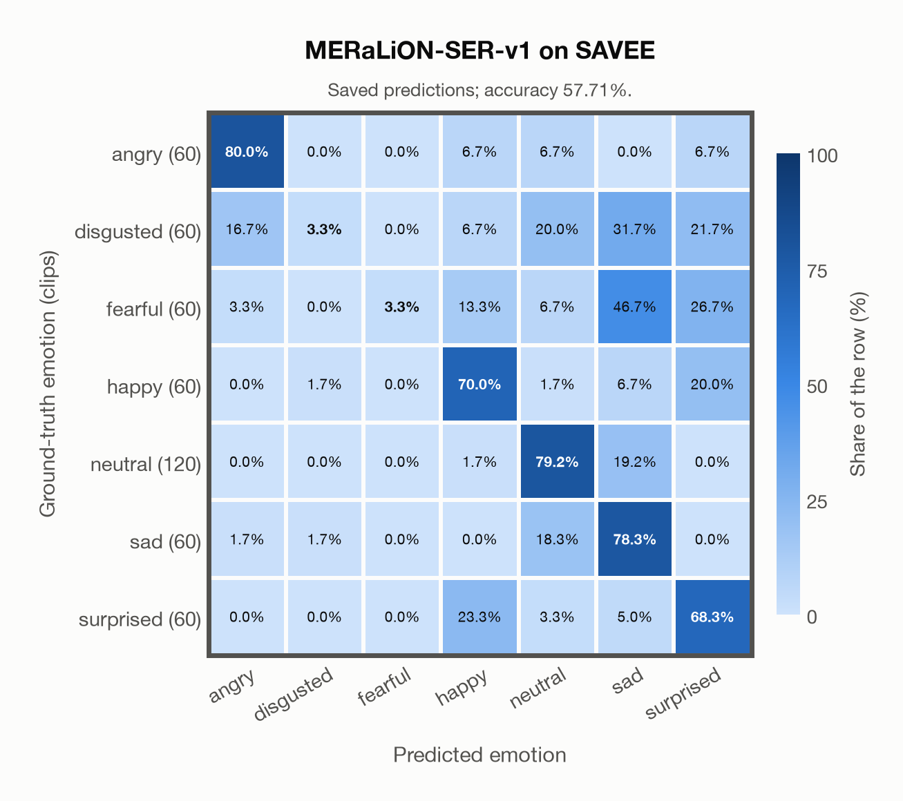

# MERaLiON-SER-v1 on SAVEE

Regenerated offline from saved CSV/JSON by `scripts/evaluation/refresh_reports.py`. This refresh performs no model inference or API requests.

## Summary

| Metric | Recomputed value |
|---|---:|
| Clips | 480 |
| Accuracy: acted emotion | 57.71% |
| UAR: mean ground-truth-row recall | 54.64% |
| Macro F1 | 48.33% |
| Weighted F1: true-support weighted | 51.82% |
| Accuracy: all model classes | 57.71% |

## Imported run and verification

- Source: [prediction CSV](../../outputs/meralion_ser_v1/savee_predictions.csv) and [metadata JSON](../../outputs/meralion_ser_v1/savee_predictions.json); both remain byte-for-byte unchanged.
- Original execution date recorded in JSON: `2026-11-06`.
- Dataset scope recorded in JSON: **SAVEE**, English (British); 480 / 480 clips.
- Ground-truth column: `acted_emotion`. Candidate classes: angry, disgusted, fearful, happy, neutral, sad, surprised.
- Row counts, unique audio paths, correctness flags and saved metrics were checked against the CSV. Metric agreement tolerance is 0.000001 (six-decimal metadata).
- Weighted F1 weights each class's F1 by its true support, using the same resolved truth as macro F1; invalid answers remain errors. New metrics absent from the source JSON are recorded in the offline audit and summaries; the source JSON is preserved.
- Original execution/client runtime metadata (reported by the imported run, not measured by this refresh): `{"device": "mps", "hardware": "Apple M4 Max", "seconds": 100.9, "ms_per_clip": 210.2, "on_cpu": 0}`.

## Results per emotion

| Ground-truth emotion | Clips | Recall | Acted-or-listener recall |
|---|---:|---:|---:|
| angry | 60 | 80.00% | — |
| disgusted | 60 | 3.33% | — |
| fearful | 60 | 3.33% | — |
| happy | 60 | 70.00% | — |
| neutral | 120 | 79.17% | — |
| sad | 60 | 78.33% | — |
| surprised | 60 | 68.33% | — |

Precision/F1 use the same resolved-truth convention as the evaluation script. Weighted F1 uses the resolved-truth clip counts below as weights.

| Predicted emotion | Resolved-truth clips | Precision | Recall | F1 |
|---|---:|---:|---:|---:|
| angry | 60 | 78.69% | 80.00% | 79.34% |
| disgusted | 60 | 50.00% | 3.33% | 6.25% |
| fearful | 60 | 100.00% | 3.33% | 6.45% |
| happy | 60 | 56.76% | 70.00% | 62.69% |
| neutral | 120 | 73.64% | 79.17% | 76.31% |
| sad | 60 | 37.90% | 78.33% | 51.09% |
| surprised | 60 | 47.67% | 68.33% | 56.16% |

## Confusion matrix: acted emotion

| Ground truth \ Predicted | angry | disgusted | fearful | happy | neutral | sad | surprised |
|---|---|---|---|---|---|---|---|
| angry (60) | **80.0%** | 0.0% | 0.0% | 6.7% | 6.7% | 0.0% | 6.7% |
| disgusted (60) | 16.7% | **3.3%** | 0.0% | 6.7% | 20.0% | 31.7% | 21.7% |
| fearful (60) | 3.3% | 0.0% | **3.3%** | 13.3% | 6.7% | 46.7% | 26.7% |
| happy (60) | 0.0% | 1.7% | 0.0% | **70.0%** | 1.7% | 6.7% | 20.0% |
| neutral (120) | 0.0% | 0.0% | 0.0% | 1.7% | **79.2%** | 19.2% | 0.0% |
| sad (60) | 1.7% | 1.7% | 0.0% | 0.0% | 18.3% | **78.3%** | 0.0% |
| surprised (60) | 0.0% | 0.0% | 0.0% | 23.3% | 3.3% | 5.0% | **68.3%** |

## Caveats

- **Training involvement for MERaLiON-SER-v1: Used via upstream training**. Evidence scope: upstream teacher lineage. SER report documents emotion2vec seed/base teachers for SG-ECMT labels; their EmoBox corpus subset is unresolved. This counts as upstream training use; it does not assert direct reuse of those raw clips by MERaLiON. Source: SER training on CREMA-D, ESD, MELD, M3ED and Singaporean speech; retained Whisper-medium pretraining sources are incompletely disclosed; upstream seed/base teacher use is counted as seen. Direct use and upstream teacher use both count as training involvement. No pattern: no corpus-specific evidence, not verified unseen. Corpus use is not test-clip leakage.
- Internal CSV/JSON consistency does not authenticate the original model or remote request logs.

[Offline validation audit](savee_offline_audit.json)
