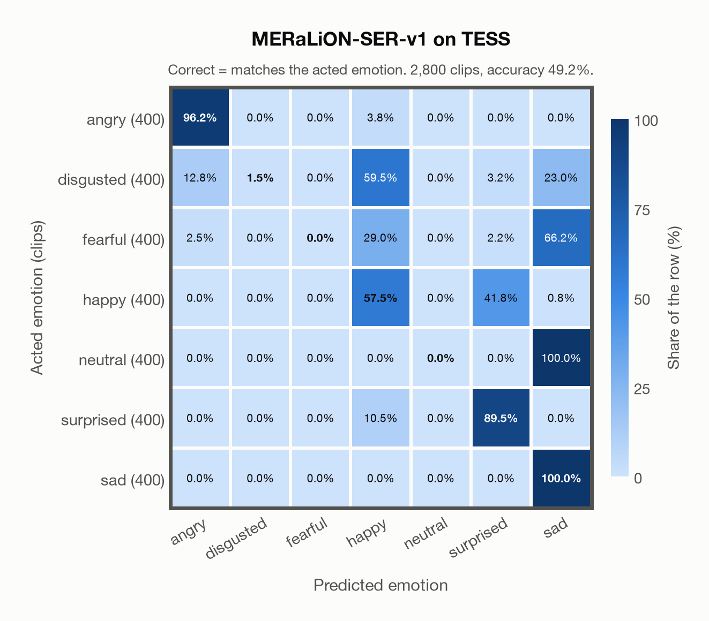

# MERaLiON-SER-v1 on TESS

Generated by `scripts/evaluation/evaluate.py` on 2026-10-29.

## Summary

| Metric | Value |
|---|---|
| Clips evaluated | 2,800 (English) |
| **Accuracy: prediction matches the acted emotion** | **49.2%** |
| Unweighted accuracy (mean recall of the 7 acted emotions) | 49.2% |
| Macro F1 (acted emotion) | 37.9% |
| Accuracy, all 7 model classes (acted emotion) | 49.2% |
| Chance level (7 emotions) | 14.3% |

## Setup

- **Model**: MERaLiON-SER-v1 (`MERaLiON/MERaLiON-SER-v1`) as released (no fine-tuning), transformers 5.18.0, loaded by `scripts/models/meralion_ser.py`. Each clip becomes Whisper log-mel features padded with silence to 30 s (as in the model card); the model ignores attention masks and pools over the whole 30 s window, padding included, which is its official behaviour. float32 on every device, as released.
- **Data**: 2,800 clips of TESS (English) from `data/tess/`.
- **Ground truth (acted emotion)**: the emotion each actress was asked to portray, from the last word of the file name (`angry`, `disgust`, `fear`, `happy`, `neutral`, `ps` for pleasant surprise, `sad`).
- Label mapping: angry, happy, neutral and sad keep their names; disgust = disgusted, fear = fearful, **pleasant surprise = surprised**.
- Two actresses, aged 26 and 64, say "Say the word ..." with the same 200 target words in each of the seven emotions.
- **7 emotions**: the prediction is the most probable of the 7 emotions in this dataset (angry, disgusted, fearful, happy, neutral, surprised, sad); the model has no other classes. **All 7 model classes**: the prediction is the most probable of all 7 model classes, so choosing a class that the dataset does not have counts as wrong.
- **Hardware**: Apple M4 Max, device `mps`, PyTorch 2.5.1. Inference took 12.0 min (257 ms per clip).
- **Per-clip predictions**: `outputs/meralion_ser_v1/tess_predictions.csv` (in git, so the results can be checked clip by clip). The JSON file next to it describes the columns.

## Results per emotion

Rows: acted emotion. Precision, recall and F1 compare the prediction with the acted emotion.

| Emotion | Clips | Precision | Recall | F1 |
|---|---|---|---|---|
| angry | 400 | 86.3% | 96.2% | 91.0% |
| disgusted | 400 | 100.0% | 1.5% | 3.0% |
| fearful | 400 | 0.0% | 0.0% | 0.0% |
| happy | 400 | 35.9% | 57.5% | 44.2% |
| neutral | 400 | 0.0% | 0.0% | 0.0% |
| surprised | 400 | 65.4% | 89.5% | 75.6% |
| sad | 400 | 34.5% | 100.0% | 51.3% |

## Confusion matrix: acted emotion

The same numbers as a table. Rows: acted emotion. Columns: predicted emotion. Each row adds up to 100%.

| Acted \ Predicted | angry | disgusted | fearful | happy | neutral | surprised | sad |
|---|---|---|---|---|---|---|---|
| angry (400) | **96.2%** | 0.0% | 0.0% | 3.8% | 0.0% | 0.0% | 0.0% |
| disgusted (400) | 12.8% | **1.5%** | 0.0% | 59.5% | 0.0% | 3.2% | 23.0% |
| fearful (400) | 2.5% | 0.0% | **0.0%** | 29.0% | 0.0% | 2.2% | 66.2% |
| happy (400) | 0.0% | 0.0% | 0.0% | **57.5%** | 0.0% | 41.8% | 0.8% |
| neutral (400) | 0.0% | 0.0% | 0.0% | 0.0% | **0.0%** | 0.0% | 100.0% |
| surprised (400) | 0.0% | 0.0% | 0.0% | 10.5% | 0.0% | **89.5%** | 0.0% |
| sad (400) | 0.0% | 0.0% | 0.0% | 0.0% | 0.0% | 0.0% | **100.0%** |

Most frequent confusions: neutral predicted as sad (100.0%), fearful predicted as sad (66.2%), disgusted predicted as happy (59.5%).

## Caveats

- **Not in MERaLiON-SER-v1's training data** (CREMA-D, ESD, MELD, M3ED and Singaporean speech).
- Only two speakers, so the result says little about other voices; models often score close to 100% on TESS.
- No listeners' labels are published with the dataset. Audio: 24,414 Hz WAV (one file, `OAF_food_fear.wav`, is 96 kHz), resampled to 16 kHz.
