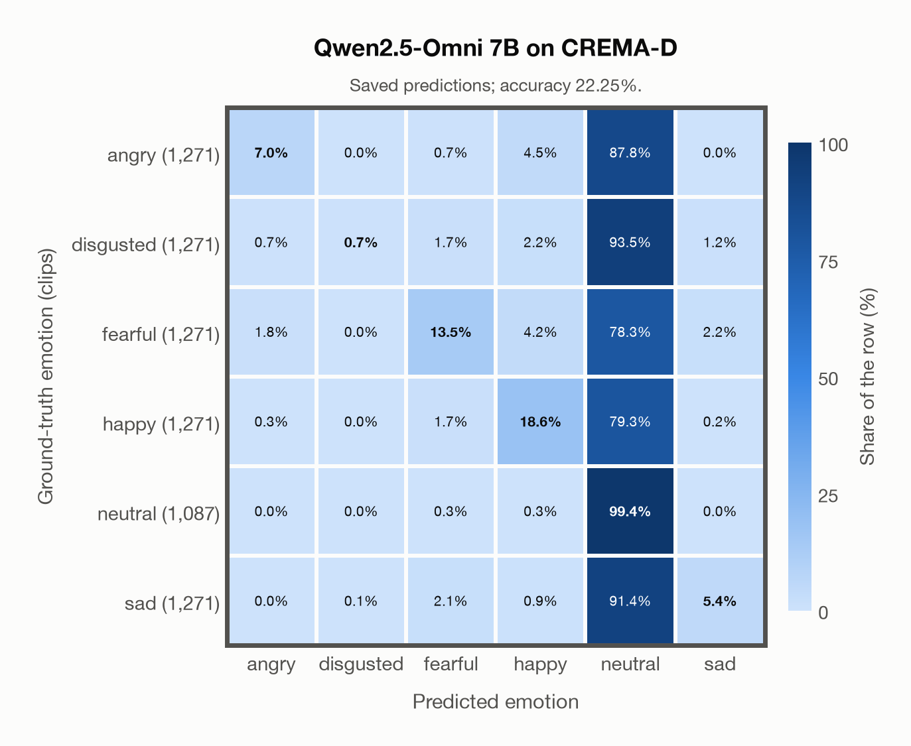
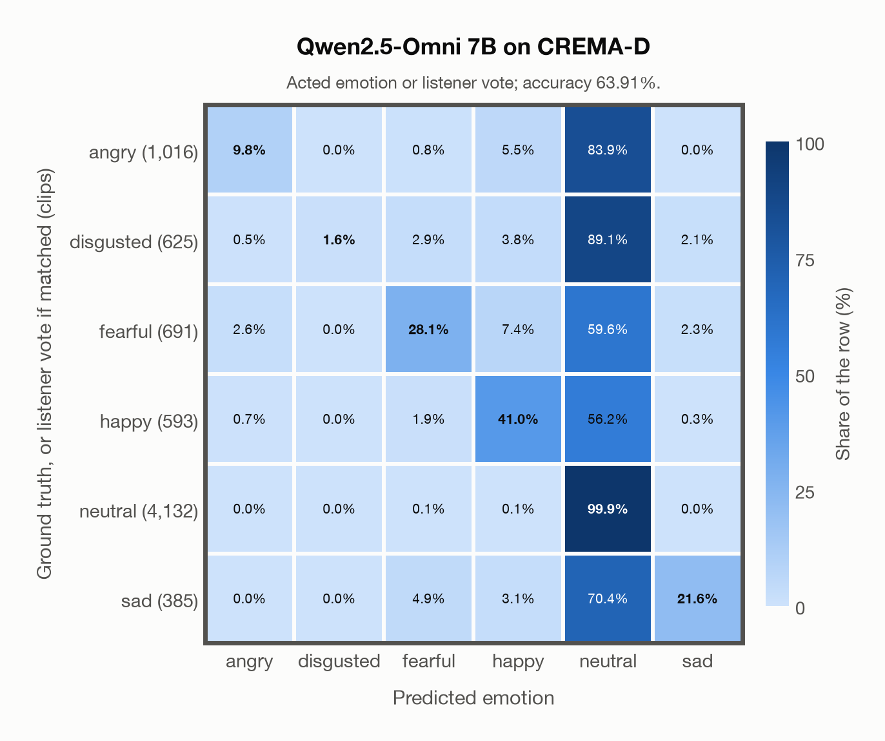

# Qwen2.5-Omni 7B on CREMA-D

Regenerated offline from saved CSV/JSON by `scripts/evaluation/refresh_reports.py`. This refresh performs no model inference or API requests.

## Summary

| Metric | Recomputed value |
|---|---:|
| Clips | 7,442 |
| Accuracy: acted emotion | 22.25% |
| UAR: mean ground-truth-row recall | 24.11% |
| Macro F1 | 17.24% |
| Weighted F1: true-support weighted | 16.96% |
| Accuracy: all model classes | 22.25% |
| Accuracy: acted emotion or listener vote | 63.91% |
| Single listener vote vs acted emotion | 45.59% |
| Model vs single listener vote | 60.08% |

## Imported run and verification

- Source: [prediction CSV](../../outputs/qwen2_5_omni_7b/crema_d_predictions.csv) and [metadata JSON](../../outputs/qwen2_5_omni_7b/crema_d_predictions.json); both remain byte-for-byte unchanged.
- Original execution date recorded in JSON: `2026-11-11`.
- Dataset scope recorded in JSON: **CREMA-D**, English; 7,442 / 7,442 clips.
- Ground-truth column: `acted_emotion`. Candidate classes: angry, disgusted, fearful, happy, neutral, sad.
- Row counts, unique audio paths, correctness flags and saved metrics were checked against the CSV. Metric agreement tolerance is 0.000001 (six-decimal metadata).
- Weighted F1 weights each class's F1 by its true support, using the same resolved truth as macro F1; invalid answers remain errors. New metrics absent from the source JSON are recorded in the offline audit and summaries; the source JSON is preserved.
- Saved candidate/prompt/model protocol matches current configuration: scope `dataset`, model `Qwen/Qwen2.5-Omni-7B`, prompt hash `8bf25e176a1f`.
- Original execution/client runtime metadata (reported by the imported run, not measured by this refresh): `{"device": "mps", "hardware": "Apple M3 Pro", "seconds": 5954.1, "ms_per_clip": 800.1, "on_cpu": 0}`.
- Saved p_* columns encode the returned answer as one-hot values; they are not calibrated API class probabilities, and no confidence plot is inferred from them.
- A raw responses journal is present; this refresh validates CSV/JSON only.

## Results per emotion

| Ground-truth emotion | Clips | Recall | Acted-or-listener recall |
|---|---:|---:|---:|
| angry | 1,271 | 7.00% | 27.93% |
| disgusted | 1,271 | 0.71% | 51.61% |
| fearful | 1,271 | 13.53% | 60.90% |
| happy | 1,271 | 18.57% | 72.46% |
| neutral | 1,087 | 99.45% | 99.45% |
| sad | 1,271 | 5.43% | 76.24% |

Precision/F1 use the same resolved-truth convention as the evaluation script. Weighted F1 uses the resolved-truth clip counts below as weights.

| Predicted emotion | Resolved-truth clips | Precision | Recall | F1 |
|---|---:|---:|---:|---:|
| angry | 1,271 | 71.20% | 7.00% | 12.75% |
| disgusted | 1,271 | 90.00% | 0.71% | 1.41% |
| fearful | 1,271 | 67.98% | 13.53% | 22.57% |
| happy | 1,271 | 60.67% | 18.57% | 28.43% |
| neutral | 1,087 | 16.50% | 99.45% | 28.31% |
| sad | 1,271 | 60.53% | 5.43% | 9.96% |

## Confusion matrix: acted emotion

| Ground truth \ Predicted | angry | disgusted | fearful | happy | neutral | sad |
|---|---|---|---|---|---|---|
| angry (1,271) | **7.0%** | 0.0% | 0.7% | 4.5% | 87.8% | 0.0% |
| disgusted (1,271) | 0.7% | **0.7%** | 1.7% | 2.2% | 93.5% | 1.2% |
| fearful (1,271) | 1.8% | 0.0% | **13.5%** | 4.2% | 78.3% | 2.2% |
| happy (1,271) | 0.3% | 0.0% | 1.7% | **18.6%** | 79.3% | 0.2% |
| neutral (1,087) | 0.0% | 0.0% | 0.3% | 0.3% | **99.4%** | 0.0% |
| sad (1,271) | 0.0% | 0.1% | 2.1% | 0.9% | 91.4% | **5.4%** |

## Confusion matrix: acted emotion or listener vote

A prediction accepted only through the listener vote is placed in that predicted emotion's row; other clips keep their original ground-truth row. Row supports can therefore change.

| Ground truth \ Predicted | angry | disgusted | fearful | happy | neutral | sad |
|---|---|---|---|---|---|---|
| angry (1,016) | **9.8%** | 0.0% | 0.8% | 5.5% | 83.9% | 0.0% |
| disgusted (625) | 0.5% | **1.6%** | 2.9% | 3.8% | 89.1% | 2.1% |
| fearful (691) | 2.6% | 0.0% | **28.1%** | 7.4% | 59.6% | 2.3% |
| happy (593) | 0.7% | 0.0% | 1.9% | **41.0%** | 56.2% | 0.3% |
| neutral (4,132) | 0.0% | 0.0% | 0.1% | 0.1% | **99.9%** | 0.0% |
| sad (385) | 0.0% | 0.0% | 4.9% | 3.1% | 70.4% | **21.6%** |

## Caveats

- **Training involvement for Qwen2.5-Omni 7B: No corpus-specific evidence**. Source: Qwen2.5 and Whisper-large-v3 initialization plus multimodal pre/post-training; complete corpus-level provenance not published. Direct use and upstream teacher use both count as training involvement. No pattern: no corpus-specific evidence, not verified unseen. Corpus use is not test-clip leakage.
- The known empty CREMA-D recording 1076_MTI_SAD_XX.wav is retained in the saved predictions, matching the existing project evaluation scope.
- Internal CSV/JSON consistency does not authenticate the original model or remote request logs.

[Offline validation audit](crema_d_offline_audit.json)
