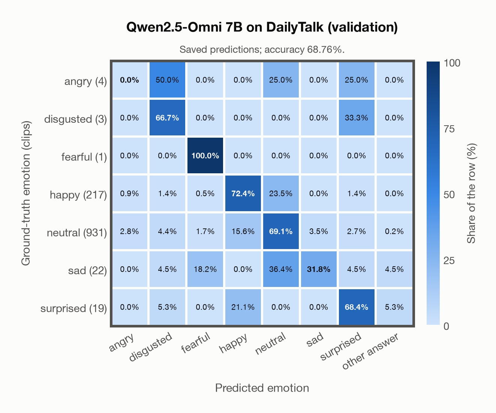

# Qwen2.5-Omni 7B on DailyTalk (validation)

Regenerated offline from saved CSV/JSON by `scripts/evaluation/refresh_reports.py`. This refresh performs no model inference or API requests.

## Summary

| Metric | Recomputed value |
|---|---:|
| Clips | 1,197 |
| Accuracy: acted emotion | 68.76% |
| UAR: mean ground-truth-row recall | 58.33% |
| Macro F1 | 31.26% |
| Weighted F1: true-support weighted | 73.19% |
| Accuracy: all model classes | 68.76% |

## Imported run and verification

- Source: [prediction CSV](../../outputs/qwen2_5_omni_7b/dailytalk_predictions.csv) and [metadata JSON](../../outputs/qwen2_5_omni_7b/dailytalk_predictions.json); both remain byte-for-byte unchanged.
- Original execution date recorded in JSON: `2026-11-13`.
- Dataset scope recorded in JSON: **DailyTalk (validation)**, English; 1,197 / 1,197 clips.
- Ground-truth column: `acted_emotion`. Candidate classes: angry, disgusted, fearful, happy, neutral, sad, surprised.
- Row counts, unique audio paths, correctness flags and saved metrics were checked against the CSV. Metric agreement tolerance is 0.000001 (six-decimal metadata).
- Weighted F1 weights each class's F1 by its true support, using the same resolved truth as macro F1; invalid answers remain errors. New metrics absent from the source JSON are recorded in the offline audit and summaries; the source JSON is preserved.
- Saved candidate/prompt/model protocol matches current configuration: scope `dataset`, model `Qwen/Qwen2.5-Omni-7B`, prompt hash `aab2967fd07a`.
- Original execution/client runtime metadata (reported by the imported run, not measured by this refresh): `{"device": "mps", "hardware": "Apple M3 Pro", "seconds": 1075.7, "ms_per_clip": 898.7, "on_cpu": 0}`.
- Saved p_* columns encode the returned answer as one-hot values; they are not calibrated API class probabilities, and no confidence plot is inferred from them.
- A raw responses journal is present; this refresh validates CSV/JSON only.

## Results per emotion

| Ground-truth emotion | Clips | Recall | Acted-or-listener recall |
|---|---:|---:|---:|
| angry | 4 | 0.00% | — |
| disgusted | 3 | 66.67% | — |
| fearful | 1 | 100.00% | — |
| happy | 217 | 72.35% | — |
| neutral | 931 | 69.07% | — |
| sad | 22 | 31.82% | — |
| surprised | 19 | 68.42% | — |

Precision/F1 use the same resolved-truth convention as the evaluation script. Weighted F1 uses the resolved-truth clip counts below as weights.

| Predicted emotion | Resolved-truth clips | Precision | Recall | F1 |
|---|---:|---:|---:|---:|
| angry | 4 | 0.00% | 0.00% | 0.00% |
| disgusted | 3 | 4.00% | 66.67% | 7.55% |
| fearful | 1 | 4.55% | 100.00% | 8.70% |
| happy | 217 | 51.31% | 72.35% | 60.04% |
| neutral | 931 | 91.47% | 69.07% | 78.70% |
| sad | 22 | 17.50% | 31.82% | 22.58% |
| surprised | 19 | 29.55% | 68.42% | 41.27% |

## Confusion matrix: acted emotion

| Ground truth \ Predicted | angry | disgusted | fearful | happy | neutral | sad | surprised | other answer |
|---|---|---|---|---|---|---|---|---|
| angry (4) | **0.0%** | 50.0% | 0.0% | 0.0% | 25.0% | 0.0% | 25.0% | 0.0% |
| disgusted (3) | 0.0% | **66.7%** | 0.0% | 0.0% | 0.0% | 0.0% | 33.3% | 0.0% |
| fearful (1) | 0.0% | 0.0% | **100.0%** | 0.0% | 0.0% | 0.0% | 0.0% | 0.0% |
| happy (217) | 0.9% | 1.4% | 0.5% | **72.4%** | 23.5% | 0.0% | 1.4% | 0.0% |
| neutral (931) | 2.8% | 4.4% | 1.7% | 15.6% | **69.1%** | 3.5% | 2.7% | 0.2% |
| sad (22) | 0.0% | 4.5% | 18.2% | 0.0% | 36.4% | **31.8%** | 4.5% | 4.5% |
| surprised (19) | 0.0% | 5.3% | 0.0% | 21.1% | 0.0% | 0.0% | **68.4%** | 5.3% |

## Caveats

- **Training involvement for Qwen2.5-Omni 7B: No corpus-specific evidence**. Source: Qwen2.5 and Whisper-large-v3 initialization plus multimodal pre/post-training; complete corpus-level provenance not published. Direct use and upstream teacher use both count as training involvement. No pattern: no corpus-specific evidence, not verified unseen. Corpus use is not test-clip leakage.
- Internal CSV/JSON consistency does not authenticate the original model or remote request logs.

[Offline validation audit](dailytalk_offline_audit.json)
