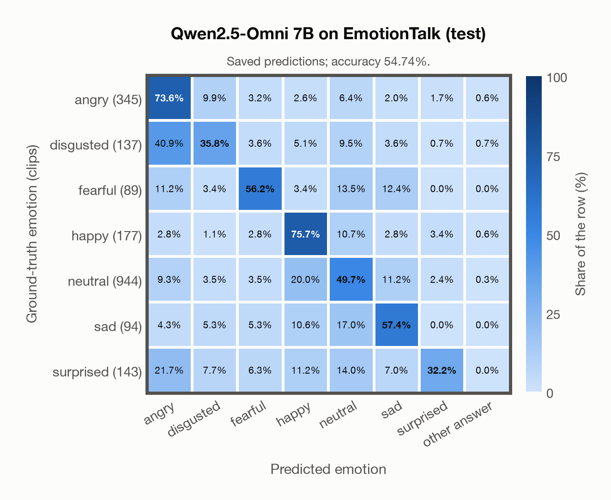

# Qwen2.5-Omni 7B on EmotionTalk (test)

Regenerated offline from saved CSV/JSON by `scripts/evaluation/refresh_reports.py`. This refresh performs no model inference or API requests.

## Summary

| Metric | Recomputed value |
|---|---:|
| Clips | 1,929 |
| Accuracy: acted emotion | 54.74% |
| UAR: mean ground-truth-row recall | 54.37% |
| Macro F1 | 48.16% |
| Weighted F1: true-support weighted | 55.87% |
| Accuracy: all model classes | 54.74% |

## Imported run and verification

- Source: [prediction CSV](../../outputs/qwen2_5_omni_7b/emotiontalk_predictions.csv) and [metadata JSON](../../outputs/qwen2_5_omni_7b/emotiontalk_predictions.json); both remain byte-for-byte unchanged.
- Original execution date recorded in JSON: `2026-11-13`.
- Dataset scope recorded in JSON: **EmotionTalk (test)**, Mandarin; 1,929 / 1,929 clips.
- Ground-truth column: `acted_emotion`. Candidate classes: angry, disgusted, fearful, happy, neutral, sad, surprised.
- Row counts, unique audio paths, correctness flags and saved metrics were checked against the CSV. Metric agreement tolerance is 0.000001 (six-decimal metadata).
- Weighted F1 weights each class's F1 by its true support, using the same resolved truth as macro F1; invalid answers remain errors. New metrics absent from the source JSON are recorded in the offline audit and summaries; the source JSON is preserved.
- Saved candidate/prompt/model protocol matches current configuration: scope `dataset`, model `Qwen/Qwen2.5-Omni-7B`, prompt hash `aab2967fd07a`.
- Original execution/client runtime metadata (reported by the imported run, not measured by this refresh): `{"device": "mps", "hardware": "Apple M3 Pro", "seconds": 2172.7, "ms_per_clip": 1126.3, "on_cpu": 0}`.
- Saved p_* columns encode the returned answer as one-hot values; they are not calibrated API class probabilities, and no confidence plot is inferred from them.
- A raw responses journal is present; this refresh validates CSV/JSON only.

## Results per emotion

| Ground-truth emotion | Clips | Recall | Acted-or-listener recall |
|---|---:|---:|---:|
| angry | 345 | 73.62% | — |
| disgusted | 137 | 35.77% | — |
| fearful | 89 | 56.18% | — |
| happy | 177 | 75.71% | — |
| neutral | 944 | 49.68% | — |
| sad | 94 | 57.45% | — |
| surprised | 143 | 32.17% | — |

Precision/F1 use the same resolved-truth convention as the evaluation script. Weighted F1 uses the resolved-truth clip counts below as weights.

| Predicted emotion | Resolved-truth clips | Precision | Recall | F1 |
|---|---:|---:|---:|---:|
| angry | 345 | 56.70% | 73.62% | 64.06% |
| disgusted | 137 | 35.77% | 35.77% | 35.77% |
| fearful | 89 | 42.37% | 56.18% | 48.31% |
| happy | 177 | 36.41% | 75.71% | 49.17% |
| neutral | 944 | 82.14% | 49.68% | 61.91% |
| sad | 94 | 27.27% | 57.45% | 36.99% |
| surprised | 143 | 56.10% | 32.17% | 40.89% |

## Confusion matrix: acted emotion

| Ground truth \ Predicted | angry | disgusted | fearful | happy | neutral | sad | surprised | other answer |
|---|---|---|---|---|---|---|---|---|
| angry (345) | **73.6%** | 9.9% | 3.2% | 2.6% | 6.4% | 2.0% | 1.7% | 0.6% |
| disgusted (137) | 40.9% | **35.8%** | 3.6% | 5.1% | 9.5% | 3.6% | 0.7% | 0.7% |
| fearful (89) | 11.2% | 3.4% | **56.2%** | 3.4% | 13.5% | 12.4% | 0.0% | 0.0% |
| happy (177) | 2.8% | 1.1% | 2.8% | **75.7%** | 10.7% | 2.8% | 3.4% | 0.6% |
| neutral (944) | 9.3% | 3.5% | 3.5% | 20.0% | **49.7%** | 11.2% | 2.4% | 0.3% |
| sad (94) | 4.3% | 5.3% | 5.3% | 10.6% | 17.0% | **57.4%** | 0.0% | 0.0% |
| surprised (143) | 21.7% | 7.7% | 6.3% | 11.2% | 14.0% | 7.0% | **32.2%** | 0.0% |

## Caveats

- **Training involvement for Qwen2.5-Omni 7B: No corpus-specific evidence**. Source: Qwen2.5 and Whisper-large-v3 initialization plus multimodal pre/post-training; complete corpus-level provenance not published. Direct use and upstream teacher use both count as training involvement. No pattern: no corpus-specific evidence, not verified unseen. Corpus use is not test-clip leakage.
- Internal CSV/JSON consistency does not authenticate the original model or remote request logs.

[Offline validation audit](emotiontalk_offline_audit.json)
