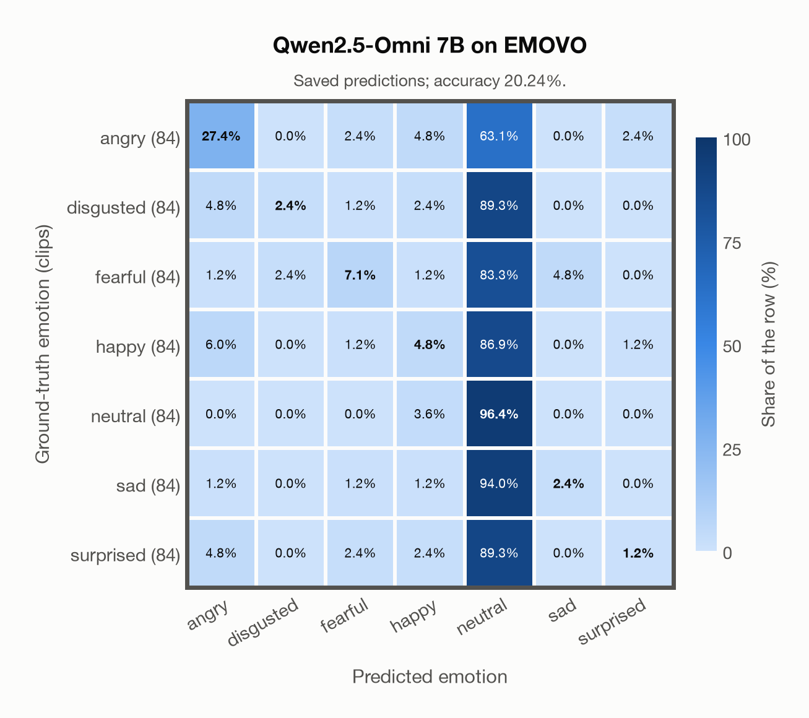

# Qwen2.5-Omni 7B on EMOVO

Regenerated offline from saved CSV/JSON by `scripts/evaluation/refresh_reports.py`. This refresh performs no model inference or API requests.

## Summary

| Metric | Recomputed value |
|---|---:|
| Clips | 588 |
| Accuracy: acted emotion | 20.24% |
| UAR: mean ground-truth-row recall | 20.24% |
| Macro F1 | 13.82% |
| Weighted F1: true-support weighted | 13.82% |
| Accuracy: all model classes | 20.24% |

## Imported run and verification

- Source: [prediction CSV](../../outputs/qwen2_5_omni_7b/emovo_predictions.csv) and [metadata JSON](../../outputs/qwen2_5_omni_7b/emovo_predictions.json); both remain byte-for-byte unchanged.
- Original execution date recorded in JSON: `2026-11-13`.
- Dataset scope recorded in JSON: **EMOVO**, Italian; 588 / 588 clips.
- Ground-truth column: `acted_emotion`. Candidate classes: angry, disgusted, fearful, happy, neutral, sad, surprised.
- Row counts, unique audio paths, correctness flags and saved metrics were checked against the CSV. Metric agreement tolerance is 0.000001 (six-decimal metadata).
- Weighted F1 weights each class's F1 by its true support, using the same resolved truth as macro F1; invalid answers remain errors. New metrics absent from the source JSON are recorded in the offline audit and summaries; the source JSON is preserved.
- Saved candidate/prompt/model protocol matches current configuration: scope `dataset`, model `Qwen/Qwen2.5-Omni-7B`, prompt hash `aab2967fd07a`.
- Original execution/client runtime metadata (reported by the imported run, not measured by this refresh): `{"device": "mps", "hardware": "Apple M3 Pro", "seconds": 516.9, "ms_per_clip": 879.0, "on_cpu": 0}`.
- Saved p_* columns encode the returned answer as one-hot values; they are not calibrated API class probabilities, and no confidence plot is inferred from them.
- A raw responses journal is present; this refresh validates CSV/JSON only.

## Results per emotion

| Ground-truth emotion | Clips | Recall | Acted-or-listener recall |
|---|---:|---:|---:|
| angry | 84 | 27.38% | — |
| disgusted | 84 | 2.38% | — |
| fearful | 84 | 7.14% | — |
| happy | 84 | 4.76% | — |
| neutral | 84 | 96.43% | — |
| sad | 84 | 2.38% | — |
| surprised | 84 | 1.19% | — |

Precision/F1 use the same resolved-truth convention as the evaluation script. Weighted F1 uses the resolved-truth clip counts below as weights.

| Predicted emotion | Resolved-truth clips | Precision | Recall | F1 |
|---|---:|---:|---:|---:|
| angry | 84 | 60.53% | 27.38% | 37.70% |
| disgusted | 84 | 50.00% | 2.38% | 4.55% |
| fearful | 84 | 46.15% | 7.14% | 12.37% |
| happy | 84 | 23.53% | 4.76% | 7.92% |
| neutral | 84 | 16.01% | 96.43% | 27.46% |
| sad | 84 | 33.33% | 2.38% | 4.44% |
| surprised | 84 | 25.00% | 1.19% | 2.27% |

## Confusion matrix: acted emotion

| Ground truth \ Predicted | angry | disgusted | fearful | happy | neutral | sad | surprised |
|---|---|---|---|---|---|---|---|
| angry (84) | **27.4%** | 0.0% | 2.4% | 4.8% | 63.1% | 0.0% | 2.4% |
| disgusted (84) | 4.8% | **2.4%** | 1.2% | 2.4% | 89.3% | 0.0% | 0.0% |
| fearful (84) | 1.2% | 2.4% | **7.1%** | 1.2% | 83.3% | 4.8% | 0.0% |
| happy (84) | 6.0% | 0.0% | 1.2% | **4.8%** | 86.9% | 0.0% | 1.2% |
| neutral (84) | 0.0% | 0.0% | 0.0% | 3.6% | **96.4%** | 0.0% | 0.0% |
| sad (84) | 1.2% | 0.0% | 1.2% | 1.2% | 94.0% | **2.4%** | 0.0% |
| surprised (84) | 4.8% | 0.0% | 2.4% | 2.4% | 89.3% | 0.0% | **1.2%** |

## Caveats

- **Training involvement for Qwen2.5-Omni 7B: No corpus-specific evidence**. Source: Qwen2.5 and Whisper-large-v3 initialization plus multimodal pre/post-training; complete corpus-level provenance not published. Direct use and upstream teacher use both count as training involvement. No pattern: no corpus-specific evidence, not verified unseen. Corpus use is not test-clip leakage.
- Internal CSV/JSON consistency does not authenticate the original model or remote request logs.

[Offline validation audit](emovo_offline_audit.json)
