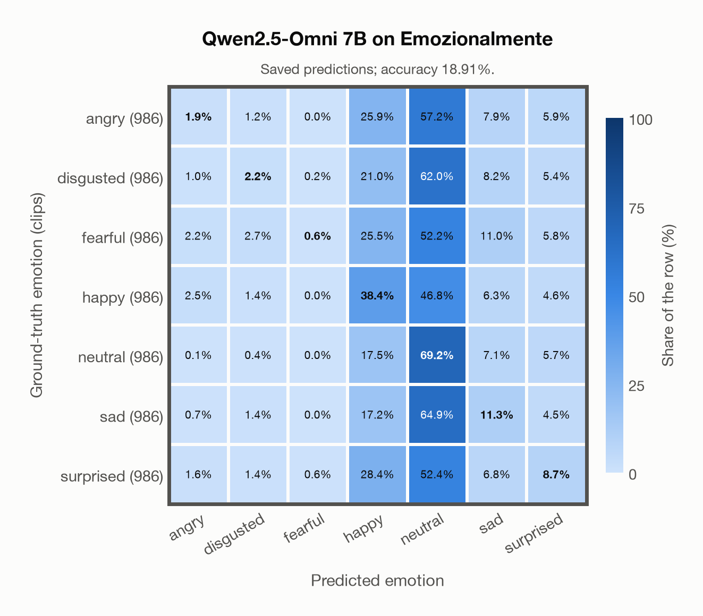
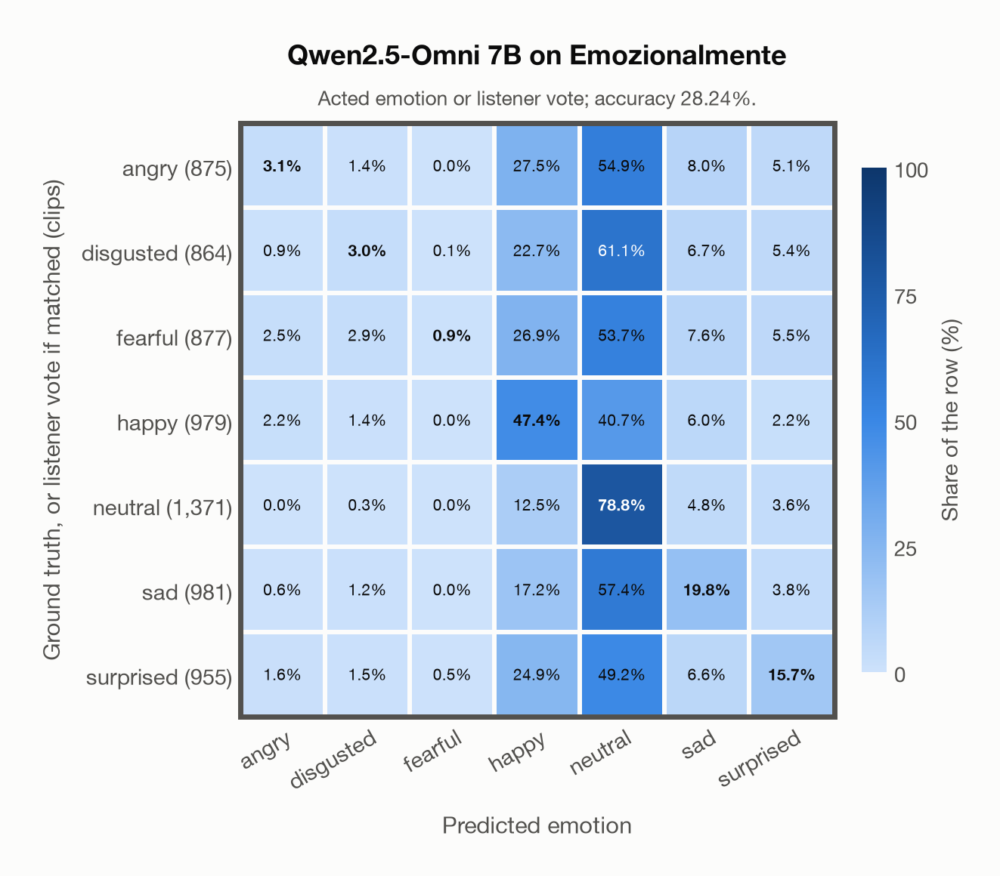

# Qwen2.5-Omni 7B on Emozionalmente

Regenerated offline from saved CSV/JSON by `scripts/evaluation/refresh_reports.py`. This refresh performs no model inference or API requests.

## Summary

| Metric | Recomputed value |
|---|---:|
| Clips | 6,902 |
| Accuracy: acted emotion | 18.91% |
| UAR: mean ground-truth-row recall | 18.91% |
| Macro F1 | 12.97% |
| Weighted F1: true-support weighted | 12.97% |
| Accuracy: all model classes | 18.91% |
| Accuracy: acted emotion or listener vote | 28.24% |
| Single listener vote vs acted emotion | 81.22% |
| Model vs single listener vote | 24.49% |

## Imported run and verification

- Source: [prediction CSV](../../outputs/qwen2_5_omni_7b/emozionalmente_predictions.csv) and [metadata JSON](../../outputs/qwen2_5_omni_7b/emozionalmente_predictions.json); both remain byte-for-byte unchanged.
- Original execution date recorded in JSON: `2026-11-13`.
- Dataset scope recorded in JSON: **Emozionalmente**, Italian; 6,902 / 6,902 clips.
- Ground-truth column: `acted_emotion`. Candidate classes: angry, disgusted, fearful, happy, neutral, sad, surprised.
- Row counts, unique audio paths, correctness flags and saved metrics were checked against the CSV. Metric agreement tolerance is 0.000001 (six-decimal metadata).
- Weighted F1 weights each class's F1 by its true support, using the same resolved truth as macro F1; invalid answers remain errors. New metrics absent from the source JSON are recorded in the offline audit and summaries; the source JSON is preserved.
- Saved candidate/prompt/model protocol matches current configuration: scope `dataset`, model `Qwen/Qwen2.5-Omni-7B`, prompt hash `aab2967fd07a`.
- Original execution/client runtime metadata (reported by the imported run, not measured by this refresh): `{"device": "mps", "hardware": "Apple M3 Pro", "seconds": 6082.1, "ms_per_clip": 881.2, "on_cpu": 0}`.
- Saved p_* columns encode the returned answer as one-hot values; they are not calibrated API class probabilities, and no confidence plot is inferred from them.
- A raw responses journal is present; this refresh validates CSV/JSON only.

## Results per emotion

| Ground-truth emotion | Clips | Recall | Acted-or-listener recall |
|---|---:|---:|---:|
| angry | 986 | 1.93% | 14.00% |
| disgusted | 986 | 2.23% | 15.01% |
| fearful | 986 | 0.61% | 11.87% |
| happy | 986 | 38.44% | 47.77% |
| neutral | 986 | 69.17% | 70.49% |
| sad | 986 | 11.26% | 20.18% |
| surprised | 986 | 8.72% | 18.36% |

Precision/F1 use the same resolved-truth convention as the evaluation script. Weighted F1 uses the resolved-truth clip counts below as weights.

| Predicted emotion | Resolved-truth clips | Precision | Recall | F1 |
|---|---:|---:|---:|---:|
| angry | 986 | 19.00% | 1.93% | 3.50% |
| disgusted | 986 | 20.56% | 2.23% | 4.03% |
| fearful | 986 | 42.86% | 0.61% | 1.20% |
| happy | 986 | 22.10% | 38.44% | 28.06% |
| neutral | 986 | 17.09% | 69.17% | 27.41% |
| sad | 986 | 19.24% | 11.26% | 14.20% |
| surprised | 986 | 21.55% | 8.72% | 12.42% |

## Confusion matrix: acted emotion

| Ground truth \ Predicted | angry | disgusted | fearful | happy | neutral | sad | surprised |
|---|---|---|---|---|---|---|---|
| angry (986) | **1.9%** | 1.2% | 0.0% | 25.9% | 57.2% | 7.9% | 5.9% |
| disgusted (986) | 1.0% | **2.2%** | 0.2% | 21.0% | 62.0% | 8.2% | 5.4% |
| fearful (986) | 2.2% | 2.7% | **0.6%** | 25.5% | 52.2% | 11.0% | 5.8% |
| happy (986) | 2.5% | 1.4% | 0.0% | **38.4%** | 46.8% | 6.3% | 4.6% |
| neutral (986) | 0.1% | 0.4% | 0.0% | 17.5% | **69.2%** | 7.1% | 5.7% |
| sad (986) | 0.7% | 1.4% | 0.0% | 17.2% | 64.9% | **11.3%** | 4.5% |
| surprised (986) | 1.6% | 1.4% | 0.6% | 28.4% | 52.4% | 6.8% | **8.7%** |

## Confusion matrix: acted emotion or listener vote

A prediction accepted only through the listener vote is placed in that predicted emotion's row; other clips keep their original ground-truth row. Row supports can therefore change.

| Ground truth \ Predicted | angry | disgusted | fearful | happy | neutral | sad | surprised |
|---|---|---|---|---|---|---|---|
| angry (875) | **3.1%** | 1.4% | 0.0% | 27.5% | 54.9% | 8.0% | 5.1% |
| disgusted (864) | 0.9% | **3.0%** | 0.1% | 22.7% | 61.1% | 6.7% | 5.4% |
| fearful (877) | 2.5% | 2.9% | **0.9%** | 26.9% | 53.7% | 7.6% | 5.5% |
| happy (979) | 2.2% | 1.4% | 0.0% | **47.4%** | 40.7% | 6.0% | 2.2% |
| neutral (1,371) | 0.0% | 0.3% | 0.0% | 12.5% | **78.8%** | 4.8% | 3.6% |
| sad (981) | 0.6% | 1.2% | 0.0% | 17.2% | 57.4% | **19.8%** | 3.8% |
| surprised (955) | 1.6% | 1.5% | 0.5% | 24.9% | 49.2% | 6.6% | **15.7%** |

## Caveats

- **Training involvement for Qwen2.5-Omni 7B: No corpus-specific evidence**. Source: Qwen2.5 and Whisper-large-v3 initialization plus multimodal pre/post-training; complete corpus-level provenance not published. Direct use and upstream teacher use both count as training involvement. No pattern: no corpus-specific evidence, not verified unseen. Corpus use is not test-clip leakage.
- Internal CSV/JSON consistency does not authenticate the original model or remote request logs.

[Offline validation audit](emozionalmente_offline_audit.json)
