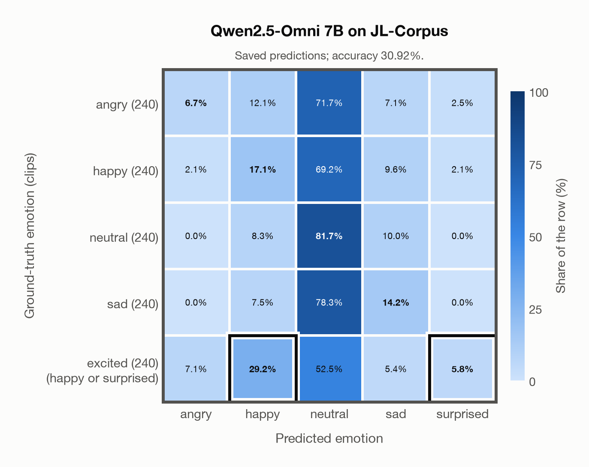

# Qwen2.5-Omni 7B on JL-Corpus

Regenerated offline from saved CSV/JSON by `scripts/evaluation/refresh_reports.py`. This refresh performs no model inference or API requests.

## Summary

| Metric | Recomputed value |
|---|---:|
| Clips | 1,200 |
| Accuracy: acted emotion | 30.92% |
| UAR: mean ground-truth-row recall | 30.92% |
| Macro F1 | 34.64% |
| Weighted F1: true-support weighted | 27.61% |
| Accuracy: all model classes | 30.92% |

## Imported run and verification

- Source: [prediction CSV](../../outputs/qwen2_5_omni_7b/jl_corpus_predictions.csv) and [metadata JSON](../../outputs/qwen2_5_omni_7b/jl_corpus_predictions.json); both remain byte-for-byte unchanged.
- Original execution date recorded in JSON: `2026-11-12`.
- Dataset scope recorded in JSON: **JL-Corpus**, English (New Zealand); 1,200 / 1,200 clips.
- Ground-truth column: `acted_emotion`. Candidate classes: angry, happy, neutral, sad, surprised.
- Row counts, unique audio paths, correctness flags and saved metrics were checked against the CSV. Metric agreement tolerance is 0.000001 (six-decimal metadata).
- Weighted F1 weights each class's F1 by its true support, using the same resolved truth as macro F1; invalid answers remain errors. New metrics absent from the source JSON are recorded in the offline audit and summaries; the source JSON is preserved.
- Saved candidate/prompt/model protocol matches current configuration: scope `dataset`, model `Qwen/Qwen2.5-Omni-7B`, prompt hash `1add00540a85`.
- Original execution/client runtime metadata (reported by the imported run, not measured by this refresh): `{"device": "mps", "hardware": "Apple M3 Pro", "seconds": 882.3, "ms_per_clip": 735.3, "on_cpu": 0}`.
- Saved p_* columns encode the returned answer as one-hot values; they are not calibrated API class probabilities, and no confidence plot is inferred from them.
- A raw responses journal is present; this refresh validates CSV/JSON only.
- Composite labels follow the existing accepted-label rule: excited accepts happy or surprised. F1 resolves a correct composite to the predicted class, otherwise to its first accepted class. Weighted F1 uses the resulting resolved-truth support, which can depend on the predictions.

## Results per emotion

| Ground-truth emotion | Clips | Recall | Acted-or-listener recall |
|---|---:|---:|---:|
| angry | 240 | 6.67% | — |
| happy | 240 | 17.08% | — |
| neutral | 240 | 81.67% | — |
| sad | 240 | 14.17% | — |
| excited (happy or surprised) | 240 | 35.00% | — |

Precision/F1 use the same resolved-truth convention as the evaluation script. Weighted F1 uses the resolved-truth clip counts below as weights.

| Predicted emotion | Resolved-truth clips | Precision | Recall | F1 |
|---|---:|---:|---:|---:|
| angry | 240 | 42.11% | 6.67% | 11.51% |
| happy | 466 | 62.36% | 23.82% | 34.47% |
| neutral | 240 | 23.11% | 81.67% | 36.03% |
| sad | 240 | 30.63% | 14.17% | 19.37% |
| surprised | 14 | 56.00% | 100.00% | 71.79% |

## Confusion matrix: acted emotion

| Ground truth \ Predicted | angry | happy | neutral | sad | surprised |
|---|---|---|---|---|---|
| angry (240) | **6.7%** | 12.1% | 71.7% | 7.1% | 2.5% |
| happy (240) | 2.1% | **17.1%** | 69.2% | 9.6% | 2.1% |
| neutral (240) | 0.0% | 8.3% | **81.7%** | 10.0% | 0.0% |
| sad (240) | 0.0% | 7.5% | 78.3% | **14.2%** | 0.0% |
| excited (happy or surprised) (240) | 7.1% | **29.2%** | 52.5% | 5.4% | **5.8%** |

## Caveats

- **Training involvement for Qwen2.5-Omni 7B: No corpus-specific evidence**. Source: Qwen2.5 and Whisper-large-v3 initialization plus multimodal pre/post-training; complete corpus-level provenance not published. Direct use and upstream teacher use both count as training involvement. No pattern: no corpus-specific evidence, not verified unseen. Corpus use is not test-clip leakage.
- Internal CSV/JSON consistency does not authenticate the original model or remote request logs.

[Offline validation audit](jl_corpus_offline_audit.json)
