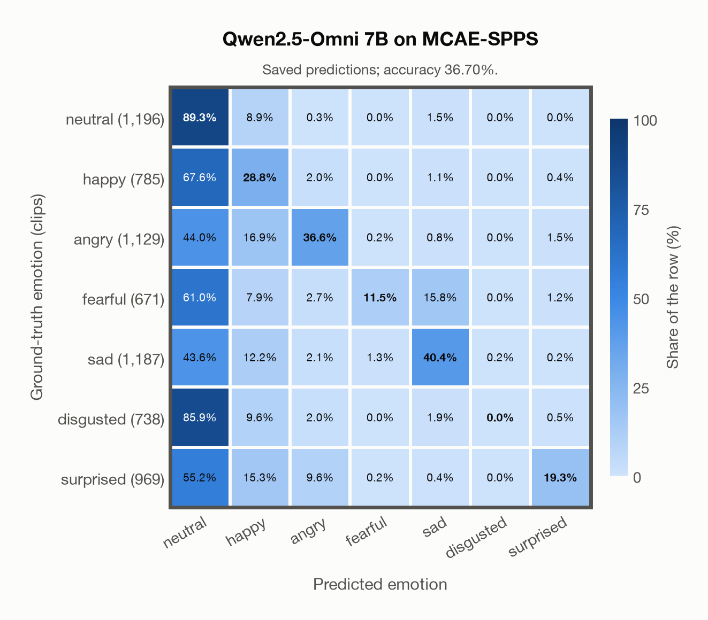

# Qwen2.5-Omni 7B on MCAE-SPPS

Regenerated offline from saved CSV/JSON by `scripts/evaluation/refresh_reports.py`. This refresh performs no model inference or API requests.

## Summary

| Metric | Recomputed value |
|---|---:|
| Clips | 6,675 |
| Accuracy: acted emotion | 36.70% |
| UAR: mean ground-truth-row recall | 32.26% |
| Macro F1 | 31.15% |
| Weighted F1: true-support weighted | 34.25% |
| Accuracy: all model classes | 36.70% |
| Accuracy: acted emotion or listener vote | 36.70% |
| Single listener vote vs acted emotion | 100.00% |
| Model vs single listener vote | 36.70% |

## Imported run and verification

- Source: [prediction CSV](../../outputs/qwen2_5_omni_7b/mcae_spps_predictions.csv) and [metadata JSON](../../outputs/qwen2_5_omni_7b/mcae_spps_predictions.json); both remain byte-for-byte unchanged.
- Original execution date recorded in JSON: `2026-11-11`.
- Dataset scope recorded in JSON: **MCAE-SPPS**, Mandarin; 6,675 / 6,675 clips.
- Ground-truth column: `acted_emotion`. Candidate classes: neutral, happy, angry, fearful, sad, disgusted, surprised.
- Row counts, unique audio paths, correctness flags and saved metrics were checked against the CSV. Metric agreement tolerance is 0.000001 (six-decimal metadata).
- Weighted F1 weights each class's F1 by its true support, using the same resolved truth as macro F1; invalid answers remain errors. New metrics absent from the source JSON are recorded in the offline audit and summaries; the source JSON is preserved.
- Saved candidate/prompt/model protocol matches current configuration: scope `dataset`, model `Qwen/Qwen2.5-Omni-7B`, prompt hash `aab2967fd07a`.
- Original execution/client runtime metadata (reported by the imported run, not measured by this refresh): `{"device": "mps", "hardware": "Apple M3 Pro", "seconds": 4433.0, "ms_per_clip": 664.1, "on_cpu": 0}`.
- Saved p_* columns encode the returned answer as one-hot values; they are not calibrated API class probabilities, and no confidence plot is inferred from them.
- A raw responses journal is present; this refresh validates CSV/JSON only.

## Results per emotion

| Ground-truth emotion | Clips | Recall | Acted-or-listener recall |
|---|---:|---:|---:|
| neutral | 1,196 | 89.30% | 89.30% |
| happy | 785 | 28.79% | 28.79% |
| angry | 1,129 | 36.58% | 36.58% |
| fearful | 671 | 11.48% | 11.48% |
| sad | 1,187 | 40.35% | 40.35% |
| disgusted | 738 | 0.00% | 0.00% |
| surprised | 969 | 19.30% | 19.30% |

Precision/F1 use the same resolved-truth convention as the evaluation script. Weighted F1 uses the resolved-truth clip counts below as weights.

| Predicted emotion | Resolved-truth clips | Precision | Recall | F1 |
|---|---:|---:|---:|---:|
| neutral | 1,196 | 25.48% | 89.30% | 39.64% |
| happy | 785 | 24.02% | 28.79% | 26.19% |
| angry | 1,129 | 70.84% | 36.58% | 48.25% |
| fearful | 671 | 79.38% | 11.48% | 20.05% |
| sad | 1,187 | 74.96% | 40.35% | 52.46% |
| disgusted | 738 | 0.00% | 0.00% | 0.00% |
| surprised | 969 | 84.62% | 19.30% | 31.43% |

## Confusion matrix: acted emotion

| Ground truth \ Predicted | neutral | happy | angry | fearful | sad | disgusted | surprised |
|---|---|---|---|---|---|---|---|
| neutral (1,196) | **89.3%** | 8.9% | 0.3% | 0.0% | 1.5% | 0.0% | 0.0% |
| happy (785) | 67.6% | **28.8%** | 2.0% | 0.0% | 1.1% | 0.0% | 0.4% |
| angry (1,129) | 44.0% | 16.9% | **36.6%** | 0.2% | 0.8% | 0.0% | 1.5% |
| fearful (671) | 61.0% | 7.9% | 2.7% | **11.5%** | 15.8% | 0.0% | 1.2% |
| sad (1,187) | 43.6% | 12.2% | 2.1% | 1.3% | **40.4%** | 0.2% | 0.2% |
| disgusted (738) | 85.9% | 9.6% | 2.0% | 0.0% | 1.9% | **0.0%** | 0.5% |
| surprised (969) | 55.2% | 15.3% | 9.6% | 0.2% | 0.4% | 0.0% | **19.3%** |

## Confusion matrix: acted emotion or listener vote

A prediction accepted only through the listener vote is placed in that predicted emotion's row; other clips keep their original ground-truth row. Row supports can therefore change.

| Ground truth \ Predicted | neutral | happy | angry | fearful | sad | disgusted | surprised |
|---|---|---|---|---|---|---|---|
| neutral (1,196) | **89.3%** | 8.9% | 0.3% | 0.0% | 1.5% | 0.0% | 0.0% |
| happy (785) | 67.6% | **28.8%** | 2.0% | 0.0% | 1.1% | 0.0% | 0.4% |
| angry (1,129) | 44.0% | 16.9% | **36.6%** | 0.2% | 0.8% | 0.0% | 1.5% |
| fearful (671) | 61.0% | 7.9% | 2.7% | **11.5%** | 15.8% | 0.0% | 1.2% |
| sad (1,187) | 43.6% | 12.2% | 2.1% | 1.3% | **40.4%** | 0.2% | 0.2% |
| disgusted (738) | 85.9% | 9.6% | 2.0% | 0.0% | 1.9% | **0.0%** | 0.5% |
| surprised (969) | 55.2% | 15.3% | 9.6% | 0.2% | 0.4% | 0.0% | **19.3%** |

## Caveats

- **Training involvement for Qwen2.5-Omni 7B: No corpus-specific evidence**. Source: Qwen2.5 and Whisper-large-v3 initialization plus multimodal pre/post-training; complete corpus-level provenance not published. Direct use and upstream teacher use both count as training involvement. No pattern: no corpus-specific evidence, not verified unseen. Corpus use is not test-clip leakage.
- Internal CSV/JSON consistency does not authenticate the original model or remote request logs.

[Offline validation audit](mcae_spps_offline_audit.json)
