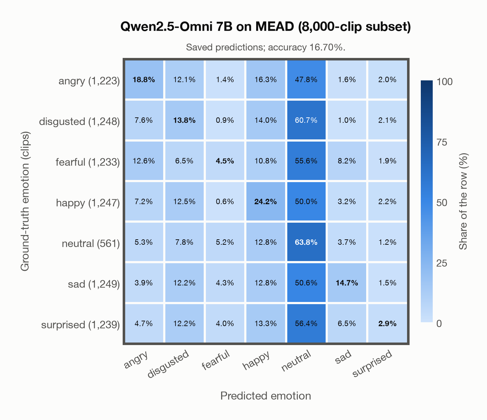

# Qwen2.5-Omni 7B on MEAD (8,000-clip subset)

Regenerated offline from saved CSV/JSON by `scripts/evaluation/refresh_reports.py`. This refresh performs no model inference or API requests.

## Summary

| Metric | Recomputed value |
|---|---:|
| Clips | 8,000 |
| Accuracy: acted emotion | 16.70% |
| UAR: mean ground-truth-row recall | 20.38% |
| Macro F1 | 16.17% |
| Weighted F1: true-support weighted | 16.31% |
| Accuracy: all model classes | 16.70% |

## Imported run and verification

- Source: [prediction CSV](../../outputs/qwen2_5_omni_7b/mead_predictions.csv) and [metadata JSON](../../outputs/qwen2_5_omni_7b/mead_predictions.json); both remain byte-for-byte unchanged.
- Original execution date recorded in JSON: `2026-11-13`.
- Dataset scope recorded in JSON: **MEAD (8,000-clip subset)**, English; 8,000 / 8,000 clips.
- Ground-truth column: `acted_emotion`. Candidate classes: angry, disgusted, fearful, happy, neutral, sad, surprised.
- Row counts, unique audio paths, correctness flags and saved metrics were checked against the CSV. Metric agreement tolerance is 0.000001 (six-decimal metadata).
- Weighted F1 weights each class's F1 by its true support, using the same resolved truth as macro F1; invalid answers remain errors. New metrics absent from the source JSON are recorded in the offline audit and summaries; the source JSON is preserved.
- Saved candidate/prompt/model protocol matches current configuration: scope `dataset`, model `Qwen/Qwen2.5-Omni-7B`, prompt hash `aab2967fd07a`.
- Original execution/client runtime metadata (reported by the imported run, not measured by this refresh): `{"device": "mps", "hardware": "Apple M3 Pro", "seconds": 8034.7, "ms_per_clip": 1004.3, "on_cpu": 0}`.
- Saved p_* columns encode the returned answer as one-hot values; they are not calibrated API class probabilities, and no confidence plot is inferred from them.
- A raw responses journal is present; this refresh validates CSV/JSON only.

## Results per emotion

| Ground-truth emotion | Clips | Recall | Acted-or-listener recall |
|---|---:|---:|---:|
| angry | 1,223 | 18.81% | — |
| disgusted | 1,248 | 13.78% | — |
| fearful | 1,233 | 4.46% | — |
| happy | 1,247 | 24.22% | — |
| neutral | 561 | 63.81% | — |
| sad | 1,249 | 14.65% | — |
| surprised | 1,239 | 2.91% | — |

Precision/F1 use the same resolved-truth convention as the evaluation script. Weighted F1 uses the resolved-truth clip counts below as weights.

| Predicted emotion | Resolved-truth clips | Precision | Recall | F1 |
|---|---:|---:|---:|---:|
| angry | 1,223 | 32.53% | 18.81% | 23.83% |
| disgusted | 1,248 | 19.05% | 13.78% | 15.99% |
| fearful | 1,233 | 24.77% | 4.46% | 7.56% |
| happy | 1,247 | 25.04% | 24.22% | 24.62% |
| neutral | 561 | 8.25% | 63.81% | 14.61% |
| sad | 1,249 | 39.96% | 14.65% | 21.44% |
| surprised | 1,239 | 22.09% | 2.91% | 5.14% |

## Confusion matrix: acted emotion

| Ground truth \ Predicted | angry | disgusted | fearful | happy | neutral | sad | surprised |
|---|---|---|---|---|---|---|---|
| angry (1,223) | **18.8%** | 12.1% | 1.4% | 16.3% | 47.8% | 1.6% | 2.0% |
| disgusted (1,248) | 7.6% | **13.8%** | 0.9% | 14.0% | 60.7% | 1.0% | 2.1% |
| fearful (1,233) | 12.6% | 6.5% | **4.5%** | 10.8% | 55.6% | 8.2% | 1.9% |
| happy (1,247) | 7.2% | 12.5% | 0.6% | **24.2%** | 50.0% | 3.2% | 2.2% |
| neutral (561) | 5.3% | 7.8% | 5.2% | 12.8% | **63.8%** | 3.7% | 1.2% |
| sad (1,249) | 3.9% | 12.2% | 4.3% | 12.8% | 50.6% | **14.7%** | 1.5% |
| surprised (1,239) | 4.7% | 12.2% | 4.0% | 13.3% | 56.4% | 6.5% | **2.9%** |

## Caveats

- **Training involvement for Qwen2.5-Omni 7B: No corpus-specific evidence**. Source: Qwen2.5 and Whisper-large-v3 initialization plus multimodal pre/post-training; complete corpus-level provenance not published. Direct use and upstream teacher use both count as training involvement. No pattern: no corpus-specific evidence, not verified unseen. Corpus use is not test-clip leakage.
- Internal CSV/JSON consistency does not authenticate the original model or remote request logs.

[Offline validation audit](mead_offline_audit.json)
