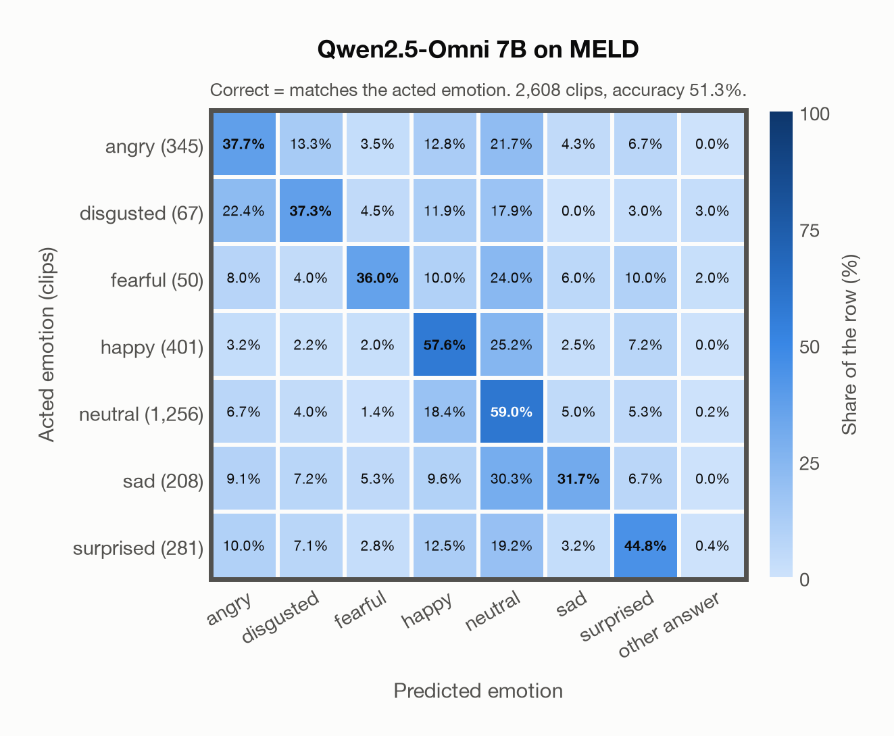

# Qwen2.5-Omni 7B on MELD

Generated by `scripts/evaluation/evaluate.py` on 2026-11-09.

## Summary

| Metric | Value |
|---|---|
| Clips evaluated | 2,608 (English) |
| **Accuracy: prediction matches the acted emotion** | **51.3%** |
| Unweighted accuracy (mean recall of the 7 acted emotions) | 43.5% |
| Macro F1 (acted emotion) | 40.4% |
| Weighted F1 (by true class support) | 52.39% |
| Accuracy, all 8 model classes (acted emotion) | 51.3% |
| Chance level (7 emotions) | 14.3% |

## Setup

- **Model**: Qwen2.5-Omni 7B (`Qwen/Qwen2.5-Omni-7B`) as released (no fine-tuning), transformers 5.18.0, loaded by `scripts/models/qwen2_5_omni.py`. Qwen2.5-Omni-7B's Thinker (text output only; the Talker is not loaded) gets one conversation per clip in its chat template: the system prompt, then one user turn with the audio first and the user prompt after it (as in the model card), with the system and user prompts of `scripts/llm_eval/prompts.yaml` (the same as for GPT Realtime); the clip as 16 kHz mono. Greedy decoding (do_sample=False, no repetition penalty), at most 24 new tokens, bfloat16 on `mps`, sdpa attention; so the answers are the same from run to run (up to rounding differences between devices). The answer is read by `scripts/llm_eval/parsing.py` and becomes a one-hot vector over the 7 configured emotions plus `invalid`. Allowed answers for this run: angry, disgusted, fearful, happy, neutral, sad, surprised. An answer that is not exactly one allowed label gets a follow-up in the same conversation ("Answer with exactly one word from this list, in lowercase, and nothing else: angry, disgusted, fearful, happy, neutral, sad, surprised."), up to 1 time(s); then `invalid`. An answer that is not one of the dataset's emotions counts as wrong (column *other answer* of the confusion matrices); the raw answers are in `outputs/qwen2_5_omni_7b/responses.jsonl`.
- **Data**: 2,608 clips of MELD (English) from `data/meld/`.
- **Ground truth (acted emotion)**: the label of each utterance (`Emotion` in `test_sent_emo.csv`): the majority of three annotators who watched the video and read the transcript; the speakers were not asked to act an emotion.
- Label mapping: anger = angry, disgust = disgusted, fear = fearful, joy = happy, neutral = neutral, sadness = sad, surprise = surprised.
- Only the official **test split** (2,610 utterances of 280 dialogues): it is the standard split for reporting results, and the train and dev splits were used to train several of the models.
- Utterances from the TV series *Friends*, converted from the test videos to 16 kHz mono WAV by scripts/common/download_data.py. Left out: `dia38_utt4` (joy) and `dia220_utt0` (disgust), whose time stamps are wrong (each clip holds 4–5 minutes of the episode for one short line).
- **7 emotions**: the prediction is the model's answer when it is one of the 7 emotions in this dataset (angry, disgusted, fearful, happy, neutral, sad, surprised); any other answer (`invalid`) counts as wrong, so the accuracy is the same with all 8 model classes.
- **Other answer**: for 6 clips the model's answer is none of the 7 emotions (an emotion this dataset does not have, or no readable answer). They count as wrong and have their own last column, *other answer*, in the confusion matrices; precision, recall and F1 are over the 7 emotions.
- **Hardware**: Apple M4 Max, device `mps`, PyTorch 2.7.1. Inference took 31.0 min (713 ms per clip; answers saved by an earlier run take no time).
- **Per-clip predictions**: `outputs/qwen2_5_omni_7b/meld_predictions.csv` (in git, so the results can be checked clip by clip). The JSON file next to it describes the columns.

## Results per emotion

Rows: acted emotion. Precision, recall and F1 compare the prediction with the acted emotion.

| Emotion | Clips | Precision | Recall | F1 |
|---|---|---|---|---|
| angry | 345 | 44.4% | 37.7% | 40.8% |
| disgusted | 67 | 15.0% | 37.3% | 21.4% |
| fearful | 50 | 23.1% | 36.0% | 28.1% |
| happy | 401 | 40.2% | 57.6% | 47.4% |
| neutral | 1,256 | 70.0% | 59.0% | 64.0% |
| sad | 208 | 39.8% | 31.7% | 35.3% |
| surprised | 281 | 47.4% | 44.8% | 46.1% |

## Confusion matrix: acted emotion

The same numbers as a table. Rows: acted emotion. Columns: predicted emotion. Each row adds up to 100%. *other answer*: the answer is none of the dataset's emotions (wrong).

| Acted \ Predicted | angry | disgusted | fearful | happy | neutral | sad | surprised | other answer |
|---|---|---|---|---|---|---|---|---|
| angry (345) | **37.7%** | 13.3% | 3.5% | 12.8% | 21.7% | 4.3% | 6.7% | 0.0% |
| disgusted (67) | 22.4% | **37.3%** | 4.5% | 11.9% | 17.9% | 0.0% | 3.0% | 3.0% |
| fearful (50) | 8.0% | 4.0% | **36.0%** | 10.0% | 24.0% | 6.0% | 10.0% | 2.0% |
| happy (401) | 3.2% | 2.2% | 2.0% | **57.6%** | 25.2% | 2.5% | 7.2% | 0.0% |
| neutral (1,256) | 6.7% | 4.0% | 1.4% | 18.4% | **59.0%** | 5.0% | 5.3% | 0.2% |
| sad (208) | 9.1% | 7.2% | 5.3% | 9.6% | 30.3% | **31.7%** | 6.7% | 0.0% |
| surprised (281) | 10.0% | 7.1% | 2.8% | 12.5% | 19.2% | 3.2% | **44.8%** | 0.4% |

Most frequent confusions: sad predicted as neutral (30.3%), happy predicted as neutral (25.2%), fearful predicted as neutral (24.0%).

## Predictions outside the 7 emotions

With all 8 model classes, the model chose a class that this dataset does not have for 6 clips (0.2%): `invalid` 6.

## Caveats

- **Training involvement for Qwen2.5-Omni 7B: No corpus-specific evidence**. Source: Qwen2.5 and Whisper-large-v3 initialization plus multimodal pre/post-training; complete corpus-level provenance not published. Direct use and upstream teacher use both count as training involvement. No pattern: no corpus-specific evidence, not verified unseen. Corpus use is not test-clip leakage. The model may have heard these public datasets during training.
- **In-the-wild speech with noisy labels.** The annotators saw the video and the transcript, not the voice alone, and agreed moderately (Fleiss' kappa 0.43); the classes are very unbalanced (48% neutral, 2% fear).
- Several speakers, laughter of the studio audience and background music can be heard in a clip; a third of the clips are shorter than 2 s.
- MELD's train split is in the training data of MERaLiON-SER-v1 and of EmoBox (emotion2vec+), so these models have heard the same speakers and show.
- The clips come from a copyrighted TV show (the authors rely on fair use); the repository is GPL-3.0.

[Derived metric verification](../derived_metrics.json)
