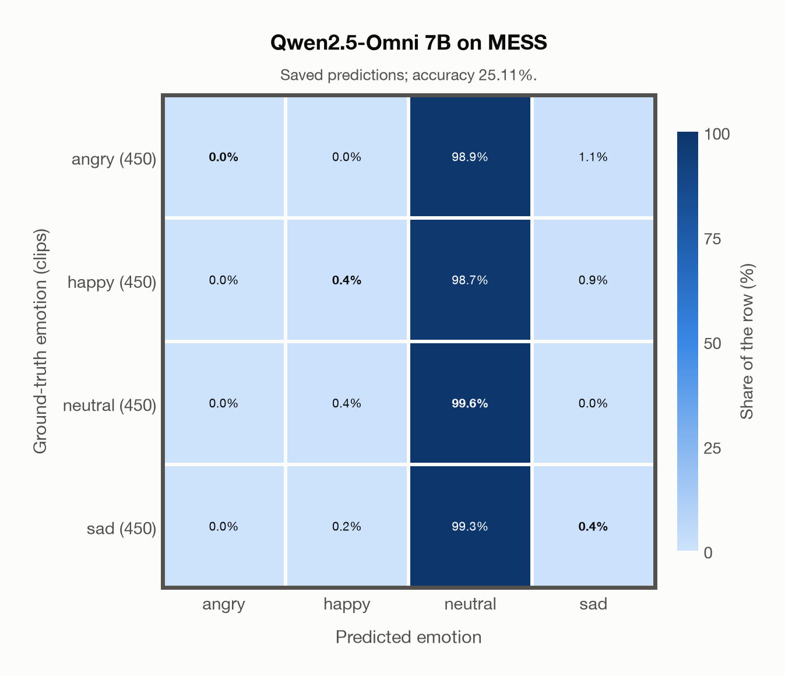

# Qwen2.5-Omni 7B on MESS

Regenerated offline from saved CSV/JSON by `scripts/evaluation/refresh_reports.py`. This refresh performs no model inference or API requests.

## Summary

| Metric | Recomputed value |
|---|---:|
| Clips | 1,800 |
| Accuracy: acted emotion | 25.11% |
| UAR: mean ground-truth-row recall | 25.11% |
| Macro F1 | 10.46% |
| Weighted F1: true-support weighted | 10.46% |
| Accuracy: all model classes | 25.11% |

## Imported run and verification

- Source: [prediction CSV](../../outputs/qwen2_5_omni_7b/mess_predictions.csv) and [metadata JSON](../../outputs/qwen2_5_omni_7b/mess_predictions.json); both remain byte-for-byte unchanged.
- Original execution date recorded in JSON: `2026-11-11`.
- Dataset scope recorded in JSON: **MESS**, English; 1,800 / 1,800 clips.
- Ground-truth column: `acted_emotion`. Candidate classes: angry, happy, neutral, sad.
- Row counts, unique audio paths, correctness flags and saved metrics were checked against the CSV. Metric agreement tolerance is 0.000001 (six-decimal metadata).
- Weighted F1 weights each class's F1 by its true support, using the same resolved truth as macro F1; invalid answers remain errors. New metrics absent from the source JSON are recorded in the offline audit and summaries; the source JSON is preserved.
- Saved candidate/prompt/model protocol matches current configuration: scope `dataset`, model `Qwen/Qwen2.5-Omni-7B`, prompt hash `e683d765d4ac`.
- Original execution/client runtime metadata (reported by the imported run, not measured by this refresh): `{"device": "mps", "hardware": "Apple M3 Pro", "seconds": 1443.6, "ms_per_clip": 802.0, "on_cpu": 0}`.
- Saved p_* columns encode the returned answer as one-hot values; they are not calibrated API class probabilities, and no confidence plot is inferred from them.
- A raw responses journal is present; this refresh validates CSV/JSON only.

## Results per emotion

| Ground-truth emotion | Clips | Recall | Acted-or-listener recall |
|---|---:|---:|---:|
| angry | 450 | 0.00% | — |
| happy | 450 | 0.44% | — |
| neutral | 450 | 99.56% | — |
| sad | 450 | 0.44% | — |

Precision/F1 use the same resolved-truth convention as the evaluation script. Weighted F1 uses the resolved-truth clip counts below as weights.

| Predicted emotion | Resolved-truth clips | Precision | Recall | F1 |
|---|---:|---:|---:|---:|
| angry | 450 | 0.00% | 0.00% | 0.00% |
| happy | 450 | 40.00% | 0.44% | 0.88% |
| neutral | 450 | 25.11% | 99.56% | 40.11% |
| sad | 450 | 18.18% | 0.44% | 0.87% |

## Confusion matrix: acted emotion

| Ground truth \ Predicted | angry | happy | neutral | sad |
|---|---|---|---|---|
| angry (450) | **0.0%** | 0.0% | 98.9% | 1.1% |
| happy (450) | 0.0% | **0.4%** | 98.7% | 0.9% |
| neutral (450) | 0.0% | 0.4% | **99.6%** | 0.0% |
| sad (450) | 0.0% | 0.2% | 99.3% | **0.4%** |

## Caveats

- **Training involvement for Qwen2.5-Omni 7B: No corpus-specific evidence**. Source: Qwen2.5 and Whisper-large-v3 initialization plus multimodal pre/post-training; complete corpus-level provenance not published. Direct use and upstream teacher use both count as training involvement. No pattern: no corpus-specific evidence, not verified unseen. Corpus use is not test-clip leakage.
- Internal CSV/JSON consistency does not authenticate the original model or remote request logs.

[Offline validation audit](mess_offline_audit.json)
