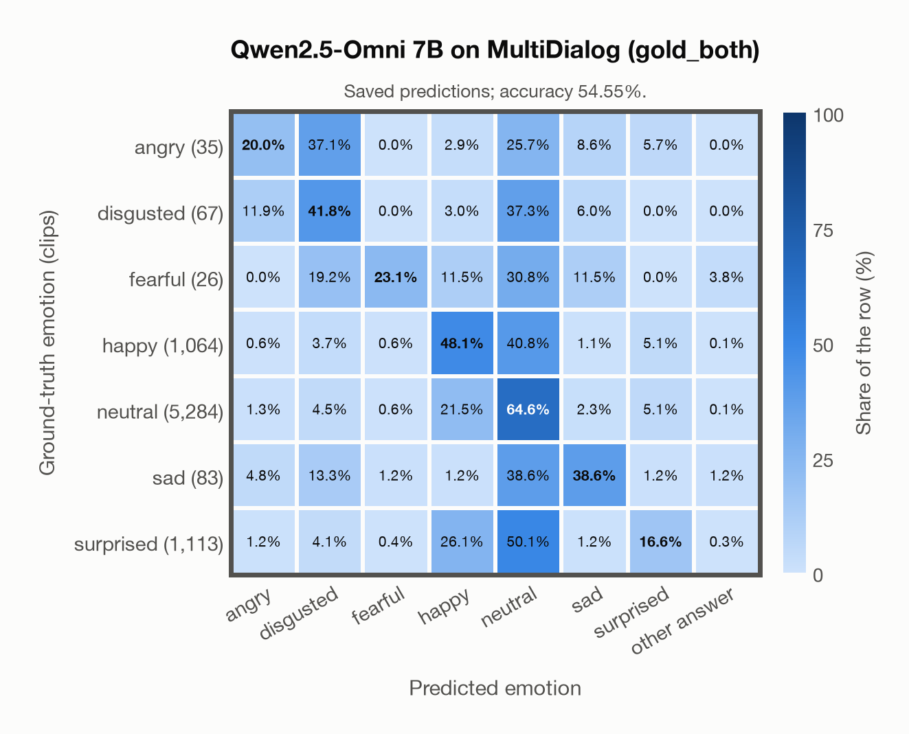

# Qwen2.5-Omni 7B on MultiDialog (gold_both)

Regenerated offline from saved CSV/JSON by `scripts/evaluation/refresh_reports.py`. This refresh performs no model inference or API requests.

## Summary

| Metric | Recomputed value |
|---|---:|
| Clips | 7,672 |
| Accuracy: acted emotion | 54.55% |
| UAR: mean ground-truth-row recall | 36.11% |
| Macro F1 | 26.94% |
| Weighted F1: true-support weighted | 56.66% |
| Accuracy: all model classes | 54.55% |

## Imported run and verification

- Source: [prediction CSV](../../outputs/qwen2_5_omni_7b/multidialog_predictions.csv) and [metadata JSON](../../outputs/qwen2_5_omni_7b/multidialog_predictions.json); both remain byte-for-byte unchanged.
- Original execution date recorded in JSON: `2026-11-13`.
- Dataset scope recorded in JSON: **MultiDialog (gold_both)**, English; 7,672 / 7,672 clips.
- Ground-truth column: `acted_emotion`. Candidate classes: angry, disgusted, fearful, happy, neutral, sad, surprised.
- Row counts, unique audio paths, correctness flags and saved metrics were checked against the CSV. Metric agreement tolerance is 0.000001 (six-decimal metadata).
- Weighted F1 weights each class's F1 by its true support, using the same resolved truth as macro F1; invalid answers remain errors. New metrics absent from the source JSON are recorded in the offline audit and summaries; the source JSON is preserved.
- Saved candidate/prompt/model protocol matches current configuration: scope `dataset`, model `Qwen/Qwen2.5-Omni-7B`, prompt hash `aab2967fd07a`.
- Original execution/client runtime metadata (reported by the imported run, not measured by this refresh): `{"device": "mps", "hardware": "Apple M3 Pro", "seconds": 9121.0, "ms_per_clip": 1188.9, "on_cpu": 0}`.
- Saved p_* columns encode the returned answer as one-hot values; they are not calibrated API class probabilities, and no confidence plot is inferred from them.
- A raw responses journal is present; this refresh validates CSV/JSON only.

## Results per emotion

| Ground-truth emotion | Clips | Recall | Acted-or-listener recall |
|---|---:|---:|---:|
| angry | 35 | 20.00% | — |
| disgusted | 67 | 41.79% | — |
| fearful | 26 | 23.08% | — |
| happy | 1,064 | 48.12% | — |
| neutral | 5,284 | 64.63% | — |
| sad | 83 | 38.55% | — |
| surprised | 1,113 | 16.62% | — |

Precision/F1 use the same resolved-truth convention as the evaluation script. Weighted F1 uses the resolved-truth clip counts below as weights.

| Predicted emotion | Resolved-truth clips | Precision | Recall | F1 |
|---|---:|---:|---:|---:|
| angry | 35 | 6.67% | 20.00% | 10.00% |
| disgusted | 67 | 7.39% | 41.79% | 12.56% |
| fearful | 26 | 12.00% | 23.08% | 15.79% |
| happy | 1,064 | 26.31% | 48.12% | 34.02% |
| neutral | 5,284 | 76.21% | 64.63% | 69.94% |
| sad | 83 | 16.93% | 38.55% | 23.53% |
| surprised | 1,113 | 36.13% | 16.62% | 22.77% |

## Confusion matrix: acted emotion

| Ground truth \ Predicted | angry | disgusted | fearful | happy | neutral | sad | surprised | other answer |
|---|---|---|---|---|---|---|---|---|
| angry (35) | **20.0%** | 37.1% | 0.0% | 2.9% | 25.7% | 8.6% | 5.7% | 0.0% |
| disgusted (67) | 11.9% | **41.8%** | 0.0% | 3.0% | 37.3% | 6.0% | 0.0% | 0.0% |
| fearful (26) | 0.0% | 19.2% | **23.1%** | 11.5% | 30.8% | 11.5% | 0.0% | 3.8% |
| happy (1,064) | 0.6% | 3.7% | 0.6% | **48.1%** | 40.8% | 1.1% | 5.1% | 0.1% |
| neutral (5,284) | 1.3% | 4.5% | 0.6% | 21.5% | **64.6%** | 2.3% | 5.1% | 0.1% |
| sad (83) | 4.8% | 13.3% | 1.2% | 1.2% | 38.6% | **38.6%** | 1.2% | 1.2% |
| surprised (1,113) | 1.2% | 4.1% | 0.4% | 26.1% | 50.1% | 1.2% | **16.6%** | 0.3% |

## Caveats

- **Training involvement for Qwen2.5-Omni 7B: No corpus-specific evidence**. Source: Qwen2.5 and Whisper-large-v3 initialization plus multimodal pre/post-training; complete corpus-level provenance not published. Direct use and upstream teacher use both count as training involvement. No pattern: no corpus-specific evidence, not verified unseen. Corpus use is not test-clip leakage.
- Internal CSV/JSON consistency does not authenticate the original model or remote request logs.

[Offline validation audit](multidialog_offline_audit.json)
