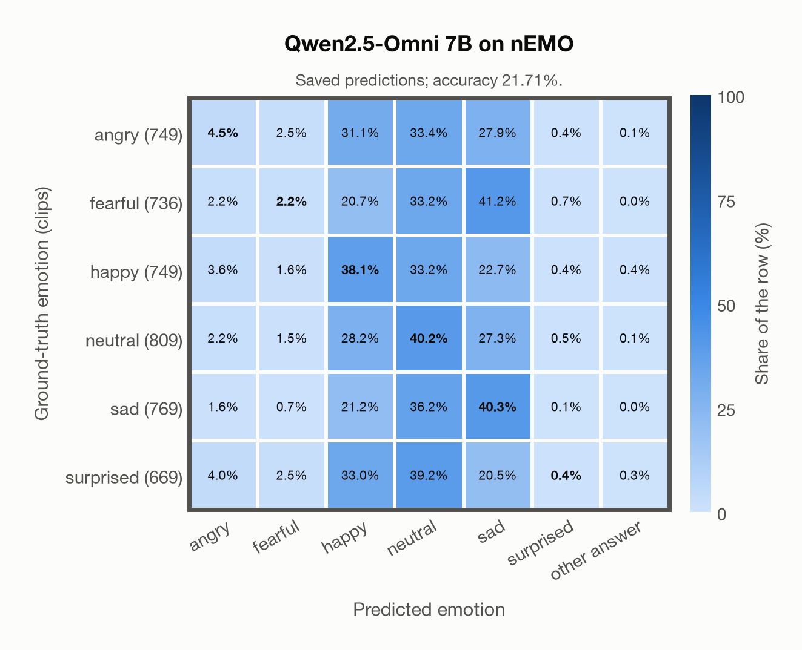

# Qwen2.5-Omni 7B on nEMO

Regenerated offline from saved CSV/JSON by `scripts/evaluation/refresh_reports.py`. This refresh performs no model inference or API requests.

## Summary

| Metric | Recomputed value |
|---|---:|
| Clips | 4,481 |
| Accuracy: acted emotion | 21.71% |
| UAR: mean ground-truth-row recall | 20.95% |
| Macro F1 | 16.12% |
| Weighted F1: true-support weighted | 16.63% |
| Accuracy: all model classes | 21.71% |

## Imported run and verification

- Source: [prediction CSV](../../outputs/qwen2_5_omni_7b/nemo_predictions.csv) and [metadata JSON](../../outputs/qwen2_5_omni_7b/nemo_predictions.json); both remain byte-for-byte unchanged.
- Original execution date recorded in JSON: `2026-11-11`.
- Dataset scope recorded in JSON: **nEMO**, Polish; 4,481 / 4,481 clips.
- Ground-truth column: `acted_emotion`. Candidate classes: angry, fearful, happy, neutral, sad, surprised.
- Row counts, unique audio paths, correctness flags and saved metrics were checked against the CSV. Metric agreement tolerance is 0.000001 (six-decimal metadata).
- Weighted F1 weights each class's F1 by its true support, using the same resolved truth as macro F1; invalid answers remain errors. New metrics absent from the source JSON are recorded in the offline audit and summaries; the source JSON is preserved.
- Saved candidate/prompt/model protocol matches current configuration: scope `dataset`, model `Qwen/Qwen2.5-Omni-7B`, prompt hash `6c3ec6823d3d`.
- Original execution/client runtime metadata (reported by the imported run, not measured by this refresh): `{"device": "mps", "hardware": "Apple M3 Pro", "seconds": 2964.5, "ms_per_clip": 661.6, "on_cpu": 0}`.
- Saved p_* columns encode the returned answer as one-hot values; they are not calibrated API class probabilities, and no confidence plot is inferred from them.
- A raw responses journal is present; this refresh validates CSV/JSON only.

## Results per emotion

| Ground-truth emotion | Clips | Recall | Acted-or-listener recall |
|---|---:|---:|---:|
| angry | 749 | 4.54% | — |
| fearful | 736 | 2.17% | — |
| happy | 749 | 38.05% | — |
| neutral | 809 | 40.17% | — |
| sad | 769 | 40.31% | — |
| surprised | 669 | 0.45% | — |

Precision/F1 use the same resolved-truth convention as the evaluation script. Weighted F1 uses the resolved-truth clip counts below as weights.

| Predicted emotion | Resolved-truth clips | Precision | Recall | F1 |
|---|---:|---:|---:|---:|
| angry | 749 | 25.37% | 4.54% | 7.70% |
| fearful | 736 | 19.75% | 2.17% | 3.92% |
| happy | 749 | 22.23% | 38.05% | 28.06% |
| neutral | 809 | 20.21% | 40.17% | 26.89% |
| sad | 769 | 22.96% | 40.31% | 29.26% |
| surprised | 669 | 15.79% | 0.45% | 0.87% |

## Confusion matrix: acted emotion

| Ground truth \ Predicted | angry | fearful | happy | neutral | sad | surprised | other answer |
|---|---|---|---|---|---|---|---|
| angry (749) | **4.5%** | 2.5% | 31.1% | 33.4% | 27.9% | 0.4% | 0.1% |
| fearful (736) | 2.2% | **2.2%** | 20.7% | 33.2% | 41.2% | 0.7% | 0.0% |
| happy (749) | 3.6% | 1.6% | **38.1%** | 33.2% | 22.7% | 0.4% | 0.4% |
| neutral (809) | 2.2% | 1.5% | 28.2% | **40.2%** | 27.3% | 0.5% | 0.1% |
| sad (769) | 1.6% | 0.7% | 21.2% | 36.2% | **40.3%** | 0.1% | 0.0% |
| surprised (669) | 4.0% | 2.5% | 33.0% | 39.2% | 20.5% | **0.4%** | 0.3% |

## Caveats

- **Training involvement for Qwen2.5-Omni 7B: No corpus-specific evidence**. Source: Qwen2.5 and Whisper-large-v3 initialization plus multimodal pre/post-training; complete corpus-level provenance not published. Direct use and upstream teacher use both count as training involvement. No pattern: no corpus-specific evidence, not verified unseen. Corpus use is not test-clip leakage.
- Internal CSV/JSON consistency does not authenticate the original model or remote request logs.

[Offline validation audit](nemo_offline_audit.json)
