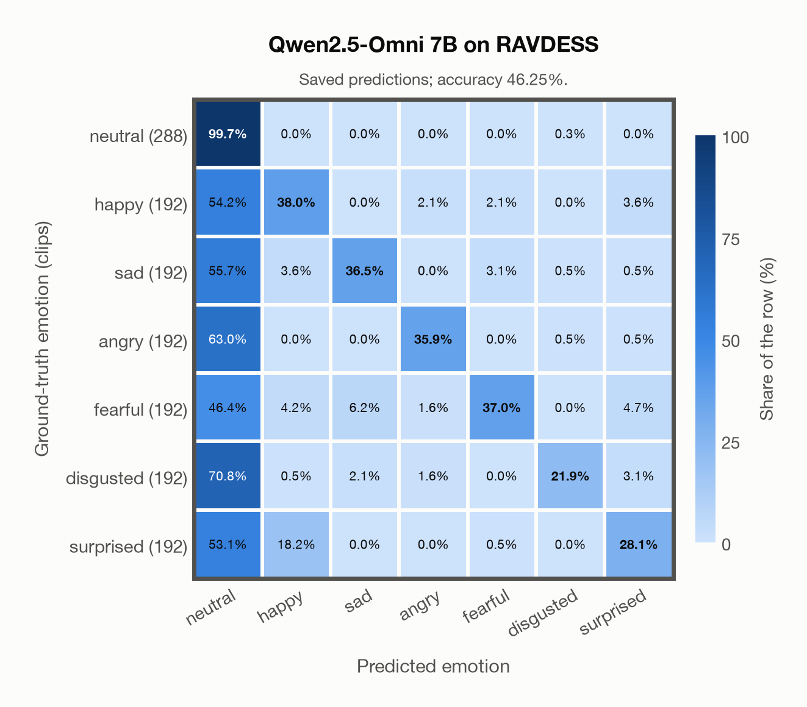

# Qwen2.5-Omni 7B on RAVDESS

Regenerated offline from saved CSV/JSON by `scripts/evaluation/refresh_reports.py`. This refresh performs no model inference or API requests.

## Summary

| Metric | Recomputed value |
|---|---:|
| Clips | 1,440 |
| Accuracy: acted emotion | 46.25% |
| UAR: mean ground-truth-row recall | 42.44% |
| Macro F1 | 45.90% |
| Weighted F1: true-support weighted | 45.94% |
| Accuracy: all model classes | 46.25% |

## Imported run and verification

- Source: [prediction CSV](../../outputs/qwen2_5_omni_7b/ravdess_predictions.csv) and [metadata JSON](../../outputs/qwen2_5_omni_7b/ravdess_predictions.json); both remain byte-for-byte unchanged.
- Original execution date recorded in JSON: `2026-11-12`.
- Dataset scope recorded in JSON: **RAVDESS**, English; 1,440 / 1,440 clips.
- Ground-truth column: `acted_emotion`. Candidate classes: neutral, happy, sad, angry, fearful, disgusted, surprised.
- Row counts, unique audio paths, correctness flags and saved metrics were checked against the CSV. Metric agreement tolerance is 0.000001 (six-decimal metadata).
- Weighted F1 weights each class's F1 by its true support, using the same resolved truth as macro F1; invalid answers remain errors. New metrics absent from the source JSON are recorded in the offline audit and summaries; the source JSON is preserved.
- Saved candidate/prompt/model protocol matches current configuration: scope `dataset`, model `Qwen/Qwen2.5-Omni-7B`, prompt hash `aab2967fd07a`.
- Original execution/client runtime metadata (reported by the imported run, not measured by this refresh): `{"device": "mps", "hardware": "Apple M3 Pro", "seconds": 1077.0, "ms_per_clip": 747.9, "on_cpu": 0}`.
- Saved p_* columns encode the returned answer as one-hot values; they are not calibrated API class probabilities, and no confidence plot is inferred from them.
- A raw responses journal is present; this refresh validates CSV/JSON only.

## Results per emotion

| Ground-truth emotion | Clips | Recall | Acted-or-listener recall |
|---|---:|---:|---:|
| neutral | 288 | 99.65% | — |
| happy | 192 | 38.02% | — |
| sad | 192 | 36.46% | — |
| angry | 192 | 35.94% | — |
| fearful | 192 | 36.98% | — |
| disgusted | 192 | 21.88% | — |
| surprised | 192 | 28.12% | — |

Precision/F1 use the same resolved-truth convention as the evaluation script. Weighted F1 uses the resolved-truth clip counts below as weights.

| Predicted emotion | Resolved-truth clips | Precision | Recall | F1 |
|---|---:|---:|---:|---:|
| neutral | 288 | 30.34% | 99.65% | 46.52% |
| happy | 192 | 58.87% | 38.02% | 46.20% |
| sad | 192 | 81.40% | 36.46% | 50.36% |
| angry | 192 | 87.34% | 35.94% | 50.92% |
| fearful | 192 | 86.59% | 36.98% | 51.82% |
| disgusted | 192 | 93.33% | 21.88% | 35.44% |
| surprised | 192 | 69.23% | 28.12% | 40.00% |

## Confusion matrix: acted emotion

| Ground truth \ Predicted | neutral | happy | sad | angry | fearful | disgusted | surprised |
|---|---|---|---|---|---|---|---|
| neutral (288) | **99.7%** | 0.0% | 0.0% | 0.0% | 0.0% | 0.3% | 0.0% |
| happy (192) | 54.2% | **38.0%** | 0.0% | 2.1% | 2.1% | 0.0% | 3.6% |
| sad (192) | 55.7% | 3.6% | **36.5%** | 0.0% | 3.1% | 0.5% | 0.5% |
| angry (192) | 63.0% | 0.0% | 0.0% | **35.9%** | 0.0% | 0.5% | 0.5% |
| fearful (192) | 46.4% | 4.2% | 6.2% | 1.6% | **37.0%** | 0.0% | 4.7% |
| disgusted (192) | 70.8% | 0.5% | 2.1% | 1.6% | 0.0% | **21.9%** | 3.1% |
| surprised (192) | 53.1% | 18.2% | 0.0% | 0.0% | 0.5% | 0.0% | **28.1%** |

## Caveats

- **Training involvement for Qwen2.5-Omni 7B: No corpus-specific evidence**. Source: Qwen2.5 and Whisper-large-v3 initialization plus multimodal pre/post-training; complete corpus-level provenance not published. Direct use and upstream teacher use both count as training involvement. No pattern: no corpus-specific evidence, not verified unseen. Corpus use is not test-clip leakage.
- Internal CSV/JSON consistency does not authenticate the original model or remote request logs.

[Offline validation audit](ravdess_offline_audit.json)
