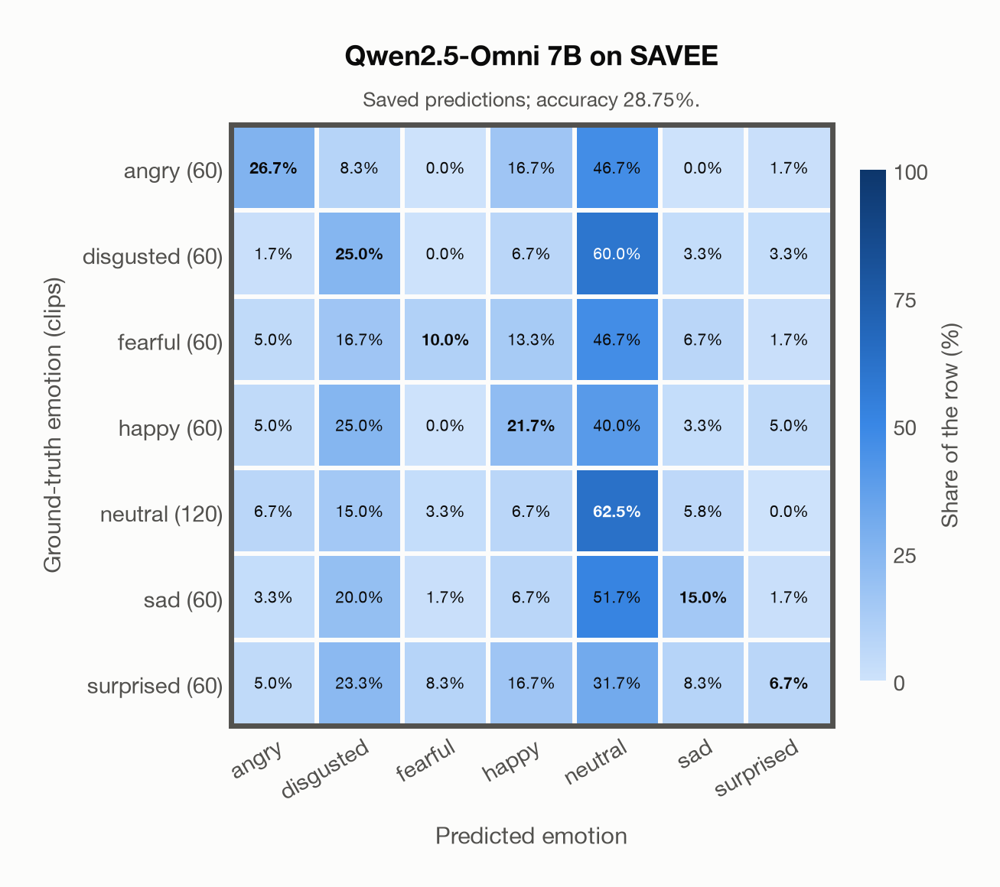

# Qwen2.5-Omni 7B on SAVEE

Regenerated offline from saved CSV/JSON by `scripts/evaluation/refresh_reports.py`. This refresh performs no model inference or API requests.

## Summary

| Metric | Recomputed value |
|---|---:|
| Clips | 480 |
| Accuracy: acted emotion | 28.75% |
| UAR: mean ground-truth-row recall | 23.93% |
| Macro F1 | 23.48% |
| Weighted F1: true-support weighted | 25.74% |
| Accuracy: all model classes | 28.75% |

## Imported run and verification

- Source: [prediction CSV](../../outputs/qwen2_5_omni_7b/savee_predictions.csv) and [metadata JSON](../../outputs/qwen2_5_omni_7b/savee_predictions.json); both remain byte-for-byte unchanged.
- Original execution date recorded in JSON: `2026-11-13`.
- Dataset scope recorded in JSON: **SAVEE**, English (British); 480 / 480 clips.
- Ground-truth column: `acted_emotion`. Candidate classes: angry, disgusted, fearful, happy, neutral, sad, surprised.
- Row counts, unique audio paths, correctness flags and saved metrics were checked against the CSV. Metric agreement tolerance is 0.000001 (six-decimal metadata).
- Weighted F1 weights each class's F1 by its true support, using the same resolved truth as macro F1; invalid answers remain errors. New metrics absent from the source JSON are recorded in the offline audit and summaries; the source JSON is preserved.
- Saved candidate/prompt/model protocol matches current configuration: scope `dataset`, model `Qwen/Qwen2.5-Omni-7B`, prompt hash `aab2967fd07a`.
- Original execution/client runtime metadata (reported by the imported run, not measured by this refresh): `{"device": "mps", "hardware": "Apple M3 Pro", "seconds": 458.5, "ms_per_clip": 955.2, "on_cpu": 0}`.
- Saved p_* columns encode the returned answer as one-hot values; they are not calibrated API class probabilities, and no confidence plot is inferred from them.
- A raw responses journal is present; this refresh validates CSV/JSON only.

## Results per emotion

| Ground-truth emotion | Clips | Recall | Acted-or-listener recall |
|---|---:|---:|---:|
| angry | 60 | 26.67% | — |
| disgusted | 60 | 25.00% | — |
| fearful | 60 | 10.00% | — |
| happy | 60 | 21.67% | — |
| neutral | 120 | 62.50% | — |
| sad | 60 | 15.00% | — |
| surprised | 60 | 6.67% | — |

Precision/F1 use the same resolved-truth convention as the evaluation script. Weighted F1 uses the resolved-truth clip counts below as weights.

| Predicted emotion | Resolved-truth clips | Precision | Recall | F1 |
|---|---:|---:|---:|---:|
| angry | 60 | 44.44% | 26.67% | 33.33% |
| disgusted | 60 | 16.85% | 25.00% | 20.13% |
| fearful | 60 | 37.50% | 10.00% | 15.79% |
| happy | 60 | 22.81% | 21.67% | 22.22% |
| neutral | 120 | 31.12% | 62.50% | 41.55% |
| sad | 60 | 31.03% | 15.00% | 20.22% |
| surprised | 60 | 33.33% | 6.67% | 11.11% |

## Confusion matrix: acted emotion

| Ground truth \ Predicted | angry | disgusted | fearful | happy | neutral | sad | surprised |
|---|---|---|---|---|---|---|---|
| angry (60) | **26.7%** | 8.3% | 0.0% | 16.7% | 46.7% | 0.0% | 1.7% |
| disgusted (60) | 1.7% | **25.0%** | 0.0% | 6.7% | 60.0% | 3.3% | 3.3% |
| fearful (60) | 5.0% | 16.7% | **10.0%** | 13.3% | 46.7% | 6.7% | 1.7% |
| happy (60) | 5.0% | 25.0% | 0.0% | **21.7%** | 40.0% | 3.3% | 5.0% |
| neutral (120) | 6.7% | 15.0% | 3.3% | 6.7% | **62.5%** | 5.8% | 0.0% |
| sad (60) | 3.3% | 20.0% | 1.7% | 6.7% | 51.7% | **15.0%** | 1.7% |
| surprised (60) | 5.0% | 23.3% | 8.3% | 16.7% | 31.7% | 8.3% | **6.7%** |

## Caveats

- **Training involvement for Qwen2.5-Omni 7B: No corpus-specific evidence**. Source: Qwen2.5 and Whisper-large-v3 initialization plus multimodal pre/post-training; complete corpus-level provenance not published. Direct use and upstream teacher use both count as training involvement. No pattern: no corpus-specific evidence, not verified unseen. Corpus use is not test-clip leakage.
- Internal CSV/JSON consistency does not authenticate the original model or remote request logs.

[Offline validation audit](savee_offline_audit.json)
