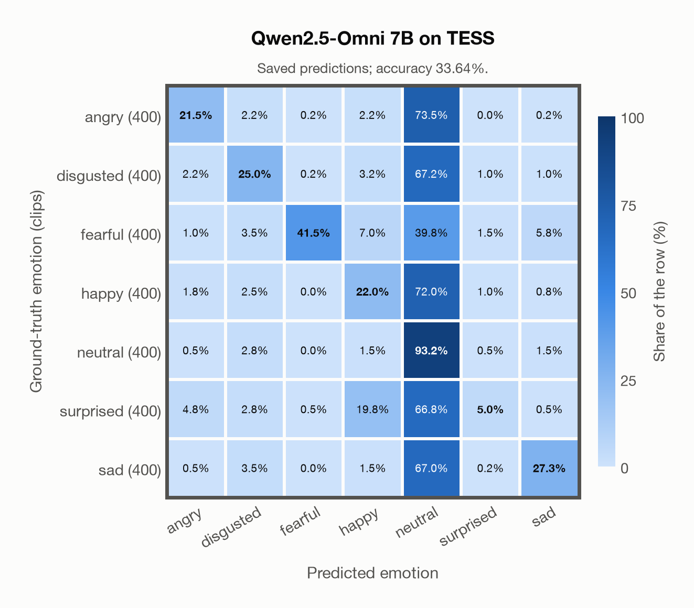

# Qwen2.5-Omni 7B on TESS

Regenerated offline from saved CSV/JSON by `scripts/evaluation/refresh_reports.py`. This refresh performs no model inference or API requests.

## Summary

| Metric | Recomputed value |
|---|---:|
| Clips | 2,800 |
| Accuracy: acted emotion | 33.64% |
| UAR: mean ground-truth-row recall | 33.64% |
| Macro F1 | 33.57% |
| Weighted F1: true-support weighted | 33.57% |
| Accuracy: all model classes | 33.64% |

## Imported run and verification

- Source: [prediction CSV](../../outputs/qwen2_5_omni_7b/tess_predictions.csv) and [metadata JSON](../../outputs/qwen2_5_omni_7b/tess_predictions.json); both remain byte-for-byte unchanged.
- Original execution date recorded in JSON: `2026-11-12`.
- Dataset scope recorded in JSON: **TESS**, English; 2,800 / 2,800 clips.
- Ground-truth column: `acted_emotion`. Candidate classes: angry, disgusted, fearful, happy, neutral, surprised, sad.
- Row counts, unique audio paths, correctness flags and saved metrics were checked against the CSV. Metric agreement tolerance is 0.000001 (six-decimal metadata).
- Weighted F1 weights each class's F1 by its true support, using the same resolved truth as macro F1; invalid answers remain errors. New metrics absent from the source JSON are recorded in the offline audit and summaries; the source JSON is preserved.
- Saved candidate/prompt/model protocol matches current configuration: scope `dataset`, model `Qwen/Qwen2.5-Omni-7B`, prompt hash `aab2967fd07a`.
- Original execution/client runtime metadata (reported by the imported run, not measured by this refresh): `{"device": "mps", "hardware": "Apple M3 Pro", "seconds": 2360.4, "ms_per_clip": 843.0, "on_cpu": 0}`.
- Saved p_* columns encode the returned answer as one-hot values; they are not calibrated API class probabilities, and no confidence plot is inferred from them.
- A raw responses journal is present; this refresh validates CSV/JSON only.

## Results per emotion

| Ground-truth emotion | Clips | Recall | Acted-or-listener recall |
|---|---:|---:|---:|
| angry | 400 | 21.50% | — |
| disgusted | 400 | 25.00% | — |
| fearful | 400 | 41.50% | — |
| happy | 400 | 22.00% | — |
| neutral | 400 | 93.25% | — |
| surprised | 400 | 5.00% | — |
| sad | 400 | 27.25% | — |

Precision/F1 use the same resolved-truth convention as the evaluation script. Weighted F1 uses the resolved-truth clip counts below as weights.

| Predicted emotion | Resolved-truth clips | Precision | Recall | F1 |
|---|---:|---:|---:|---:|
| angry | 400 | 66.67% | 21.50% | 32.51% |
| disgusted | 400 | 59.17% | 25.00% | 35.15% |
| fearful | 400 | 97.65% | 41.50% | 58.25% |
| happy | 400 | 38.43% | 22.00% | 27.98% |
| neutral | 400 | 19.45% | 93.25% | 32.18% |
| surprised | 400 | 54.05% | 5.00% | 9.15% |
| sad | 400 | 73.65% | 27.25% | 39.78% |

## Confusion matrix: acted emotion

| Ground truth \ Predicted | angry | disgusted | fearful | happy | neutral | surprised | sad |
|---|---|---|---|---|---|---|---|
| angry (400) | **21.5%** | 2.2% | 0.2% | 2.2% | 73.5% | 0.0% | 0.2% |
| disgusted (400) | 2.2% | **25.0%** | 0.2% | 3.2% | 67.2% | 1.0% | 1.0% |
| fearful (400) | 1.0% | 3.5% | **41.5%** | 7.0% | 39.8% | 1.5% | 5.8% |
| happy (400) | 1.8% | 2.5% | 0.0% | **22.0%** | 72.0% | 1.0% | 0.8% |
| neutral (400) | 0.5% | 2.8% | 0.0% | 1.5% | **93.2%** | 0.5% | 1.5% |
| surprised (400) | 4.8% | 2.8% | 0.5% | 19.8% | 66.8% | **5.0%** | 0.5% |
| sad (400) | 0.5% | 3.5% | 0.0% | 1.5% | 67.0% | 0.2% | **27.3%** |

## Caveats

- **Training involvement for Qwen2.5-Omni 7B: No corpus-specific evidence**. Source: Qwen2.5 and Whisper-large-v3 initialization plus multimodal pre/post-training; complete corpus-level provenance not published. Direct use and upstream teacher use both count as training involvement. No pattern: no corpus-specific evidence, not verified unseen. Corpus use is not test-clip leakage.
- Internal CSV/JSON consistency does not authenticate the original model or remote request logs.

[Offline validation audit](tess_offline_audit.json)
