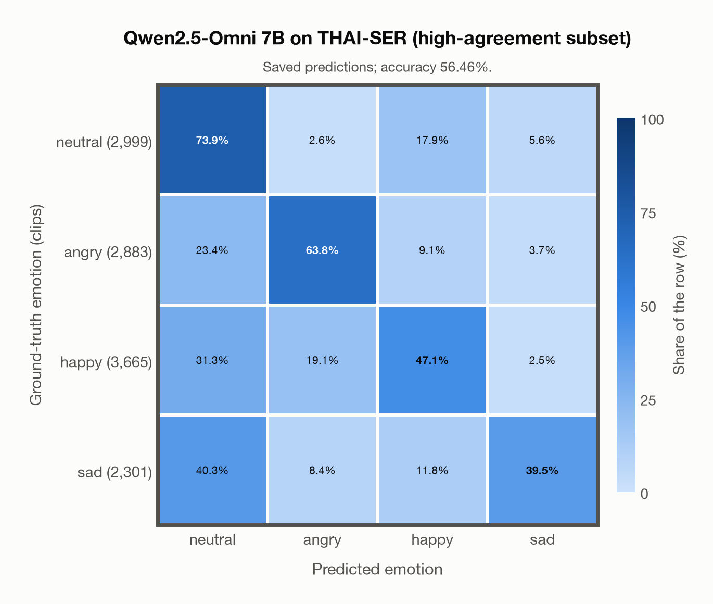
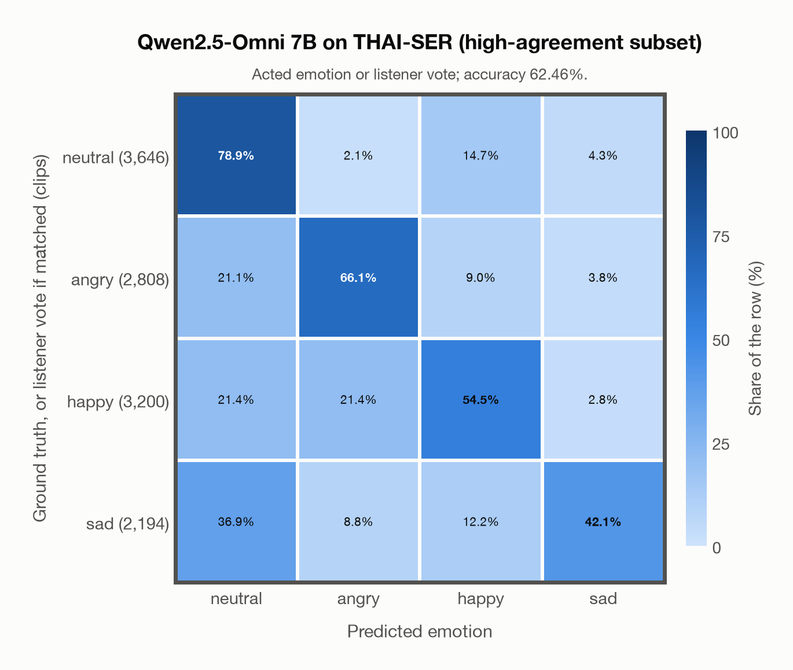

# Qwen2.5-Omni 7B on THAI-SER (high-agreement subset)

Regenerated offline from saved CSV/JSON by `scripts/evaluation/refresh_reports.py`. This refresh performs no model inference or API requests.

## Summary

| Metric | Recomputed value |
|---|---:|
| Clips | 11,848 |
| Accuracy: acted emotion | 56.46% |
| UAR: mean ground-truth-row recall | 56.06% |
| Macro F1 | 56.11% |
| Weighted F1: true-support weighted | 56.19% |
| Accuracy: all model classes | 56.46% |
| Accuracy: acted emotion or listener vote | 62.46% |
| Single listener vote vs acted emotion | 77.23% |
| Model vs single listener vote | 55.43% |

## Imported run and verification

- Source: [prediction CSV](../../outputs/qwen2_5_omni_7b/thai_ser_predictions.csv) and [metadata JSON](../../outputs/qwen2_5_omni_7b/thai_ser_predictions.json); both remain byte-for-byte unchanged.
- Original execution date recorded in JSON: `2026-11-11`.
- Dataset scope recorded in JSON: **THAI-SER (high-agreement subset)**, Thai; 11,848 / 11,848 clips.
- Ground-truth column: `acted_emotion`. Candidate classes: neutral, angry, happy, sad.
- Row counts, unique audio paths, correctness flags and saved metrics were checked against the CSV. Metric agreement tolerance is 0.000001 (six-decimal metadata).
- Weighted F1 weights each class's F1 by its true support, using the same resolved truth as macro F1; invalid answers remain errors. New metrics absent from the source JSON are recorded in the offline audit and summaries; the source JSON is preserved.
- Saved candidate/prompt/model protocol matches current configuration: scope `dataset`, model `Qwen/Qwen2.5-Omni-7B`, prompt hash `e683d765d4ac`.
- Original execution/client runtime metadata (reported by the imported run, not measured by this refresh): `{"device": "mps", "hardware": "Apple M3 Pro", "seconds": 15999.2, "ms_per_clip": 1350.4, "on_cpu": 0}`.
- Saved p_* columns encode the returned answer as one-hot values; they are not calibrated API class probabilities, and no confidence plot is inferred from them.
- A raw responses journal is present; this refresh validates CSV/JSON only.

## Results per emotion

| Ground-truth emotion | Clips | Recall | Acted-or-listener recall |
|---|---:|---:|---:|
| neutral | 2,999 | 73.89% | 74.39% |
| angry | 2,883 | 63.79% | 66.98% |
| happy | 3,665 | 47.09% | 60.25% |
| sad | 2,301 | 39.46% | 44.76% |

Precision/F1 use the same resolved-truth convention as the evaluation script. Weighted F1 uses the resolved-truth clip counts below as weights.

| Predicted emotion | Resolved-truth clips | Precision | Recall | F1 |
|---|---:|---:|---:|---:|
| neutral | 2,999 | 44.65% | 73.89% | 55.66% |
| angry | 2,883 | 65.44% | 63.79% | 64.61% |
| happy | 3,665 | 61.69% | 47.09% | 53.41% |
| sad | 2,301 | 71.10% | 39.46% | 50.75% |

## Confusion matrix: acted emotion

| Ground truth \ Predicted | neutral | angry | happy | sad |
|---|---|---|---|---|
| neutral (2,999) | **73.9%** | 2.6% | 17.9% | 5.6% |
| angry (2,883) | 23.4% | **63.8%** | 9.1% | 3.7% |
| happy (3,665) | 31.3% | 19.1% | **47.1%** | 2.5% |
| sad (2,301) | 40.3% | 8.4% | 11.8% | **39.5%** |

## Confusion matrix: acted emotion or listener vote

A prediction accepted only through the listener vote is placed in that predicted emotion's row; other clips keep their original ground-truth row. Row supports can therefore change.

| Ground truth \ Predicted | neutral | angry | happy | sad |
|---|---|---|---|---|
| neutral (3,646) | **78.9%** | 2.1% | 14.7% | 4.3% |
| angry (2,808) | 21.1% | **66.1%** | 9.0% | 3.8% |
| happy (3,200) | 21.4% | 21.4% | **54.5%** | 2.8% |
| sad (2,194) | 36.9% | 8.8% | 12.2% | **42.1%** |

## Caveats

- **Training involvement for Qwen2.5-Omni 7B: No corpus-specific evidence**. Source: Qwen2.5 and Whisper-large-v3 initialization plus multimodal pre/post-training; complete corpus-level provenance not published. Direct use and upstream teacher use both count as training involvement. No pattern: no corpus-specific evidence, not verified unseen. Corpus use is not test-clip leakage.
- Internal CSV/JSON consistency does not authenticate the original model or remote request logs.

[Offline validation audit](thai_ser_offline_audit.json)
