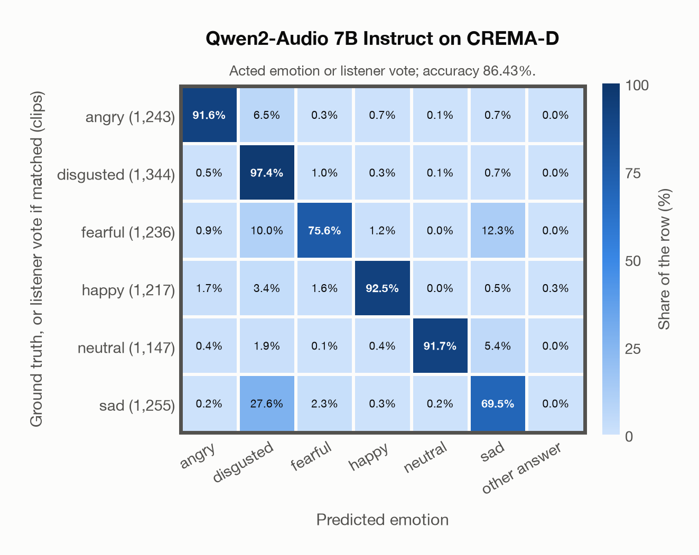

# Qwen2-Audio 7B Instruct on CREMA-D

Regenerated offline from saved CSV/JSON by `scripts/evaluation/refresh_reports.py`. This refresh performs no model inference or API requests.

## Summary

| Metric | Recomputed value |
|---|---:|
| Clips | 7,442 |
| Accuracy: acted emotion | 83.20% |
| UAR: mean ground-truth-row recall | 83.39% |
| Macro F1 | 83.66% |
| Weighted F1: true-support weighted | 83.45% |
| Accuracy: all model classes | 83.20% |
| Invalid / outside-candidate answers | 4 (0.05%) |
| Accuracy: acted emotion or listener vote | 86.43% |
| Single listener vote vs acted emotion | 45.59% |
| Model vs single listener vote | 44.40% |

## Imported run and verification

- Source: [prediction CSV](../../outputs/qwen2_audio_7b/crema_d_predictions.csv) and [metadata JSON](../../outputs/qwen2_audio_7b/crema_d_predictions.json); both remain byte-for-byte unchanged.
- Original execution date recorded in JSON: `2026-11-12`.
- Dataset scope recorded in JSON: **CREMA-D**, English; 7,442 / 7,442 clips.
- Ground-truth column: `acted_emotion`. Candidate classes: angry, disgusted, fearful, happy, neutral, sad.
- Row counts, unique audio paths, correctness flags and saved metrics were checked against the CSV. Metric agreement tolerance is 0.000001 (six-decimal metadata).
- Weighted F1 weights each class's F1 by its true support, using the same resolved truth as macro F1; invalid answers remain errors. New metrics absent from the source JSON are recorded in the offline audit and summaries; the source JSON is preserved.
- Saved candidate/prompt/model protocol matches current configuration: scope `dataset`, model `Qwen/Qwen2-Audio-7B-Instruct`, prompt hash `8bf25e176a1f`.
- Original execution/client runtime metadata (reported by the imported run, not measured by this refresh): `{"device": "mps", "hardware": "Apple M4 Max", "seconds": 1080.3, "ms_per_clip": 145.2, "on_cpu": 0}`.
- Saved p_* columns encode the returned answer as one-hot values; they are not calibrated API class probabilities, and no confidence plot is inferred from them.
- A raw responses journal is present; this refresh validates CSV/JSON only.

## Prediction distribution

Counts and shares use all saved samples. The invalid bucket combines `invalid` and `other answer`: answers outside the dataset's candidate classes remain errors.

| Predicted label | Clips | Share of all clips |
|---|---:|---:|
| angry | 1,185 | 15.92% |
| disgusted | 1,923 | 25.84% |
| fearful | 1,000 | 13.44% |
| happy | 1,163 | 15.63% |
| neutral | 1,056 | 14.19% |
| sad | 1,111 | 14.93% |
| invalid / outside candidates | 4 | 0.05% |

## Results per emotion

| Ground-truth emotion | Clips | Recall | Acted-or-listener recall |
|---|---:|---:|---:|
| angry | 1,271 | 87.73% | 91.82% |
| disgusted | 1,271 | 96.07% | 97.25% |
| fearful | 1,271 | 71.52% | 76.24% |
| happy | 1,271 | 88.51% | 92.84% |
| neutral | 1,087 | 90.98% | 91.26% |
| sad | 1,271 | 65.54% | 69.87% |

Precision/F1 use the same resolved-truth convention as the evaluation script. Weighted F1 uses the resolved-truth clip counts below as weights.

| Predicted emotion | Resolved-truth clips | Precision | Recall | F1 |
|---|---:|---:|---:|---:|
| angry | 1,271 | 94.09% | 87.73% | 90.80% |
| disgusted | 1,271 | 63.49% | 96.07% | 76.46% |
| fearful | 1,271 | 90.90% | 71.52% | 80.05% |
| happy | 1,271 | 96.73% | 88.51% | 92.44% |
| neutral | 1,087 | 93.66% | 90.98% | 92.30% |
| sad | 1,271 | 74.98% | 65.54% | 69.94% |

## Confusion matrix: acted emotion

| Ground truth \ Predicted | angry | disgusted | fearful | happy | neutral | sad | other answer |
|---|---|---|---|---|---|---|---|
| angry (1,271) | **87.7%** | 9.7% | 0.6% | 0.7% | 0.6% | 0.8% | 0.0% |
| disgusted (1,271) | 1.2% | **96.1%** | 1.2% | 0.4% | 0.4% | 0.8% | 0.0% |
| fearful (1,271) | 1.3% | 10.6% | **71.5%** | 1.2% | 0.6% | 14.8% | 0.0% |
| happy (1,271) | 2.5% | 3.7% | 2.3% | **88.5%** | 2.2% | 0.5% | 0.3% |
| neutral (1,087) | 0.5% | 2.1% | 0.1% | 0.5% | **91.0%** | 5.9% | 0.0% |
| sad (1,271) | 0.2% | 29.4% | 3.1% | 0.3% | 1.5% | **65.5%** | 0.0% |

## Confusion matrix: acted emotion or listener vote

A prediction accepted only through the listener vote is placed in that predicted emotion's row; other clips keep their original ground-truth row. Row supports can therefore change.

| Ground truth \ Predicted | angry | disgusted | fearful | happy | neutral | sad | other answer |
|---|---|---|---|---|---|---|---|
| angry (1,243) | **91.6%** | 6.5% | 0.3% | 0.7% | 0.1% | 0.7% | 0.0% |
| disgusted (1,344) | 0.5% | **97.4%** | 1.0% | 0.3% | 0.1% | 0.7% | 0.0% |
| fearful (1,236) | 0.9% | 10.0% | **75.6%** | 1.2% | 0.0% | 12.3% | 0.0% |
| happy (1,217) | 1.7% | 3.4% | 1.6% | **92.5%** | 0.0% | 0.5% | 0.3% |
| neutral (1,147) | 0.4% | 1.9% | 0.1% | 0.4% | **91.7%** | 5.4% | 0.0% |
| sad (1,255) | 0.2% | 27.6% | 2.3% | 0.3% | 0.2% | **69.5%** | 0.0% |

## Caveats

- **Training involvement for Qwen2-Audio 7B Instruct: No corpus-specific evidence**. Source: Qwen-7B and Whisper-large-v3 initialization; report states evaluation-data exclusion, but full backbone and pre/post-training corpus provenance is unavailable. Direct use and upstream teacher use both count as training involvement. No pattern: no corpus-specific evidence, not verified unseen. Corpus use is not test-clip leakage.
- The known empty CREMA-D recording 1076_MTI_SAD_XX.wav is retained in the saved predictions, matching the existing project evaluation scope.
- Internal CSV/JSON consistency does not authenticate the original model or remote request logs.

[Offline validation audit](crema_d_offline_audit.json)
