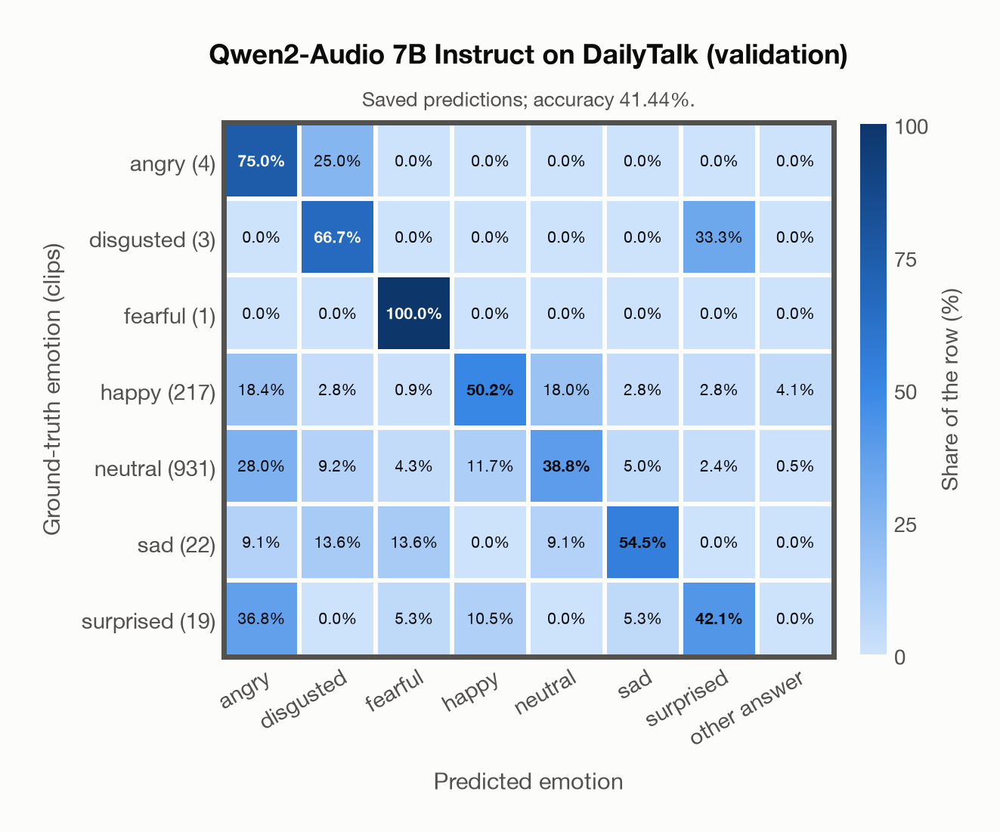

# Qwen2-Audio 7B Instruct on DailyTalk (validation)

Regenerated offline from saved CSV/JSON by `scripts/evaluation/refresh_reports.py`. This refresh performs no model inference or API requests.

## Summary

| Metric | Recomputed value |
|---|---:|
| Clips | 1,197 |
| Accuracy: acted emotion | 41.44% |
| UAR: mean ground-truth-row recall | 61.05% |
| Macro F1 | 24.27% |
| Weighted F1: true-support weighted | 52.15% |
| Accuracy: all model classes | 41.44% |
| Invalid / outside-candidate answers | 14 (1.17%) |

## Imported run and verification

- Source: [prediction CSV](../../outputs/qwen2_audio_7b/dailytalk_predictions.csv) and [metadata JSON](../../outputs/qwen2_audio_7b/dailytalk_predictions.json); both remain byte-for-byte unchanged.
- Original execution date recorded in JSON: `2026-11-14`.
- Dataset scope recorded in JSON: **DailyTalk (validation)**, English; 1,197 / 1,197 clips.
- Ground-truth column: `acted_emotion`. Candidate classes: angry, disgusted, fearful, happy, neutral, sad, surprised.
- Row counts, unique audio paths, correctness flags and saved metrics were checked against the CSV. Metric agreement tolerance is 0.000001 (six-decimal metadata).
- Weighted F1 weights each class's F1 by its true support, using the same resolved truth as macro F1; invalid answers remain errors. New metrics absent from the source JSON are recorded in the offline audit and summaries; the source JSON is preserved.
- Saved candidate/prompt/model protocol matches current configuration: scope `dataset`, model `Qwen/Qwen2-Audio-7B-Instruct`, prompt hash `aab2967fd07a`.
- Original execution/client runtime metadata (reported by the imported run, not measured by this refresh): `{"device": "mps", "hardware": "Apple M4 Max", "seconds": 1772.9, "ms_per_clip": 1481.2, "on_cpu": 0}`.
- Saved p_* columns encode the returned answer as one-hot values; they are not calibrated API class probabilities, and no confidence plot is inferred from them.
- A raw responses journal is present; this refresh validates CSV/JSON only.
- Small original ground-truth classes (at most 5 clips): angry (4 clips), disgusted (3 clips), fearful (1 clip). UAR gives each original ground-truth row equal weight; recalls from these small supports should be interpreted with care.

## Prediction distribution

Counts and shares use all saved samples. The invalid bucket combines `invalid` and `other answer`: answers outside the dataset's candidate classes remain errors.

| Predicted label | Clips | Share of all clips |
|---|---:|---:|
| angry | 313 | 26.15% |
| disgusted | 98 | 8.19% |
| fearful | 47 | 3.93% |
| happy | 220 | 18.38% |
| neutral | 402 | 33.58% |
| sad | 66 | 5.51% |
| surprised | 37 | 3.09% |
| invalid / outside candidates | 14 | 1.17% |

## Results per emotion

| Ground-truth emotion | Clips | Recall | Acted-or-listener recall |
|---|---:|---:|---:|
| angry | 4 | 75.00% | — |
| disgusted | 3 | 66.67% | — |
| fearful | 1 | 100.00% | — |
| happy | 217 | 50.23% | — |
| neutral | 931 | 38.78% | — |
| sad | 22 | 54.55% | — |
| surprised | 19 | 42.11% | — |

Precision/F1 use the same resolved-truth convention as the evaluation script. Weighted F1 uses the resolved-truth clip counts below as weights.

| Predicted emotion | Resolved-truth clips | Precision | Recall | F1 |
|---|---:|---:|---:|---:|
| angry | 4 | 0.96% | 75.00% | 1.89% |
| disgusted | 3 | 2.04% | 66.67% | 3.96% |
| fearful | 1 | 2.13% | 100.00% | 4.17% |
| happy | 217 | 49.55% | 50.23% | 49.89% |
| neutral | 931 | 89.80% | 38.78% | 54.16% |
| sad | 22 | 18.18% | 54.55% | 27.27% |
| surprised | 19 | 21.62% | 42.11% | 28.57% |

## Confusion matrix: acted emotion

| Ground truth \ Predicted | angry | disgusted | fearful | happy | neutral | sad | surprised | other answer |
|---|---|---|---|---|---|---|---|---|
| angry (4) | **75.0%** | 25.0% | 0.0% | 0.0% | 0.0% | 0.0% | 0.0% | 0.0% |
| disgusted (3) | 0.0% | **66.7%** | 0.0% | 0.0% | 0.0% | 0.0% | 33.3% | 0.0% |
| fearful (1) | 0.0% | 0.0% | **100.0%** | 0.0% | 0.0% | 0.0% | 0.0% | 0.0% |
| happy (217) | 18.4% | 2.8% | 0.9% | **50.2%** | 18.0% | 2.8% | 2.8% | 4.1% |
| neutral (931) | 28.0% | 9.2% | 4.3% | 11.7% | **38.8%** | 5.0% | 2.4% | 0.5% |
| sad (22) | 9.1% | 13.6% | 13.6% | 0.0% | 9.1% | **54.5%** | 0.0% | 0.0% |
| surprised (19) | 36.8% | 0.0% | 5.3% | 10.5% | 0.0% | 5.3% | **42.1%** | 0.0% |

## Caveats

- **Training involvement for Qwen2-Audio 7B Instruct: No corpus-specific evidence**. Source: Qwen-7B and Whisper-large-v3 initialization; report states evaluation-data exclusion, but full backbone and pre/post-training corpus provenance is unavailable. Direct use and upstream teacher use both count as training involvement. No pattern: no corpus-specific evidence, not verified unseen. Corpus use is not test-clip leakage.
- Internal CSV/JSON consistency does not authenticate the original model or remote request logs.

[Offline validation audit](dailytalk_offline_audit.json)
