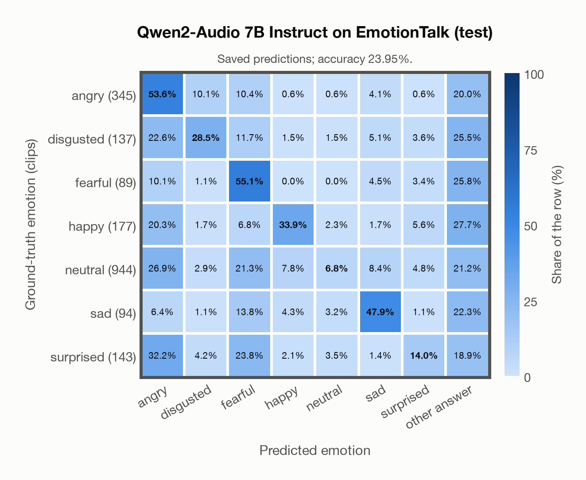

# Qwen2-Audio 7B Instruct on EmotionTalk (test)

Regenerated offline from saved CSV/JSON by `scripts/evaluation/refresh_reports.py`. This refresh performs no model inference or API requests.

## Summary

| Metric | Recomputed value |
|---|---:|
| Clips | 1,929 |
| Accuracy: acted emotion | 23.95% |
| UAR: mean ground-truth-row recall | 34.24% |
| Macro F1 | 28.17% |
| Weighted F1: true-support weighted | 23.09% |
| Accuracy: all model classes | 23.95% |
| Invalid / outside-candidate answers | 424 (21.98%) |

## Imported run and verification

- Source: [prediction CSV](../../outputs/qwen2_audio_7b/emotiontalk_predictions.csv) and [metadata JSON](../../outputs/qwen2_audio_7b/emotiontalk_predictions.json); both remain byte-for-byte unchanged.
- Original execution date recorded in JSON: `2026-11-14`.
- Dataset scope recorded in JSON: **EmotionTalk (test)**, Mandarin; 1,929 / 1,929 clips.
- Ground-truth column: `acted_emotion`. Candidate classes: angry, disgusted, fearful, happy, neutral, sad, surprised.
- Row counts, unique audio paths, correctness flags and saved metrics were checked against the CSV. Metric agreement tolerance is 0.000001 (six-decimal metadata).
- Weighted F1 weights each class's F1 by its true support, using the same resolved truth as macro F1; invalid answers remain errors. New metrics absent from the source JSON are recorded in the offline audit and summaries; the source JSON is preserved.
- Saved candidate/prompt/model protocol matches current configuration: scope `dataset`, model `Qwen/Qwen2-Audio-7B-Instruct`, prompt hash `aab2967fd07a`.
- Original execution/client runtime metadata (reported by the imported run, not measured by this refresh): `{"device": "mps", "hardware": "Apple M4 Max", "seconds": 5396.6, "ms_per_clip": 2797.6, "on_cpu": 0}`.
- Saved p_* columns encode the returned answer as one-hot values; they are not calibrated API class probabilities, and no confidence plot is inferred from them.
- A raw responses journal is present; this refresh validates CSV/JSON only.

## Prediction distribution

Counts and shares use all saved samples. The invalid bucket combines `invalid` and `other answer`: answers outside the dataset's candidate classes remain errors.

| Predicted label | Clips | Share of all clips |
|---|---:|---:|
| angry | 567 | 29.39% |
| disgusted | 112 | 5.81% |
| fearful | 361 | 18.71% |
| happy | 145 | 7.52% |
| neutral | 80 | 4.15% |
| sad | 154 | 7.98% |
| surprised | 86 | 4.46% |
| invalid / outside candidates | 424 | 21.98% |

## Results per emotion

| Ground-truth emotion | Clips | Recall | Acted-or-listener recall |
|---|---:|---:|---:|
| angry | 345 | 53.62% | — |
| disgusted | 137 | 28.47% | — |
| fearful | 89 | 55.06% | — |
| happy | 177 | 33.90% | — |
| neutral | 944 | 6.78% | — |
| sad | 94 | 47.87% | — |
| surprised | 143 | 13.99% | — |

Precision/F1 use the same resolved-truth convention as the evaluation script. Weighted F1 uses the resolved-truth clip counts below as weights.

| Predicted emotion | Resolved-truth clips | Precision | Recall | F1 |
|---|---:|---:|---:|---:|
| angry | 345 | 32.63% | 53.62% | 40.57% |
| disgusted | 137 | 34.82% | 28.47% | 31.33% |
| fearful | 89 | 13.57% | 55.06% | 21.78% |
| happy | 177 | 41.38% | 33.90% | 37.27% |
| neutral | 944 | 80.00% | 6.78% | 12.50% |
| sad | 94 | 29.22% | 47.87% | 36.29% |
| surprised | 143 | 23.26% | 13.99% | 17.47% |

## Confusion matrix: acted emotion

| Ground truth \ Predicted | angry | disgusted | fearful | happy | neutral | sad | surprised | other answer |
|---|---|---|---|---|---|---|---|---|
| angry (345) | **53.6%** | 10.1% | 10.4% | 0.6% | 0.6% | 4.1% | 0.6% | 20.0% |
| disgusted (137) | 22.6% | **28.5%** | 11.7% | 1.5% | 1.5% | 5.1% | 3.6% | 25.5% |
| fearful (89) | 10.1% | 1.1% | **55.1%** | 0.0% | 0.0% | 4.5% | 3.4% | 25.8% |
| happy (177) | 20.3% | 1.7% | 6.8% | **33.9%** | 2.3% | 1.7% | 5.6% | 27.7% |
| neutral (944) | 26.9% | 2.9% | 21.3% | 7.8% | **6.8%** | 8.4% | 4.8% | 21.2% |
| sad (94) | 6.4% | 1.1% | 13.8% | 4.3% | 3.2% | **47.9%** | 1.1% | 22.3% |
| surprised (143) | 32.2% | 4.2% | 23.8% | 2.1% | 3.5% | 1.4% | **14.0%** | 18.9% |

## Caveats

- **Training involvement for Qwen2-Audio 7B Instruct: No corpus-specific evidence**. Source: Qwen-7B and Whisper-large-v3 initialization; report states evaluation-data exclusion, but full backbone and pre/post-training corpus provenance is unavailable. Direct use and upstream teacher use both count as training involvement. No pattern: no corpus-specific evidence, not verified unseen. Corpus use is not test-clip leakage.
- Internal CSV/JSON consistency does not authenticate the original model or remote request logs.

[Offline validation audit](emotiontalk_offline_audit.json)
