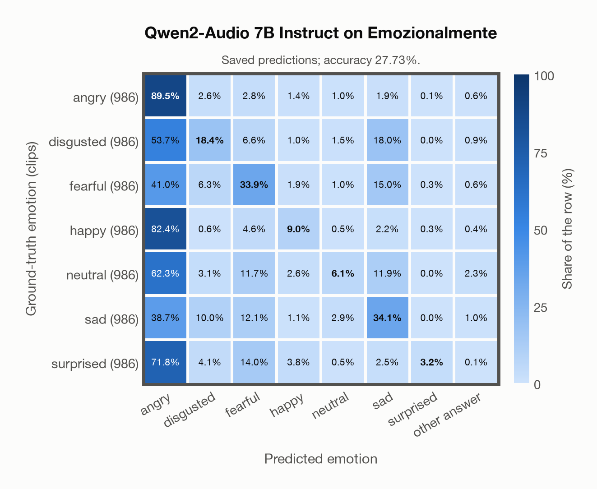
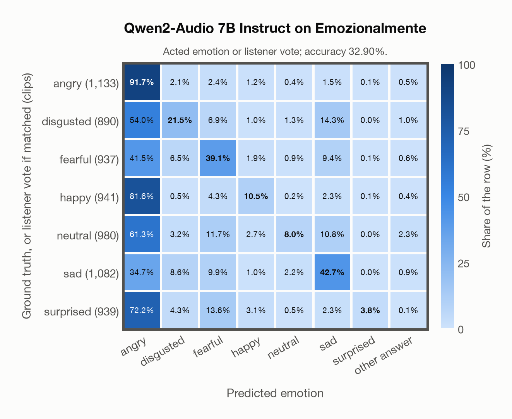

# Qwen2-Audio 7B Instruct on Emozionalmente

Regenerated offline from saved CSV/JSON by `scripts/evaluation/refresh_reports.py`. This refresh performs no model inference or API requests.

## Summary

| Metric | Recomputed value |
|---|---:|
| Clips | 6,902 |
| Accuracy: acted emotion | 27.73% |
| UAR: mean ground-truth-row recall | 27.73% |
| Macro F1 | 23.37% |
| Weighted F1: true-support weighted | 23.37% |
| Accuracy: all model classes | 27.73% |
| Invalid / outside-candidate answers | 59 (0.85%) |
| Accuracy: acted emotion or listener vote | 32.90% |
| Single listener vote vs acted emotion | 81.22% |
| Model vs single listener vote | 27.56% |

## Imported run and verification

- Source: [prediction CSV](../../outputs/qwen2_audio_7b/emozionalmente_predictions.csv) and [metadata JSON](../../outputs/qwen2_audio_7b/emozionalmente_predictions.json); both remain byte-for-byte unchanged.
- Original execution date recorded in JSON: `2026-11-14`.
- Dataset scope recorded in JSON: **Emozionalmente**, Italian; 6,902 / 6,902 clips.
- Ground-truth column: `acted_emotion`. Candidate classes: angry, disgusted, fearful, happy, neutral, sad, surprised.
- Row counts, unique audio paths, correctness flags and saved metrics were checked against the CSV. Metric agreement tolerance is 0.000001 (six-decimal metadata).
- Weighted F1 weights each class's F1 by its true support, using the same resolved truth as macro F1; invalid answers remain errors. New metrics absent from the source JSON are recorded in the offline audit and summaries; the source JSON is preserved.
- Saved candidate/prompt/model protocol matches current configuration: scope `dataset`, model `Qwen/Qwen2-Audio-7B-Instruct`, prompt hash `aab2967fd07a`.
- Original execution/client runtime metadata (reported by the imported run, not measured by this refresh): `{"device": "mps", "hardware": "Apple M4 Max", "seconds": 10491.0, "ms_per_clip": 1520.0, "on_cpu": 0}`.
- Saved p_* columns encode the returned answer as one-hot values; they are not calibrated API class probabilities, and no confidence plot is inferred from them.
- A raw responses journal is present; this refresh validates CSV/JSON only.

## Prediction distribution

Counts and shares use all saved samples. The invalid bucket combines `invalid` and `other answer`: answers outside the dataset's candidate classes remain errors.

| Predicted label | Clips | Share of all clips |
|---|---:|---:|
| angry | 4,331 | 62.75% |
| disgusted | 445 | 6.45% |
| fearful | 844 | 12.23% |
| happy | 206 | 2.98% |
| neutral | 134 | 1.94% |
| sad | 844 | 12.23% |
| surprised | 39 | 0.57% |
| invalid / outside candidates | 59 | 0.85% |

## Results per emotion

| Ground-truth emotion | Clips | Recall | Acted-or-listener recall |
|---|---:|---:|---:|
| angry | 986 | 89.45% | 90.47% |
| disgusted | 986 | 18.36% | 29.11% |
| fearful | 986 | 33.87% | 42.09% |
| happy | 986 | 9.03% | 14.60% |
| neutral | 986 | 6.09% | 8.52% |
| sad | 986 | 34.08% | 37.12% |
| surprised | 986 | 3.25% | 8.42% |

Precision/F1 use the same resolved-truth convention as the evaluation script. Weighted F1 uses the resolved-truth clip counts below as weights.

| Predicted emotion | Resolved-truth clips | Precision | Recall | F1 |
|---|---:|---:|---:|---:|
| angry | 986 | 20.36% | 89.45% | 33.18% |
| disgusted | 986 | 40.67% | 18.36% | 25.30% |
| fearful | 986 | 39.57% | 33.87% | 36.50% |
| happy | 986 | 43.20% | 9.03% | 14.93% |
| neutral | 986 | 44.78% | 6.09% | 10.71% |
| sad | 986 | 39.81% | 34.08% | 36.72% |
| surprised | 986 | 82.05% | 3.25% | 6.24% |

## Confusion matrix: acted emotion

| Ground truth \ Predicted | angry | disgusted | fearful | happy | neutral | sad | surprised | other answer |
|---|---|---|---|---|---|---|---|---|
| angry (986) | **89.5%** | 2.6% | 2.8% | 1.4% | 1.0% | 1.9% | 0.1% | 0.6% |
| disgusted (986) | 53.7% | **18.4%** | 6.6% | 1.0% | 1.5% | 18.0% | 0.0% | 0.9% |
| fearful (986) | 41.0% | 6.3% | **33.9%** | 1.9% | 1.0% | 15.0% | 0.3% | 0.6% |
| happy (986) | 82.4% | 0.6% | 4.6% | **9.0%** | 0.5% | 2.2% | 0.3% | 0.4% |
| neutral (986) | 62.3% | 3.1% | 11.7% | 2.6% | **6.1%** | 11.9% | 0.0% | 2.3% |
| sad (986) | 38.7% | 10.0% | 12.1% | 1.1% | 2.9% | **34.1%** | 0.0% | 1.0% |
| surprised (986) | 71.8% | 4.1% | 14.0% | 3.8% | 0.5% | 2.5% | **3.2%** | 0.1% |

## Confusion matrix: acted emotion or listener vote

A prediction accepted only through the listener vote is placed in that predicted emotion's row; other clips keep their original ground-truth row. Row supports can therefore change.

| Ground truth \ Predicted | angry | disgusted | fearful | happy | neutral | sad | surprised | other answer |
|---|---|---|---|---|---|---|---|---|
| angry (1,133) | **91.7%** | 2.1% | 2.4% | 1.2% | 0.4% | 1.5% | 0.1% | 0.5% |
| disgusted (890) | 54.0% | **21.5%** | 6.9% | 1.0% | 1.3% | 14.3% | 0.0% | 1.0% |
| fearful (937) | 41.5% | 6.5% | **39.1%** | 1.9% | 0.9% | 9.4% | 0.1% | 0.6% |
| happy (941) | 81.6% | 0.5% | 4.3% | **10.5%** | 0.2% | 2.3% | 0.1% | 0.4% |
| neutral (980) | 61.3% | 3.2% | 11.7% | 2.7% | **8.0%** | 10.8% | 0.0% | 2.3% |
| sad (1,082) | 34.7% | 8.6% | 9.9% | 1.0% | 2.2% | **42.7%** | 0.0% | 0.9% |
| surprised (939) | 72.2% | 4.3% | 13.6% | 3.1% | 0.5% | 2.3% | **3.8%** | 0.1% |

## Caveats

- **Training involvement for Qwen2-Audio 7B Instruct: No corpus-specific evidence**. Source: Qwen-7B and Whisper-large-v3 initialization; report states evaluation-data exclusion, but full backbone and pre/post-training corpus provenance is unavailable. Direct use and upstream teacher use both count as training involvement. No pattern: no corpus-specific evidence, not verified unseen. Corpus use is not test-clip leakage.
- Internal CSV/JSON consistency does not authenticate the original model or remote request logs.

[Offline validation audit](emozionalmente_offline_audit.json)
