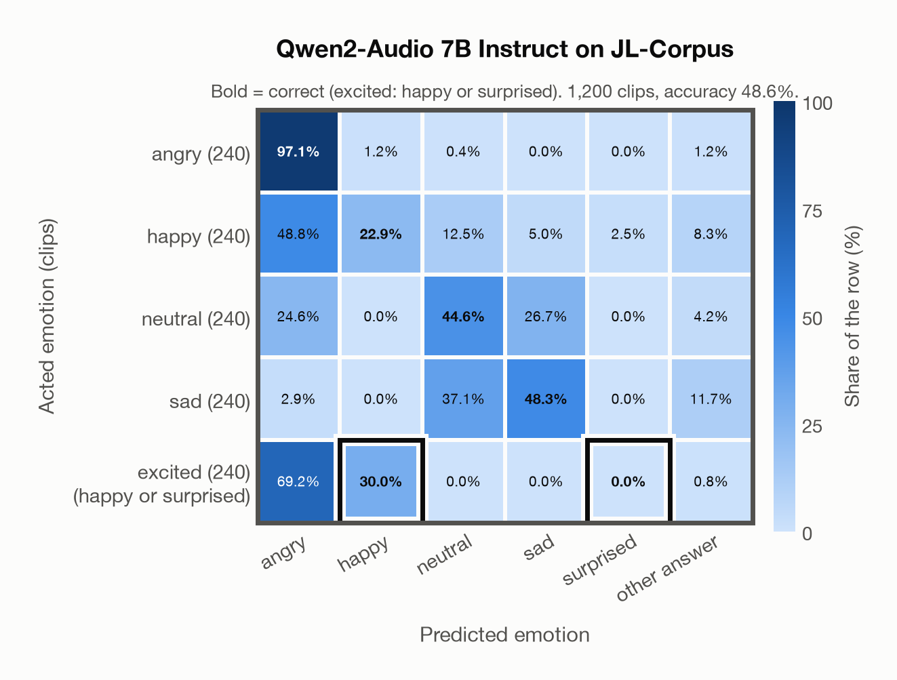

# Qwen2-Audio 7B Instruct on JL-Corpus

Generated by `scripts/evaluation/evaluate.py` on 2026-11-13.

## Summary

| Metric | Value |
|---|---|
| Clips evaluated | 1,200 (English (New Zealand)) |
| **Accuracy: prediction matches the acted emotion** | **48.6%** |
| Unweighted accuracy (mean recall of the 5 acted emotions) | 48.6% |
| Macro F1 (acted emotion, over the 5 predicted emotions) | 39.6% |
| Weighted F1 (by resolved-truth class support) | 47.9% |
| Accuracy, all 8 model classes (acted emotion) | 48.6% |
| Chance level (5 emotions; excited accepts 2) | 24.0% |

## Setup

- **Model**: Qwen2-Audio 7B Instruct (`Qwen/Qwen2-Audio-7B-Instruct`) as released (no fine-tuning), transformers 5.18.0, loaded by `scripts/models/qwen2_audio.py`. Qwen2-Audio-7B-Instruct gets one conversation per clip in its chat template: the system prompt, then one user turn with the audio first and the user prompt after it (as in the model card), with the system and user prompts of `scripts/llm_eval/prompts.yaml` (the same as for GPT Realtime); the clip as 16 kHz mono (at most its first 30 s). Greedy decoding (do_sample=False, no repetition penalty), at most 24 new tokens, bfloat16 on `mps`, sdpa attention; so the answers are the same from run to run (up to rounding differences between devices). The answer is read by `scripts/llm_eval/parsing.py` and becomes a one-hot vector over the 7 configured emotions plus `invalid`. Allowed answers for this run: angry, happy, neutral, sad, surprised. An answer that is not exactly one allowed label gets a follow-up in the same conversation ("Answer with exactly one word from this list, in lowercase, and nothing else: angry, happy, neutral, sad, surprised."), up to 1 time(s); then `invalid`. An answer that is not one of the dataset's emotions counts as wrong (column *other answer* of the confusion matrices); the raw answers are in `outputs/qwen2_audio_7b/responses.jsonl`.
- **Data**: 1,200 clips of JL-Corpus (English (New Zealand)) from `data/jl_corpus/`.
- **Ground truth (acted emotion)**: the emotion each speaker was asked to portray, from the second part of the file name.
- Only the five primary emotions (1,200 of 2,400 clips): angry, happy, neutral and sad keep their names; **excited has no model class, so a prediction of happy or surprised counts as correct** for it (its label stays excited). The prediction is therefore chosen from angry, happy, neutral, sad and surprised, although no clip is acted surprised. The five secondary emotions (anxious, apologetic, assertive, concerned, encouraging) have no model class and are left out.
- Four trained voice actors of New Zealand English (two female, two male) say the same 15 sentences in each primary emotion, in two sessions, twice each.
- **5 emotions**: the prediction is the model's answer when it is one of the 5 emotions in this dataset (angry, happy, neutral, sad, surprised); any other answer (`disgusted`, `fearful`, `invalid`) counts as wrong, so the accuracy is the same with all 8 model classes.
- **Other answer**: for 63 clips the model's answer is none of the 5 emotions (an emotion this dataset does not have, or no readable answer). They count as wrong and have their own last column, *other answer*, in the confusion matrices; precision, recall and F1 are over the 5 emotions.
- **Composite label**: *excited* has no model class, so a prediction of happy or surprised counts as correct for it (also with all 8 model classes). Each such label has its own row in the confusion matrices, whose bold cells count as correct; its recall is the share of its clips predicted correctly, and chance level (24.0% instead of 20.0%) counts every class it accepts.
- **Hardware**: Apple M4 Max, device `mps`, PyTorch 2.7.1. Inference took 29.4 min (1472 ms per clip; answers saved by an earlier run take no time).
- **Per-clip predictions**: `outputs/qwen2_audio_7b/jl_corpus_predictions.csv` (in git, so the results can be checked clip by clip). The JSON file next to it describes the columns.

## Results per emotion

Rows: acted emotion. Recall: the share of the row's clips whose prediction counts as correct; unweighted accuracy is the mean of this column.

| Emotion | Clips | Recall |
|---|---|---|
| angry | 240 | 97.1% |
| happy | 240 | 22.9% |
| neutral | 240 | 44.6% |
| sad | 240 | 48.3% |
| excited (happy or surprised) | 240 | 30.0% |

Precision, recall and F1 of each predicted emotion compare the prediction with a resolved truth: the prediction when it counts as correct, otherwise the acted emotion, and for excited the first class it accepts (happy). So a correct excited clip counts as a clip of the emotion predicted, and a wrong one as happy. Clips: the clips of each resolved truth. Macro F1 is the mean of the F1 column. Weighted F1 weights that column by the resolved-truth clip counts, using the same resolution.

| Predicted emotion | Clips | Precision | Recall | F1 |
|---|---|---|---|---|
| angry | 240 | 40.0% | 97.1% | 56.7% |
| happy | 480 | 97.7% | 26.5% | 41.6% |
| neutral | 240 | 47.1% | 44.6% | 45.8% |
| sad | 240 | 60.4% | 48.3% | 53.7% |
| surprised | 0 | 0.0% | 0.0% | 0.0% |

## Confusion matrix: acted emotion

The same numbers as a table. Rows: acted emotion. Columns: predicted emotion. Each row adds up to 100%. Bold: the cells that count as correct. *other answer*: the answer is none of the dataset's emotions (wrong).

| Acted \ Predicted | angry | happy | neutral | sad | surprised | other answer |
|---|---|---|---|---|---|---|
| angry (240) | **97.1%** | 1.2% | 0.4% | 0.0% | 0.0% | 1.2% |
| happy (240) | 48.8% | **22.9%** | 12.5% | 5.0% | 2.5% | 8.3% |
| neutral (240) | 24.6% | 0.0% | **44.6%** | 26.7% | 0.0% | 4.2% |
| sad (240) | 2.9% | 0.0% | 37.1% | **48.3%** | 0.0% | 11.7% |
| excited (happy or surprised) (240) | 69.2% | **30.0%** | 0.0% | 0.0% | **0.0%** | 0.8% |

Most frequent confusions: excited predicted as angry (69.2%), happy predicted as angry (48.8%), sad predicted as neutral (37.1%).

## Predictions outside the 5 emotions

With all 8 model classes, the model chose a class that this dataset does not have for 63 clips (5.2%): `disgusted` 0, `fearful` 0, `invalid` 63.

## Caveats

- **Training involvement for Qwen2-Audio 7B Instruct: No corpus-specific evidence**. Source: Qwen-7B and Whisper-large-v3 initialization; report states evaluation-data exclusion, but full backbone and pre/post-training corpus provenance is unavailable. Direct use and upstream teacher use both count as training involvement. No pattern: no corpus-specific evidence, not verified unseen. Corpus use is not test-clip leakage. The model may have heard these public datasets during training.
- *Excited* is neither *happy* nor *surprised*: excited clips predicted as happy or surprised count as correct. Surprised is a possible prediction only because of excited, and it is wrong for a clip of any other emotion.
- This is the raw corpus ("unchecked and unannotated"). In the authors' perception test (120 listeners) about 70% of the primary-emotion clips were recognised; the results per clip are not published, so poorly acted clips are included.
- Audio: 44.1 kHz WAV, resampled to 16 kHz.
