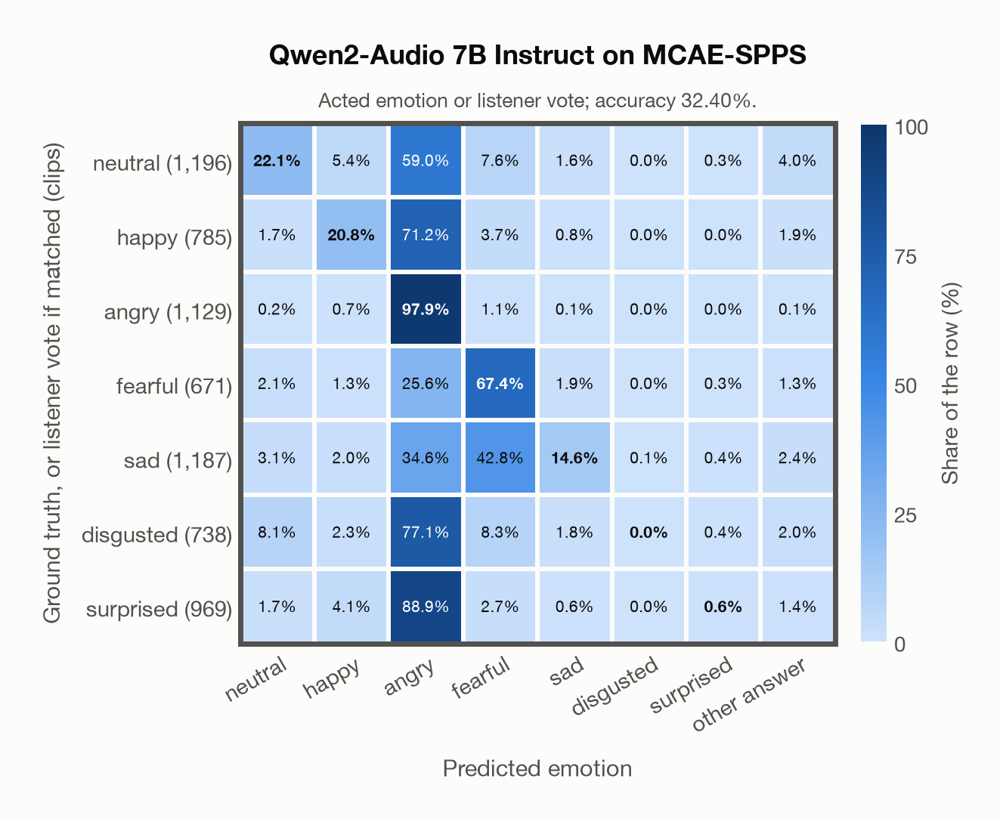

# Qwen2-Audio 7B Instruct on MCAE-SPPS

Regenerated offline from saved CSV/JSON by `scripts/evaluation/refresh_reports.py`. This refresh performs no model inference or API requests.

## Summary

| Metric | Recomputed value |
|---|---:|
| Clips | 6,675 |
| Accuracy: acted emotion | 32.40% |
| UAR: mean ground-truth-row recall | 31.90% |
| Macro F1 | 25.27% |
| Weighted F1: true-support weighted | 25.57% |
| Accuracy: all model classes | 32.40% |
| Invalid / outside-candidate answers | 130 (1.95%) |
| Accuracy: acted emotion or listener vote | 32.40% |
| Single listener vote vs acted emotion | 100.00% |
| Model vs single listener vote | 32.40% |

## Imported run and verification

- Source: [prediction CSV](../../outputs/qwen2_audio_7b/mcae_spps_predictions.csv) and [metadata JSON](../../outputs/qwen2_audio_7b/mcae_spps_predictions.json); both remain byte-for-byte unchanged.
- Original execution date recorded in JSON: `2026-11-12`.
- Dataset scope recorded in JSON: **MCAE-SPPS**, Mandarin; 6,675 / 6,675 clips.
- Ground-truth column: `acted_emotion`. Candidate classes: neutral, happy, angry, fearful, sad, disgusted, surprised.
- Row counts, unique audio paths, correctness flags and saved metrics were checked against the CSV. Metric agreement tolerance is 0.000001 (six-decimal metadata).
- Weighted F1 weights each class's F1 by its true support, using the same resolved truth as macro F1; invalid answers remain errors. New metrics absent from the source JSON are recorded in the offline audit and summaries; the source JSON is preserved.
- Saved candidate/prompt/model protocol matches current configuration: scope `dataset`, model `Qwen/Qwen2-Audio-7B-Instruct`, prompt hash `aab2967fd07a`.
- Original execution/client runtime metadata (reported by the imported run, not measured by this refresh): `{"device": "mps", "hardware": "Apple M4 Max", "seconds": 8584.9, "ms_per_clip": 1286.1, "on_cpu": 0}`.
- Saved p_* columns encode the returned answer as one-hot values; they are not calibrated API class probabilities, and no confidence plot is inferred from them.
- A raw responses journal is present; this refresh validates CSV/JSON only.

## Prediction distribution

Counts and shares use all saved samples. The invalid bucket combines `invalid` and `other answer`: answers outside the dataset's candidate classes remain errors.

| Predicted label | Clips | Share of all clips |
|---|---:|---:|
| neutral | 406 | 6.08% |
| happy | 326 | 4.88% |
| angry | 4,383 | 65.66% |
| fearful | 1,179 | 17.66% |
| sad | 231 | 3.46% |
| disgusted | 1 | 0.01% |
| surprised | 19 | 0.28% |
| invalid / outside candidates | 130 | 1.95% |

## Results per emotion

| Ground-truth emotion | Clips | Recall | Acted-or-listener recall |
|---|---:|---:|---:|
| neutral | 1,196 | 22.07% | 22.07% |
| happy | 785 | 20.76% | 20.76% |
| angry | 1,129 | 97.87% | 97.87% |
| fearful | 671 | 67.36% | 67.36% |
| sad | 1,187 | 14.57% | 14.57% |
| disgusted | 738 | 0.00% | 0.00% |
| surprised | 969 | 0.62% | 0.62% |

Precision/F1 use the same resolved-truth convention as the evaluation script. Weighted F1 uses the resolved-truth clip counts below as weights.

| Predicted emotion | Resolved-truth clips | Precision | Recall | F1 |
|---|---:|---:|---:|---:|
| neutral | 1,196 | 65.02% | 22.07% | 32.96% |
| happy | 785 | 50.00% | 20.76% | 29.34% |
| angry | 1,129 | 25.21% | 97.87% | 40.09% |
| fearful | 671 | 38.34% | 67.36% | 48.86% |
| sad | 1,187 | 74.89% | 14.57% | 24.40% |
| disgusted | 738 | 0.00% | 0.00% | 0.00% |
| surprised | 969 | 31.58% | 0.62% | 1.21% |

## Confusion matrix: acted emotion

| Ground truth \ Predicted | neutral | happy | angry | fearful | sad | disgusted | surprised | other answer |
|---|---|---|---|---|---|---|---|---|
| neutral (1,196) | **22.1%** | 5.4% | 59.0% | 7.6% | 1.6% | 0.0% | 0.3% | 4.0% |
| happy (785) | 1.7% | **20.8%** | 71.2% | 3.7% | 0.8% | 0.0% | 0.0% | 1.9% |
| angry (1,129) | 0.2% | 0.7% | **97.9%** | 1.1% | 0.1% | 0.0% | 0.0% | 0.1% |
| fearful (671) | 2.1% | 1.3% | 25.6% | **67.4%** | 1.9% | 0.0% | 0.3% | 1.3% |
| sad (1,187) | 3.1% | 2.0% | 34.6% | 42.8% | **14.6%** | 0.1% | 0.4% | 2.4% |
| disgusted (738) | 8.1% | 2.3% | 77.1% | 8.3% | 1.8% | **0.0%** | 0.4% | 2.0% |
| surprised (969) | 1.7% | 4.1% | 88.9% | 2.7% | 0.6% | 0.0% | **0.6%** | 1.4% |

## Confusion matrix: acted emotion or listener vote

A prediction accepted only through the listener vote is placed in that predicted emotion's row; other clips keep their original ground-truth row. Row supports can therefore change.

| Ground truth \ Predicted | neutral | happy | angry | fearful | sad | disgusted | surprised | other answer |
|---|---|---|---|---|---|---|---|---|
| neutral (1,196) | **22.1%** | 5.4% | 59.0% | 7.6% | 1.6% | 0.0% | 0.3% | 4.0% |
| happy (785) | 1.7% | **20.8%** | 71.2% | 3.7% | 0.8% | 0.0% | 0.0% | 1.9% |
| angry (1,129) | 0.2% | 0.7% | **97.9%** | 1.1% | 0.1% | 0.0% | 0.0% | 0.1% |
| fearful (671) | 2.1% | 1.3% | 25.6% | **67.4%** | 1.9% | 0.0% | 0.3% | 1.3% |
| sad (1,187) | 3.1% | 2.0% | 34.6% | 42.8% | **14.6%** | 0.1% | 0.4% | 2.4% |
| disgusted (738) | 8.1% | 2.3% | 77.1% | 8.3% | 1.8% | **0.0%** | 0.4% | 2.0% |
| surprised (969) | 1.7% | 4.1% | 88.9% | 2.7% | 0.6% | 0.0% | **0.6%** | 1.4% |

## Caveats

- **Training involvement for Qwen2-Audio 7B Instruct: No corpus-specific evidence**. Source: Qwen-7B and Whisper-large-v3 initialization; report states evaluation-data exclusion, but full backbone and pre/post-training corpus provenance is unavailable. Direct use and upstream teacher use both count as training involvement. No pattern: no corpus-specific evidence, not verified unseen. Corpus use is not test-clip leakage.
- Internal CSV/JSON consistency does not authenticate the original model or remote request logs.

[Offline validation audit](mcae_spps_offline_audit.json)
