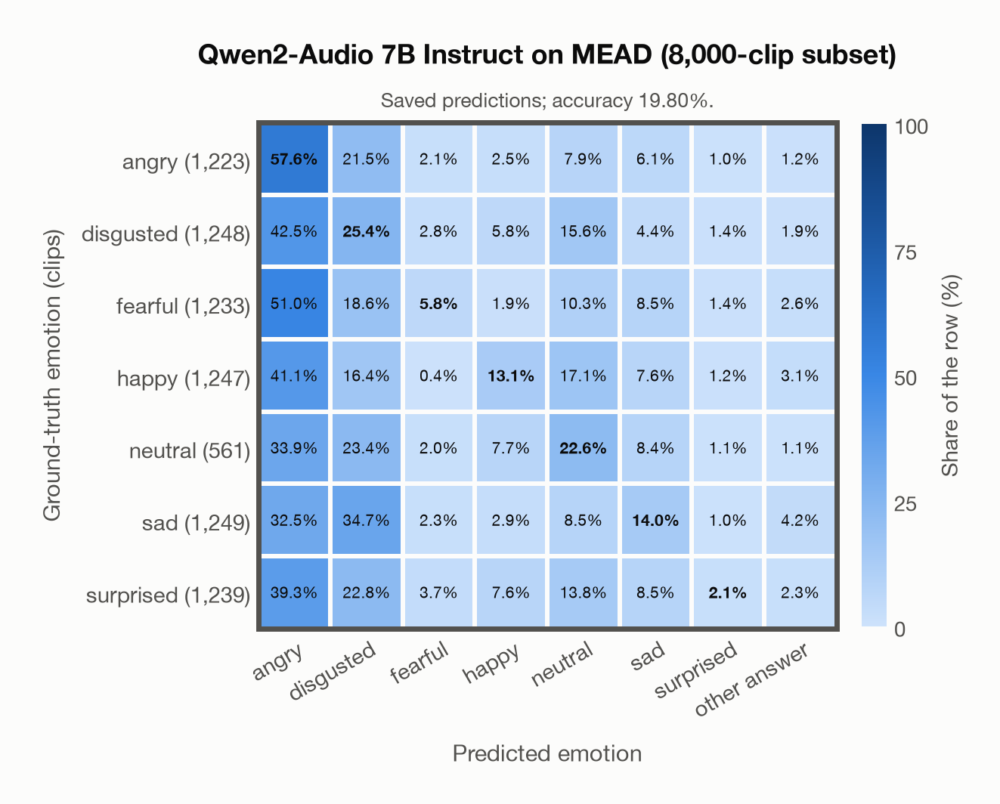

# Qwen2-Audio 7B Instruct on MEAD (8,000-clip subset)

Regenerated offline from saved CSV/JSON by `scripts/evaluation/refresh_reports.py`. This refresh performs no model inference or API requests.

## Summary

| Metric | Recomputed value |
|---|---:|
| Clips | 8,000 |
| Accuracy: acted emotion | 19.80% |
| UAR: mean ground-truth-row recall | 20.09% |
| Macro F1 | 16.78% |
| Weighted F1: true-support weighted | 16.84% |
| Accuracy: all model classes | 19.80% |
| Invalid / outside-candidate answers | 196 (2.45%) |

## Imported run and verification

- Source: [prediction CSV](../../outputs/qwen2_audio_7b/mead_predictions.csv) and [metadata JSON](../../outputs/qwen2_audio_7b/mead_predictions.json); both remain byte-for-byte unchanged.
- Original execution date recorded in JSON: `2026-11-13`.
- Dataset scope recorded in JSON: **MEAD (8,000-clip subset)**, English; 8,000 / 8,000 clips.
- Ground-truth column: `acted_emotion`. Candidate classes: angry, disgusted, fearful, happy, neutral, sad, surprised.
- Row counts, unique audio paths, correctness flags and saved metrics were checked against the CSV. Metric agreement tolerance is 0.000001 (six-decimal metadata).
- Weighted F1 weights each class's F1 by its true support, using the same resolved truth as macro F1; invalid answers remain errors. New metrics absent from the source JSON are recorded in the offline audit and summaries; the source JSON is preserved.
- Saved candidate/prompt/model protocol matches current configuration: scope `dataset`, model `Qwen/Qwen2-Audio-7B-Instruct`, prompt hash `aab2967fd07a`.
- Original execution/client runtime metadata (reported by the imported run, not measured by this refresh): `{"device": "mps", "hardware": "Apple M4 Max", "seconds": 12972.6, "ms_per_clip": 1621.6, "on_cpu": 0}`.
- Saved p_* columns encode the returned answer as one-hot values; they are not calibrated API class probabilities, and no confidence plot is inferred from them.
- A raw responses journal is present; this refresh validates CSV/JSON only.

## Prediction distribution

Counts and shares use all saved samples. The invalid bucket combines `invalid` and `other answer`: answers outside the dataset's candidate classes remain errors.

| Predicted label | Clips | Share of all clips |
|---|---:|---:|
| angry | 3,461 | 43.26% |
| disgusted | 1,859 | 23.24% |
| fearful | 223 | 2.79% |
| happy | 463 | 5.79% |
| neutral | 1,036 | 12.95% |
| sad | 656 | 8.20% |
| surprised | 106 | 1.32% |
| invalid / outside candidates | 196 | 2.45% |

## Results per emotion

| Ground-truth emotion | Clips | Recall | Acted-or-listener recall |
|---|---:|---:|---:|
| angry | 1,223 | 57.65% | — |
| disgusted | 1,248 | 25.40% | — |
| fearful | 1,233 | 5.76% | — |
| happy | 1,247 | 13.07% | — |
| neutral | 561 | 22.64% | — |
| sad | 1,249 | 14.01% | — |
| surprised | 1,239 | 2.10% | — |

Precision/F1 use the same resolved-truth convention as the evaluation script. Weighted F1 uses the resolved-truth clip counts below as weights.

| Predicted emotion | Resolved-truth clips | Precision | Recall | F1 |
|---|---:|---:|---:|---:|
| angry | 1,223 | 20.37% | 57.65% | 30.10% |
| disgusted | 1,248 | 17.05% | 25.40% | 20.41% |
| fearful | 1,233 | 31.84% | 5.76% | 9.75% |
| happy | 1,247 | 35.21% | 13.07% | 19.06% |
| neutral | 561 | 12.26% | 22.64% | 15.90% |
| sad | 1,249 | 26.68% | 14.01% | 18.37% |
| surprised | 1,239 | 24.53% | 2.10% | 3.87% |

## Confusion matrix: acted emotion

| Ground truth \ Predicted | angry | disgusted | fearful | happy | neutral | sad | surprised | other answer |
|---|---|---|---|---|---|---|---|---|
| angry (1,223) | **57.6%** | 21.5% | 2.1% | 2.5% | 7.9% | 6.1% | 1.0% | 1.2% |
| disgusted (1,248) | 42.5% | **25.4%** | 2.8% | 5.8% | 15.6% | 4.4% | 1.4% | 1.9% |
| fearful (1,233) | 51.0% | 18.6% | **5.8%** | 1.9% | 10.3% | 8.5% | 1.4% | 2.6% |
| happy (1,247) | 41.1% | 16.4% | 0.4% | **13.1%** | 17.1% | 7.6% | 1.2% | 3.1% |
| neutral (561) | 33.9% | 23.4% | 2.0% | 7.7% | **22.6%** | 8.4% | 1.1% | 1.1% |
| sad (1,249) | 32.5% | 34.7% | 2.3% | 2.9% | 8.5% | **14.0%** | 1.0% | 4.2% |
| surprised (1,239) | 39.3% | 22.8% | 3.7% | 7.6% | 13.8% | 8.5% | **2.1%** | 2.3% |

## Caveats

- **Training involvement for Qwen2-Audio 7B Instruct: No corpus-specific evidence**. Source: Qwen-7B and Whisper-large-v3 initialization; report states evaluation-data exclusion, but full backbone and pre/post-training corpus provenance is unavailable. Direct use and upstream teacher use both count as training involvement. No pattern: no corpus-specific evidence, not verified unseen. Corpus use is not test-clip leakage.
- Internal CSV/JSON consistency does not authenticate the original model or remote request logs.

[Offline validation audit](mead_offline_audit.json)
