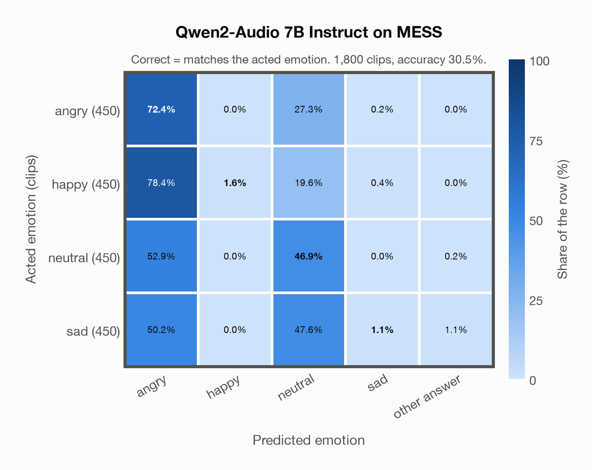

# Qwen2-Audio 7B Instruct on MESS

Generated by `scripts/evaluation/evaluate.py` on 2026-11-13.

## Summary

| Metric | Value |
|---|---|
| Clips evaluated | 1,800 (English) |
| **Accuracy: prediction matches the acted emotion** | **30.5%** |
| Unweighted accuracy (mean recall of the 4 acted emotions) | 30.5% |
| Macro F1 (acted emotion) | 21.3% |
| Weighted F1 (by class support) | 21.3% |
| Accuracy, all 8 model classes (acted emotion) | 30.5% |
| Chance level (4 emotions) | 25.0% |

## Setup

- **Model**: Qwen2-Audio 7B Instruct (`Qwen/Qwen2-Audio-7B-Instruct`) as released (no fine-tuning), transformers 5.18.0, loaded by `scripts/models/qwen2_audio.py`. Qwen2-Audio-7B-Instruct gets one conversation per clip in its chat template: the system prompt, then one user turn with the audio first and the user prompt after it (as in the model card), with the system and user prompts of `scripts/llm_eval/prompts.yaml` (the same as for GPT Realtime); the clip as 16 kHz mono (at most its first 30 s). Greedy decoding (do_sample=False, no repetition penalty), at most 24 new tokens, bfloat16 on `mps`, sdpa attention; so the answers are the same from run to run (up to rounding differences between devices). The answer is read by `scripts/llm_eval/parsing.py` and becomes a one-hot vector over the 7 configured emotions plus `invalid`. Allowed answers for this run: angry, happy, neutral, sad. An answer that is not exactly one allowed label gets a follow-up in the same conversation ("Answer with exactly one word from this list, in lowercase, and nothing else: angry, happy, neutral, sad."), up to 1 time(s); then `invalid`. An answer that is not one of the dataset's emotions counts as wrong (column *other answer* of the confusion matrices); the raw answers are in `outputs/qwen2_audio_7b/responses.jsonl`.
- **Data**: 1,800 clips of MESS (English) from `data/mess/`.
- **Ground truth (acted emotion)**: the emotion each speaker was asked to portray, from the first letter of the file name (`A`ngry, `C`alm, `H`appy, `S`ad).
- Label mapping: angry = angry, happy = happy, sad = sad, and **calm = neutral** (the project's emotions have no *calm*).
- **4 emotions**: the prediction is the model's answer when it is one of the 4 emotions in this dataset (angry, happy, neutral, sad); any other answer (`disgusted`, `fearful`, `surprised`, `invalid`) counts as wrong, so the accuracy is the same with all 8 model classes.
- **Other answer**: for 6 clips the model's answer is none of the 4 emotions (an emotion this dataset does not have, or no readable answer). They count as wrong and have their own last column, *other answer*, in the confusion matrices; precision, recall and F1 are over the 4 emotions.
- **Hardware**: Apple M4 Max, device `mps`, PyTorch 2.7.1. Inference took 41.4 min (1380 ms per clip; answers saved by an earlier run take no time).
- **Per-clip predictions**: `outputs/qwen2_audio_7b/mess_predictions.csv` (in git, so the results can be checked clip by clip). The JSON file next to it describes the columns.

## Results per emotion

Rows: acted emotion. Precision, recall and F1 compare the prediction with the acted emotion. Weighted F1 weights each class's F1 by its true clip count.

| Emotion | Clips | Precision | Recall | F1 |
|---|---|---|---|---|
| angry | 450 | 28.5% | 72.4% | 40.9% |
| happy | 450 | 100.0% | 1.6% | 3.1% |
| neutral | 450 | 33.2% | 46.9% | 38.9% |
| sad | 450 | 62.5% | 1.1% | 2.2% |

## Confusion matrix: acted emotion

The same numbers as a table. Rows: acted emotion. Columns: predicted emotion. Each row adds up to 100%. *other answer*: the answer is none of the dataset's emotions (wrong).

| Acted \ Predicted | angry | happy | neutral | sad | other answer |
|---|---|---|---|---|---|
| angry (450) | **72.4%** | 0.0% | 27.3% | 0.2% | 0.0% |
| happy (450) | 78.4% | **1.6%** | 19.6% | 0.4% | 0.0% |
| neutral (450) | 52.9% | 0.0% | **46.9%** | 0.0% | 0.2% |
| sad (450) | 50.2% | 0.0% | 47.6% | **1.1%** | 1.1% |

Most frequent confusions: happy predicted as angry (78.4%), neutral predicted as angry (52.9%), sad predicted as angry (50.2%).

## Predictions outside the 4 emotions

With all 8 model classes, the model chose a class that this dataset does not have for 6 clips (0.3%): `disgusted` 0, `fearful` 0, `surprised` 0, `invalid` 6.

## Caveats

- **Training involvement for Qwen2-Audio 7B Instruct: No corpus-specific evidence**. Source: Qwen-7B and Whisper-large-v3 initialization; report states evaluation-data exclusion, but full backbone and pre/post-training corpus provenance is unavailable. Direct use and upstream teacher use both count as training involvement. No pattern: no corpus-specific evidence, not verified unseen. Corpus use is not test-clip leakage. The model may have heard these public datasets during training.
- *Calm* is not quite *neutral*: calm clips predicted as neutral count as correct.
- The public version has 1,800 clips and acted labels only; the listeners' ratings are available from the author on request. Audio is sampled at 24,414 Hz, resampled to 16 kHz.
