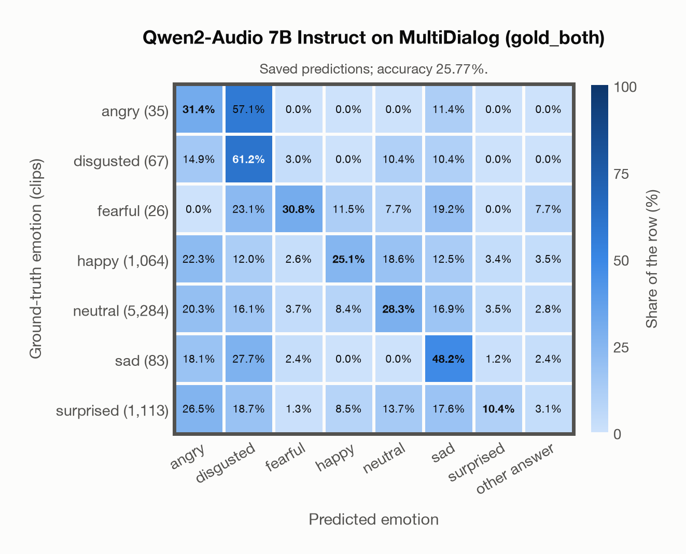

# Qwen2-Audio 7B Instruct on MultiDialog (gold_both)

Regenerated offline from saved CSV/JSON by `scripts/evaluation/refresh_reports.py`. This refresh performs no model inference or API requests.

## Summary

| Metric | Recomputed value |
|---|---:|
| Clips | 7,672 |
| Accuracy: acted emotion | 25.77% |
| UAR: mean ground-truth-row recall | 33.62% |
| Macro F1 | 15.06% |
| Weighted F1: true-support weighted | 35.25% |
| Accuracy: all model classes | 25.77% |
| Invalid / outside-candidate answers | 223 (2.91%) |

## Imported run and verification

- Source: [prediction CSV](../../outputs/qwen2_audio_7b/multidialog_predictions.csv) and [metadata JSON](../../outputs/qwen2_audio_7b/multidialog_predictions.json); both remain byte-for-byte unchanged.
- Original execution date recorded in JSON: `2026-11-14`.
- Dataset scope recorded in JSON: **MultiDialog (gold_both)**, English; 7,672 / 7,672 clips.
- Ground-truth column: `acted_emotion`. Candidate classes: angry, disgusted, fearful, happy, neutral, sad, surprised.
- Row counts, unique audio paths, correctness flags and saved metrics were checked against the CSV. Metric agreement tolerance is 0.000001 (six-decimal metadata).
- Weighted F1 weights each class's F1 by its true support, using the same resolved truth as macro F1; invalid answers remain errors. New metrics absent from the source JSON are recorded in the offline audit and summaries; the source JSON is preserved.
- Saved candidate/prompt/model protocol matches current configuration: scope `dataset`, model `Qwen/Qwen2-Audio-7B-Instruct`, prompt hash `aab2967fd07a`.
- Original execution/client runtime metadata (reported by the imported run, not measured by this refresh): `{"device": "mps", "hardware": "Apple M4 Max", "seconds": 13724.4, "ms_per_clip": 1788.9, "on_cpu": 0}`.
- Saved p_* columns encode the returned answer as one-hot values; they are not calibrated API class probabilities, and no confidence plot is inferred from them.
- A raw responses journal is present; this refresh validates CSV/JSON only.

## Prediction distribution

Counts and shares use all saved samples. The invalid bucket combines `invalid` and `other answer`: answers outside the dataset's candidate classes remain errors.

| Predicted label | Clips | Share of all clips |
|---|---:|---:|
| angry | 1,641 | 21.39% |
| disgusted | 1,279 | 16.67% |
| fearful | 252 | 3.28% |
| happy | 809 | 10.54% |
| neutral | 1,854 | 24.17% |
| sad | 1,278 | 16.66% |
| surprised | 336 | 4.38% |
| invalid / outside candidates | 223 | 2.91% |

## Results per emotion

| Ground-truth emotion | Clips | Recall | Acted-or-listener recall |
|---|---:|---:|---:|
| angry | 35 | 31.43% | — |
| disgusted | 67 | 61.19% | — |
| fearful | 26 | 30.77% | — |
| happy | 1,064 | 25.09% | — |
| neutral | 5,284 | 28.27% | — |
| sad | 83 | 48.19% | — |
| surprised | 1,113 | 10.42% | — |

Precision/F1 use the same resolved-truth convention as the evaluation script. Weighted F1 uses the resolved-truth clip counts below as weights.

| Predicted emotion | Resolved-truth clips | Precision | Recall | F1 |
|---|---:|---:|---:|---:|
| angry | 35 | 0.67% | 31.43% | 1.31% |
| disgusted | 67 | 3.21% | 61.19% | 6.09% |
| fearful | 26 | 3.17% | 30.77% | 5.76% |
| happy | 1,064 | 33.00% | 25.09% | 28.51% |
| neutral | 5,284 | 80.58% | 28.27% | 41.86% |
| sad | 83 | 3.13% | 48.19% | 5.88% |
| surprised | 1,113 | 34.52% | 10.42% | 16.01% |

## Confusion matrix: acted emotion

| Ground truth \ Predicted | angry | disgusted | fearful | happy | neutral | sad | surprised | other answer |
|---|---|---|---|---|---|---|---|---|
| angry (35) | **31.4%** | 57.1% | 0.0% | 0.0% | 0.0% | 11.4% | 0.0% | 0.0% |
| disgusted (67) | 14.9% | **61.2%** | 3.0% | 0.0% | 10.4% | 10.4% | 0.0% | 0.0% |
| fearful (26) | 0.0% | 23.1% | **30.8%** | 11.5% | 7.7% | 19.2% | 0.0% | 7.7% |
| happy (1,064) | 22.3% | 12.0% | 2.6% | **25.1%** | 18.6% | 12.5% | 3.4% | 3.5% |
| neutral (5,284) | 20.3% | 16.1% | 3.7% | 8.4% | **28.3%** | 16.9% | 3.5% | 2.8% |
| sad (83) | 18.1% | 27.7% | 2.4% | 0.0% | 0.0% | **48.2%** | 1.2% | 2.4% |
| surprised (1,113) | 26.5% | 18.7% | 1.3% | 8.5% | 13.7% | 17.6% | **10.4%** | 3.1% |

## Caveats

- **Training involvement for Qwen2-Audio 7B Instruct: No corpus-specific evidence**. Source: Qwen-7B and Whisper-large-v3 initialization; report states evaluation-data exclusion, but full backbone and pre/post-training corpus provenance is unavailable. Direct use and upstream teacher use both count as training involvement. No pattern: no corpus-specific evidence, not verified unseen. Corpus use is not test-clip leakage.
- Internal CSV/JSON consistency does not authenticate the original model or remote request logs.

[Offline validation audit](multidialog_offline_audit.json)
