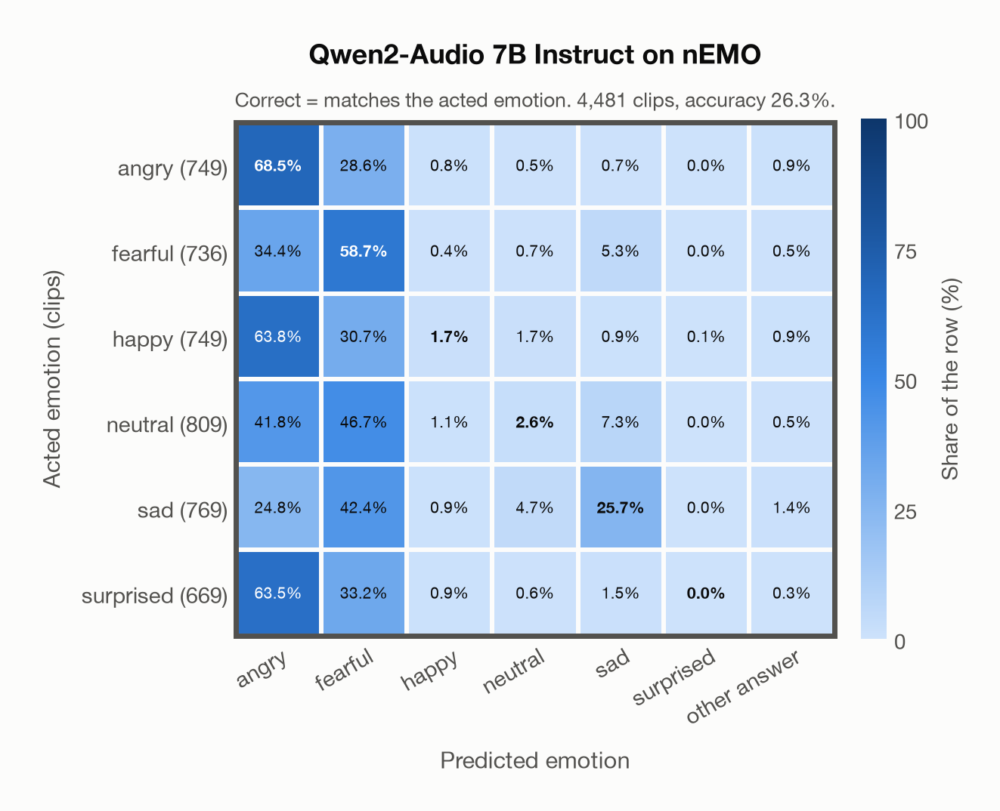

# Qwen2-Audio 7B Instruct on nEMO

Generated by `scripts/evaluation/evaluate.py` on 2026-11-13.

## Summary

| Metric | Value |
|---|---|
| Clips evaluated | 4,481 (Polish) |
| **Accuracy: prediction matches the acted emotion** | **26.3%** |
| Unweighted accuracy (mean recall of the 6 acted emotions) | 26.2% |
| Macro F1 (acted emotion) | 18.9% |
| Weighted F1 (by class support) | 19.1% |
| Accuracy, all 8 model classes (acted emotion) | 26.3% |
| Chance level (6 emotions) | 16.7% |

## Setup

- **Model**: Qwen2-Audio 7B Instruct (`Qwen/Qwen2-Audio-7B-Instruct`) as released (no fine-tuning), transformers 5.18.0, loaded by `scripts/models/qwen2_audio.py`. Qwen2-Audio-7B-Instruct gets one conversation per clip in its chat template: the system prompt, then one user turn with the audio first and the user prompt after it (as in the model card), with the system and user prompts of `scripts/llm_eval/prompts.yaml` (the same as for GPT Realtime); the clip as 16 kHz mono (at most its first 30 s). Greedy decoding (do_sample=False, no repetition penalty), at most 24 new tokens, bfloat16 on `mps`, sdpa attention; so the answers are the same from run to run (up to rounding differences between devices). The answer is read by `scripts/llm_eval/parsing.py` and becomes a one-hot vector over the 7 configured emotions plus `invalid`. Allowed answers for this run: angry, fearful, happy, neutral, sad, surprised. An answer that is not exactly one allowed label gets a follow-up in the same conversation ("Answer with exactly one word from this list, in lowercase, and nothing else: angry, fearful, happy, neutral, sad, surprised."), up to 1 time(s); then `invalid`. An answer that is not one of the dataset's emotions counts as wrong (column *other answer* of the confusion matrices); the raw answers are in `outputs/qwen2_audio_7b/responses.jsonl`.
- **Data**: 4,481 clips of nEMO (Polish) from `data/nemo/`.
- **Ground truth (acted emotion)**: the emotion each speaker was asked to portray (`emotion`).
- Label mapping: anger = angry, fear = fearful, happiness = happy, sadness = sad, surprised = surprised, neutral = neutral.
- **6 emotions**: the prediction is the model's answer when it is one of the 6 emotions in this dataset (angry, fearful, happy, neutral, sad, surprised); any other answer (`disgusted`, `invalid`) counts as wrong, so the accuracy is the same with all 8 model classes.
- **Other answer**: for 35 clips the model's answer is none of the 6 emotions (an emotion this dataset does not have, or no readable answer). They count as wrong and have their own last column, *other answer*, in the confusion matrices; precision, recall and F1 are over the 6 emotions.
- **Hardware**: Apple M4 Max, device `mps`, PyTorch 2.7.1. Inference took 100.9 min (1351 ms per clip; answers saved by an earlier run take no time).
- **Per-clip predictions**: `outputs/qwen2_audio_7b/nemo_predictions.csv` (in git, so the results can be checked clip by clip). The JSON file next to it describes the columns.

## Results per emotion

Rows: acted emotion. Precision, recall and F1 compare the prediction with the acted emotion. Weighted F1 weights each class's F1 by its true clip count.

| Emotion | Clips | Precision | Recall | F1 |
|---|---|---|---|---|
| angry | 749 | 23.3% | 68.5% | 34.8% |
| fearful | 736 | 24.0% | 58.7% | 34.0% |
| happy | 749 | 29.5% | 1.7% | 3.3% |
| neutral | 809 | 25.3% | 2.6% | 4.7% |
| sad | 769 | 62.3% | 25.7% | 36.4% |
| surprised | 669 | 0.0% | 0.0% | 0.0% |

## Confusion matrix: acted emotion

The same numbers as a table. Rows: acted emotion. Columns: predicted emotion. Each row adds up to 100%. *other answer*: the answer is none of the dataset's emotions (wrong).

| Acted \ Predicted | angry | fearful | happy | neutral | sad | surprised | other answer |
|---|---|---|---|---|---|---|---|
| angry (749) | **68.5%** | 28.6% | 0.8% | 0.5% | 0.7% | 0.0% | 0.9% |
| fearful (736) | 34.4% | **58.7%** | 0.4% | 0.7% | 5.3% | 0.0% | 0.5% |
| happy (749) | 63.8% | 30.7% | **1.7%** | 1.7% | 0.9% | 0.1% | 0.9% |
| neutral (809) | 41.8% | 46.7% | 1.1% | **2.6%** | 7.3% | 0.0% | 0.5% |
| sad (769) | 24.8% | 42.4% | 0.9% | 4.7% | **25.7%** | 0.0% | 1.4% |
| surprised (669) | 63.5% | 33.2% | 0.9% | 0.6% | 1.5% | **0.0%** | 0.3% |

Most frequent confusions: happy predicted as angry (63.8%), surprised predicted as angry (63.5%), neutral predicted as fearful (46.7%).

## Predictions outside the 6 emotions

With all 8 model classes, the model chose a class that this dataset does not have for 35 clips (0.8%): `disgusted` 0, `invalid` 35.

## Caveats

- **Training involvement for Qwen2-Audio 7B Instruct: No corpus-specific evidence**. Source: Qwen-7B and Whisper-large-v3 initialization; report states evaluation-data exclusion, but full backbone and pre/post-training corpus provenance is unavailable. Direct use and upstream teacher use both count as training involvement. No pattern: no corpus-specific evidence, not verified unseen. Corpus use is not test-clip leakage. The model may have heard these public datasets during training.
- No listeners' labels are published: listeners only screened the recordings, so there is one way of counting a prediction as correct.
- Recorded at home (24 kHz); only 3 of the 9 speakers are professional voice actors.
