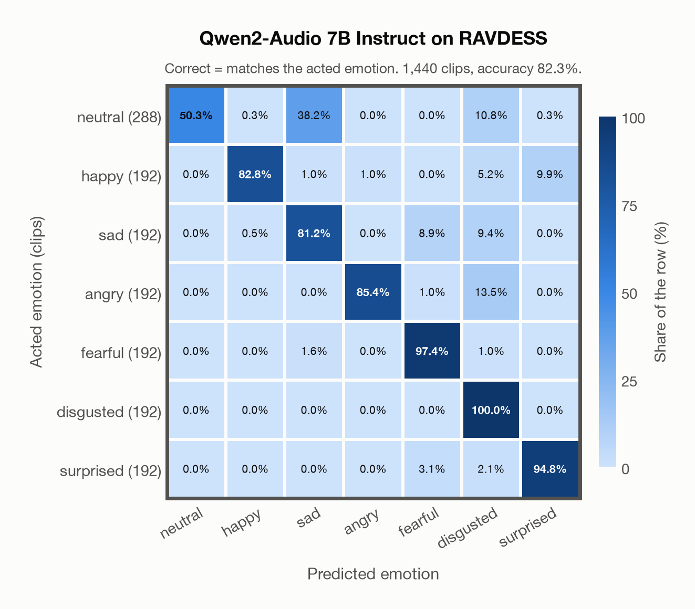

# Qwen2-Audio 7B Instruct on RAVDESS

Generated by `scripts/evaluation/evaluate.py` on 2026-11-13.

## Summary

| Metric | Value |
|---|---|
| Clips evaluated | 1,440 (English) |
| **Accuracy: prediction matches the acted emotion** | **82.3%** |
| Unweighted accuracy (mean recall of the 7 acted emotions) | 84.6% |
| Macro F1 (acted emotion) | 83.1% |
| Weighted F1 (by class support) | 82.0% |
| Accuracy, all 8 model classes (acted emotion) | 82.3% |
| Chance level (7 emotions) | 14.3% |

## Setup

- **Model**: Qwen2-Audio 7B Instruct (`Qwen/Qwen2-Audio-7B-Instruct`) as released (no fine-tuning), transformers 5.18.0, loaded by `scripts/models/qwen2_audio.py`. Qwen2-Audio-7B-Instruct gets one conversation per clip in its chat template: the system prompt, then one user turn with the audio first and the user prompt after it (as in the model card), with the system and user prompts of `scripts/llm_eval/prompts.yaml` (the same as for GPT Realtime); the clip as 16 kHz mono (at most its first 30 s). Greedy decoding (do_sample=False, no repetition penalty), at most 24 new tokens, bfloat16 on `mps`, sdpa attention; so the answers are the same from run to run (up to rounding differences between devices). The answer is read by `scripts/llm_eval/parsing.py` and becomes a one-hot vector over the 7 configured emotions plus `invalid`. Allowed answers for this run: angry, disgusted, fearful, happy, neutral, sad, surprised. An answer that is not exactly one allowed label gets a follow-up in the same conversation ("Answer with exactly one word from this list, in lowercase, and nothing else: angry, disgusted, fearful, happy, neutral, sad, surprised."), up to 1 time(s); then `invalid`. An answer that is not one of the dataset's emotions counts as wrong (column *other answer* of the confusion matrices); the raw answers are in `outputs/qwen2_audio_7b/responses.jsonl`.
- **Data**: 1,440 clips of RAVDESS (English) from `data/ravdess/`.
- **Ground truth (acted emotion)**: the emotion each actor was asked to portray, from the third number in the file name (01 neutral, 02 calm, 03 happy, 04 sad, 05 angry, 06 fearful, 07 disgust, 08 surprised).
- Label mapping: neutral, happy, sad, angry, fearful and surprised keep their names; disgust = disgusted, and **calm = neutral** (the project's emotions have no *calm*), so neutral has 288 clips: 96 acted neutral and 192 acted calm.
- 24 professional actors (12 female, 12 male) say two sentences, "Kids are talking by the door" and "Dogs are sitting by the door", twice in each emotion, at two intensities (normal and strong) except for neutral.
- **7 emotions**: the prediction is the model's answer when it is one of the 7 emotions in this dataset (neutral, happy, sad, angry, fearful, disgusted, surprised); any other answer (`invalid`) counts as wrong, so the accuracy is the same with all 8 model classes.
- **Hardware**: Apple M4 Max, device `mps`, PyTorch 2.7.1. Inference took 37.4 min (1559 ms per clip; answers saved by an earlier run take no time).
- **Per-clip predictions**: `outputs/qwen2_audio_7b/ravdess_predictions.csv` (in git, so the results can be checked clip by clip). The JSON file next to it describes the columns.

## Results per emotion

Rows: acted emotion. Precision, recall and F1 compare the prediction with the acted emotion. Weighted F1 weights each class's F1 by its true clip count.

| Emotion | Clips | Precision | Recall | F1 |
|---|---|---|---|---|
| neutral | 288 | 100.0% | 50.3% | 67.0% |
| happy | 192 | 98.8% | 82.8% | 90.1% |
| sad | 192 | 57.6% | 81.2% | 67.4% |
| angry | 192 | 98.8% | 85.4% | 91.6% |
| fearful | 192 | 88.2% | 97.4% | 92.6% |
| disgusted | 192 | 67.8% | 100.0% | 80.8% |
| surprised | 192 | 90.1% | 94.8% | 92.4% |

## Confusion matrix: acted emotion

The same numbers as a table. Rows: acted emotion. Columns: predicted emotion. Each row adds up to 100%.

| Acted \ Predicted | neutral | happy | sad | angry | fearful | disgusted | surprised |
|---|---|---|---|---|---|---|---|
| neutral (288) | **50.3%** | 0.3% | 38.2% | 0.0% | 0.0% | 10.8% | 0.3% |
| happy (192) | 0.0% | **82.8%** | 1.0% | 1.0% | 0.0% | 5.2% | 9.9% |
| sad (192) | 0.0% | 0.5% | **81.2%** | 0.0% | 8.9% | 9.4% | 0.0% |
| angry (192) | 0.0% | 0.0% | 0.0% | **85.4%** | 1.0% | 13.5% | 0.0% |
| fearful (192) | 0.0% | 0.0% | 1.6% | 0.0% | **97.4%** | 1.0% | 0.0% |
| disgusted (192) | 0.0% | 0.0% | 0.0% | 0.0% | 0.0% | **100.0%** | 0.0% |
| surprised (192) | 0.0% | 0.0% | 0.0% | 0.0% | 3.1% | 2.1% | **94.8%** |

Most frequent confusions: neutral predicted as sad (38.2%), angry predicted as disgusted (13.5%), neutral predicted as disgusted (10.8%).

## Predictions outside the 7 emotions

With all 8 model classes, the model chose a class that this dataset does not have for 0 clips (0.0%): `invalid` 0.

## Caveats

- **Training involvement for Qwen2-Audio 7B Instruct: No corpus-specific evidence**. Source: Qwen-7B and Whisper-large-v3 initialization; report states evaluation-data exclusion, but full backbone and pre/post-training corpus provenance is unavailable. Direct use and upstream teacher use both count as training involvement. No pattern: no corpus-specific evidence, not verified unseen. Corpus use is not test-clip leakage. The model may have heard these public datasets during training.
- *Calm* is not quite *neutral*: calm clips predicted as neutral count as correct.
- Listeners rated every file 10 times (247 listeners). The paper publishes their ratings as recognition rates per file, not as a vote for an emotion, so this report has no listeners' labels.
- Audio: 48 kHz WAV, resampled to 16 kHz; 5 files are stereo, and their channels are averaged.
