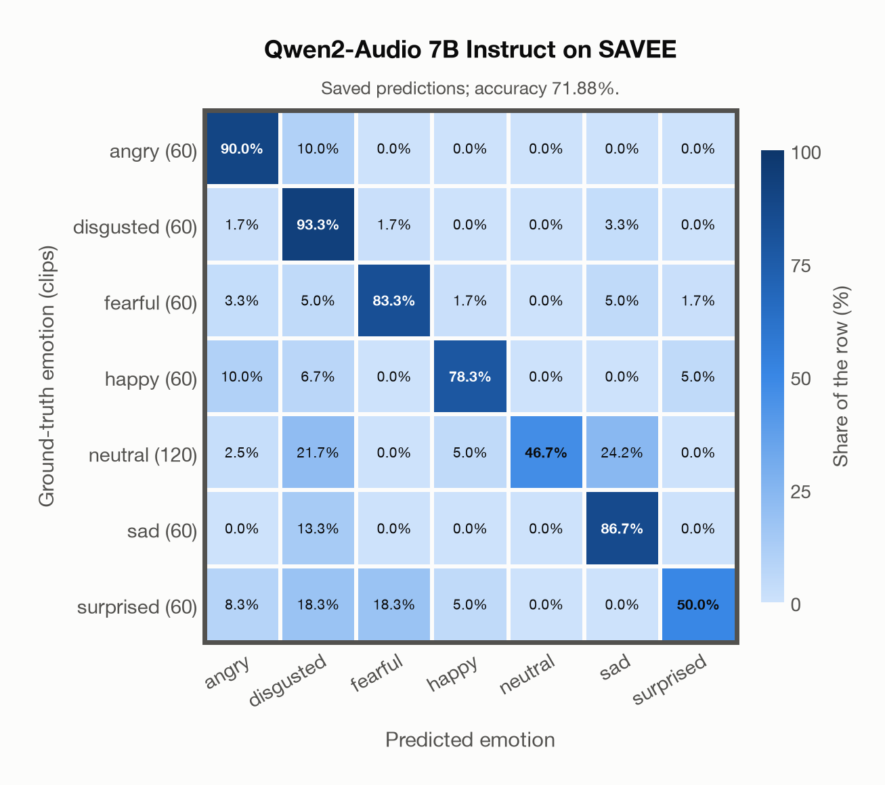

# Qwen2-Audio 7B Instruct on SAVEE

Regenerated offline from saved CSV/JSON by `scripts/evaluation/refresh_reports.py`. This refresh performs no model inference or API requests.

## Summary

| Metric | Recomputed value |
|---|---:|
| Clips | 480 |
| Accuracy: acted emotion | 71.88% |
| UAR: mean ground-truth-row recall | 75.48% |
| Macro F1 | 72.55% |
| Weighted F1: true-support weighted | 71.43% |
| Accuracy: all model classes | 71.88% |
| Invalid / outside-candidate answers | 0 (0.00%) |

## Imported run and verification

- Source: [prediction CSV](../../outputs/qwen2_audio_7b/savee_predictions.csv) and [metadata JSON](../../outputs/qwen2_audio_7b/savee_predictions.json); both remain byte-for-byte unchanged.
- Original execution date recorded in JSON: `2026-11-14`.
- Dataset scope recorded in JSON: **SAVEE**, English (British); 480 / 480 clips.
- Ground-truth column: `acted_emotion`. Candidate classes: angry, disgusted, fearful, happy, neutral, sad, surprised.
- Row counts, unique audio paths, correctness flags and saved metrics were checked against the CSV. Metric agreement tolerance is 0.000001 (six-decimal metadata).
- Weighted F1 weights each class's F1 by its true support, using the same resolved truth as macro F1; invalid answers remain errors. New metrics absent from the source JSON are recorded in the offline audit and summaries; the source JSON is preserved.
- Saved candidate/prompt/model protocol matches current configuration: scope `dataset`, model `Qwen/Qwen2-Audio-7B-Instruct`, prompt hash `aab2967fd07a`.
- Original execution/client runtime metadata (reported by the imported run, not measured by this refresh): `{"device": "mps", "hardware": "Apple M4 Max", "seconds": 707.0, "ms_per_clip": 1473.0, "on_cpu": 0}`.
- Saved p_* columns encode the returned answer as one-hot values; they are not calibrated API class probabilities, and no confidence plot is inferred from them.
- A raw responses journal is present; this refresh validates CSV/JSON only.

## Prediction distribution

Counts and shares use all saved samples. The invalid bucket combines `invalid` and `other answer`: answers outside the dataset's candidate classes remain errors.

| Predicted label | Clips | Share of all clips |
|---|---:|---:|
| angry | 71 | 14.79% |
| disgusted | 114 | 23.75% |
| fearful | 62 | 12.92% |
| happy | 57 | 11.88% |
| neutral | 56 | 11.67% |
| sad | 86 | 17.92% |
| surprised | 34 | 7.08% |
| invalid / outside candidates | 0 | 0.00% |

## Results per emotion

| Ground-truth emotion | Clips | Recall | Acted-or-listener recall |
|---|---:|---:|---:|
| angry | 60 | 90.00% | — |
| disgusted | 60 | 93.33% | — |
| fearful | 60 | 83.33% | — |
| happy | 60 | 78.33% | — |
| neutral | 120 | 46.67% | — |
| sad | 60 | 86.67% | — |
| surprised | 60 | 50.00% | — |

Precision/F1 use the same resolved-truth convention as the evaluation script. Weighted F1 uses the resolved-truth clip counts below as weights.

| Predicted emotion | Resolved-truth clips | Precision | Recall | F1 |
|---|---:|---:|---:|---:|
| angry | 60 | 76.06% | 90.00% | 82.44% |
| disgusted | 60 | 49.12% | 93.33% | 64.37% |
| fearful | 60 | 80.65% | 83.33% | 81.97% |
| happy | 60 | 82.46% | 78.33% | 80.34% |
| neutral | 120 | 100.00% | 46.67% | 63.64% |
| sad | 60 | 60.47% | 86.67% | 71.23% |
| surprised | 60 | 88.24% | 50.00% | 63.83% |

## Confusion matrix: acted emotion

| Ground truth \ Predicted | angry | disgusted | fearful | happy | neutral | sad | surprised |
|---|---|---|---|---|---|---|---|
| angry (60) | **90.0%** | 10.0% | 0.0% | 0.0% | 0.0% | 0.0% | 0.0% |
| disgusted (60) | 1.7% | **93.3%** | 1.7% | 0.0% | 0.0% | 3.3% | 0.0% |
| fearful (60) | 3.3% | 5.0% | **83.3%** | 1.7% | 0.0% | 5.0% | 1.7% |
| happy (60) | 10.0% | 6.7% | 0.0% | **78.3%** | 0.0% | 0.0% | 5.0% |
| neutral (120) | 2.5% | 21.7% | 0.0% | 5.0% | **46.7%** | 24.2% | 0.0% |
| sad (60) | 0.0% | 13.3% | 0.0% | 0.0% | 0.0% | **86.7%** | 0.0% |
| surprised (60) | 8.3% | 18.3% | 18.3% | 5.0% | 0.0% | 0.0% | **50.0%** |

## Caveats

- **Training involvement for Qwen2-Audio 7B Instruct: No corpus-specific evidence**. Source: Qwen-7B and Whisper-large-v3 initialization; report states evaluation-data exclusion, but full backbone and pre/post-training corpus provenance is unavailable. Direct use and upstream teacher use both count as training involvement. No pattern: no corpus-specific evidence, not verified unseen. Corpus use is not test-clip leakage.
- Internal CSV/JSON consistency does not authenticate the original model or remote request logs.

[Offline validation audit](savee_offline_audit.json)
