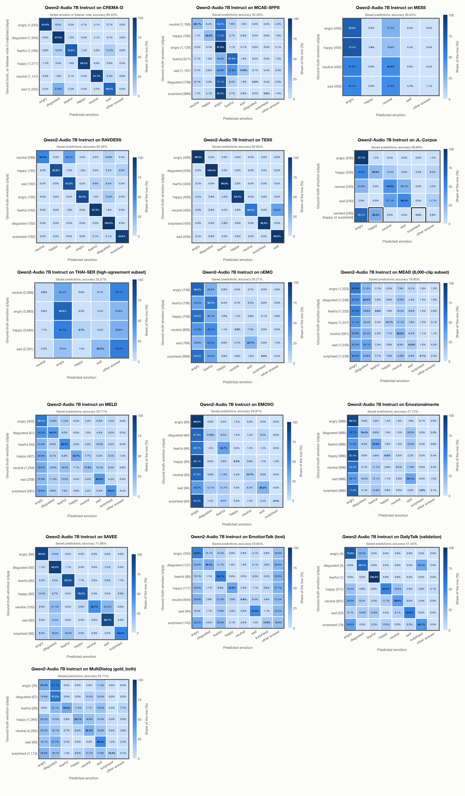

# Qwen2-Audio 7B Instruct: results on every dataset

Generated by `scripts/evaluation/evaluate.py` on 2026-11-14. Each dataset links to its full report. The datasets are grouped by training-source evidence level, each group sorted by accuracy.

| Dataset | Language | Ground-truth labels | Training involvement | Clips | Emotions | Chance | Accuracy: acted emotion | Accuracy: acted or listeners' vote | Unweighted accuracy | Macro F1 | Weighted F1 |
|---|---|---|---|---|---|---|---|---|---|---|---|
| [TESS](tess.md) | English | angry, disgusted, fearful, happy, neutral, surprised, sad | No corpus-specific evidence | 2,800 | 7 | 14.3% | **92.6%** | – | 92.6% | 92.3% | 92.3% |
| [CREMA-D](crema_d.md) | English | angry, disgusted, fearful, happy, neutral, sad | No corpus-specific evidence | 7,442 | 6 | 16.7% | **83.2%** | 86.4% | 83.4% | 83.7% | 83.5% |
| [RAVDESS](ravdess.md) | English | neutral, happy, sad, angry, fearful, disgusted, surprised | No corpus-specific evidence | 1,440 | 7 | 14.3% | **82.3%** | – | 84.6% | 83.1% | 82.0% |
| [SAVEE](savee.md) | English (British) | angry, disgusted, fearful, happy, neutral, sad, surprised | No corpus-specific evidence | 480 | 7 | 14.3% | **71.9%** | – | 75.5% | 72.5% | 71.4% |
| [JL-Corpus](jl_corpus.md) | English (New Zealand) | angry, happy, neutral, sad, excited (happy or surprised) | No corpus-specific evidence | 1,200 | 5 | 24.0% | **48.6%** | – | 48.6% | 39.6% | 47.9% |
| [DailyTalk (validation)](dailytalk.md) | English | angry, disgusted, fearful, happy, neutral, sad, surprised | No corpus-specific evidence | 1,197 | 7 | 14.3% | **41.4%** | – | 61.0% | 24.3% | 52.1% |
| [MCAE-SPPS](mcae_spps.md) | Mandarin | neutral, happy, angry, fearful, sad, disgusted, surprised | No corpus-specific evidence | 6,675 | 7 | 14.3% | **32.4%** | 32.4% | 31.9% | 25.3% | 25.6% |
| [MELD](meld.md) | English | angry, disgusted, fearful, happy, neutral, sad, surprised | No corpus-specific evidence | 2,608 | 7 | 14.3% | **30.7%** | – | 39.5% | 29.4% | 32.2% |
| [MESS](mess.md) | English | angry, happy, neutral, sad | No corpus-specific evidence | 1,800 | 4 | 25.0% | **30.5%** | – | 30.5% | 21.3% | 21.3% |
| [Emozionalmente](emozionalmente.md) | Italian | angry, disgusted, fearful, happy, neutral, sad, surprised | No corpus-specific evidence | 6,902 | 7 | 14.3% | **27.7%** | 32.9% | 27.7% | 23.4% | 23.4% |
| [EMOVO](emovo.md) | Italian | angry, disgusted, fearful, happy, neutral, sad, surprised | No corpus-specific evidence | 588 | 7 | 14.3% | **26.9%** | – | 26.9% | 21.8% | 21.8% |
| [nEMO](nemo.md) | Polish | angry, fearful, happy, neutral, sad, surprised | No corpus-specific evidence | 4,481 | 6 | 16.7% | **26.3%** | – | 26.2% | 18.9% | 19.1% |
| [MultiDialog (gold_both)](multidialog.md) | English | angry, disgusted, fearful, happy, neutral, sad, surprised | No corpus-specific evidence | 7,672 | 7 | 14.3% | **25.8%** | – | 33.6% | 15.1% | 35.2% |
| [THAI-SER (high-agreement subset)](thai_ser.md) | Thai | neutral, angry, happy, sad | No corpus-specific evidence | 11,848 | 4 | 25.0% | **25.3%** | 25.8% | 26.4% | 25.8% | 24.8% |
| [EmotionTalk (test)](emotiontalk.md) | Mandarin | angry, disgusted, fearful, happy, neutral, sad, surprised | No corpus-specific evidence | 1,929 | 7 | 14.3% | **24.0%** | – | 34.2% | 28.2% | 23.1% |
| [MEAD (8,000-clip subset)](mead.md) | English | angry, disgusted, fearful, happy, neutral, sad, surprised | No corpus-specific evidence | 8,000 | 7 | 14.3% | **19.8%** | – | 20.1% | 16.8% | 16.8% |

- **Ground-truth labels**: the emotions the speakers were asked to portray, as the project's class names (each report gives the dataset's own names), in the order of the rows of the confusion matrices.
- **Composite labels** (no model class; a prediction of any class in brackets counts as correct): JL-Corpus's *excited* (happy or surprised). Chance level counts these classes, so it is higher than 1 in the number of emotions.
- **Training involvement**: Used directly; Used via upstream training; Possible association; No corpus-specific evidence. Direct and upstream use both count as seen under this project policy; the stage is recorded separately. Direct use and upstream teacher use both count as training involvement. No pattern: no corpus-specific evidence, not verified unseen. Corpus use is not test-clip leakage.
- **Training sources**: Qwen-7B and Whisper-large-v3 initialization; report states evaluation-data exclusion, but full backbone and pre/post-training corpus provenance is unavailable. Dataset reports regenerated offline from saved artifacts; this refresh performs no inference or API requests.
- **Accuracy: acted emotion** compares the prediction with the emotion the speaker was asked to portray. The prediction is the most probable of the emotions that the dataset has, so chance level depends on how many emotions it has.
- **Accuracy: acted or listeners' vote** also accepts the listeners' majority vote; it exists only for datasets that publish listeners' labels.
- **Weighted F1** weights each class's F1 by its true support; composite labels use the same resolved truth as macro F1, explained in each report. Invalid answers remain errors. A dash means this metric has not yet been recomputed from saved predictions.
- **Subsets**: THAI-SER (high-agreement subset), MEAD (8,000-clip subset), EmotionTalk (test), DailyTalk (validation), MultiDialog (gold_both): a fixed subset of the dataset (`subsets` in config/evaluation.yaml), the same for every model; each report says how it is chosen.

## Confusion matrices

One matrix per dataset, from each dataset's report: CREMA-D, MCAE-SPPS, MESS, RAVDESS, TESS, JL-Corpus, THAI-SER (high-agreement subset), nEMO, MEAD (8,000-clip subset), MELD, EMOVO, Emozionalmente, SAVEE, EmotionTalk (test), DailyTalk (validation), MultiDialog (gold_both) (order: `summary_figure` in config/evaluation.yaml). Rows: acted emotion; columns: predicted emotion; each row adds up to 100%. CREMA-D: the matrix where a prediction also counts as correct when it matches the listeners' vote, so a clip whose prediction matched that vote sits in the row of that vote. A composite label has its own row, whose bold cells count as correct.

## Only the emotions every dataset has: angry, happy, neutral, sad

Only clips whose ground truth is one of these 4 emotions are included. Every model keeps its original dataset-level prediction; predictions outside this subset count as wrong. This is a subset analysis, not a new inference run with fewer answer choices, so there is no common chance baseline.

| Dataset | Language | Ground-truth labels | Training involvement | Clips | Accuracy | Unweighted accuracy |
|---|---|---|---|---|---|---|
| [TESS](tess.md) | English | angry, disgusted, fearful, happy, neutral, surprised, sad | No corpus-specific evidence | 1,600 | **88.0%** | 88.0% |
| [CREMA-D](crema_d.md) | English | angry, disgusted, fearful, happy, neutral, sad | No corpus-specific evidence | 4,900 | **82.9%** | 83.2% |
| [RAVDESS](ravdess.md) | English | neutral, happy, sad, angry, fearful, disgusted, surprised | No corpus-specific evidence | 864 | **72.2%** | 75.0% |
| [SAVEE](savee.md) | English (British) | angry, disgusted, fearful, happy, neutral, sad, surprised | No corpus-specific evidence | 300 | **69.7%** | 75.4% |
| [JL-Corpus](jl_corpus.md) | English (New Zealand) | angry, happy, neutral, sad, excited (happy or surprised) | No corpus-specific evidence | 960 | **53.2%** | 53.2% |
| [DailyTalk (validation)](dailytalk.md) | English | angry, disgusted, fearful, happy, neutral, sad, surprised | No corpus-specific evidence | 1,174 | **41.3%** | 54.6% |
| [MCAE-SPPS](mcae_spps.md) | Mandarin | neutral, happy, angry, fearful, sad, disgusted, surprised | No corpus-specific evidence | 4,297 | **39.7%** | 38.8% |
| [Emozionalmente](emozionalmente.md) | Italian | angry, disgusted, fearful, happy, neutral, sad, surprised | No corpus-specific evidence | 3,944 | **34.7%** | 34.7% |
| [EMOVO](emovo.md) | Italian | angry, disgusted, fearful, happy, neutral, sad, surprised | No corpus-specific evidence | 336 | **34.5%** | 34.5% |
| [MESS](mess.md) | English | angry, happy, neutral, sad | No corpus-specific evidence | 1,800 | **30.5%** | 30.5% |
| [MELD](meld.md) | English | angry, disgusted, fearful, happy, neutral, sad, surprised | No corpus-specific evidence | 2,210 | **28.8%** | 37.5% |
| [MultiDialog (gold_both)](multidialog.md) | English | angry, disgusted, fearful, happy, neutral, sad, surprised | No corpus-specific evidence | 6,466 | **28.0%** | 33.2% |
| [MEAD (8,000-clip subset)](mead.md) | English | angry, disgusted, fearful, happy, neutral, sad, surprised | No corpus-specific evidence | 4,280 | **27.3%** | 26.8% |
| [THAI-SER (high-agreement subset)](thai_ser.md) | Thai | neutral, angry, happy, sad | No corpus-specific evidence | 11,848 | **25.3%** | 26.4% |
| [nEMO](nemo.md) | Polish | angry, fearful, happy, neutral, sad, surprised | No corpus-specific evidence | 3,076 | **24.2%** | 24.6% |
| [EmotionTalk (test)](emotiontalk.md) | Mandarin | angry, disgusted, fearful, happy, neutral, sad, surprised | No corpus-specific evidence | 1,560 | **22.7%** | 35.5% |

Computed from the saved prediction labels in `outputs/`; probabilities are not used to reselect an answer.
