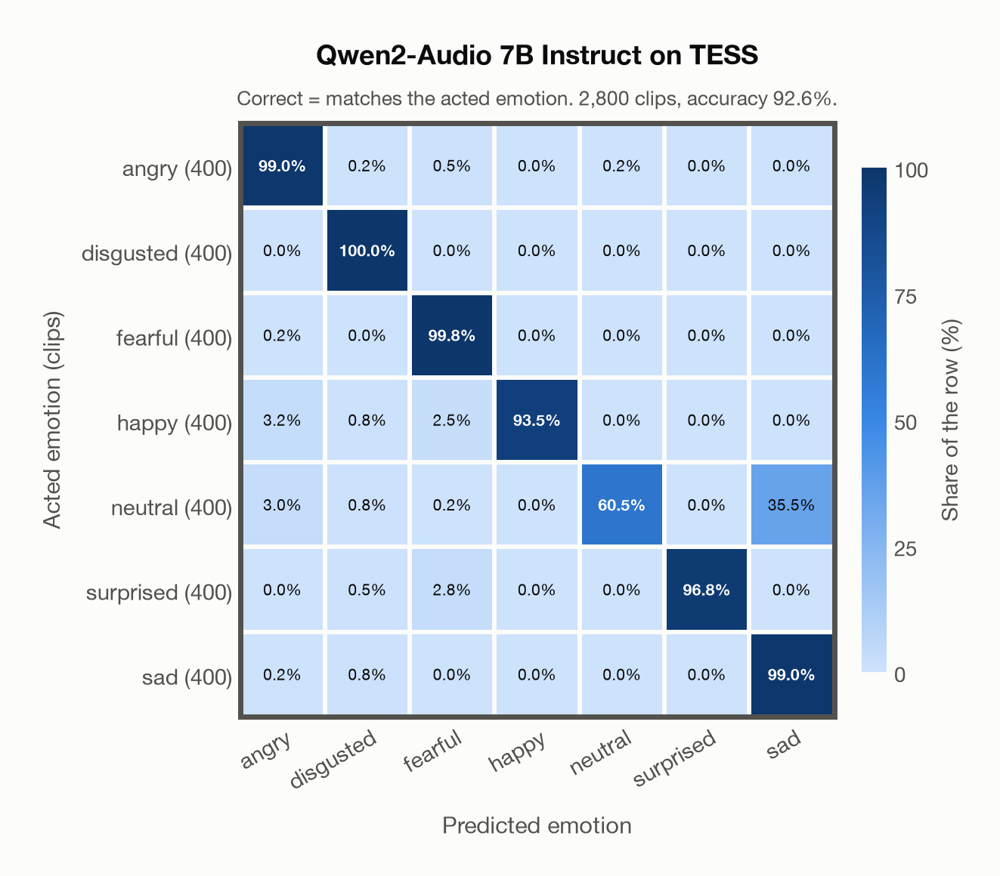

# Qwen2-Audio 7B Instruct on TESS

Generated by `scripts/evaluation/evaluate.py` on 2026-11-13.

## Summary

| Metric | Value |
|---|---|
| Clips evaluated | 2,800 (English) |
| **Accuracy: prediction matches the acted emotion** | **92.6%** |
| Unweighted accuracy (mean recall of the 7 acted emotions) | 92.6% |
| Macro F1 (acted emotion) | 92.3% |
| Weighted F1 (by class support) | 92.3% |
| Accuracy, all 8 model classes (acted emotion) | 92.6% |
| Chance level (7 emotions) | 14.3% |

## Setup

- **Model**: Qwen2-Audio 7B Instruct (`Qwen/Qwen2-Audio-7B-Instruct`) as released (no fine-tuning), transformers 5.18.0, loaded by `scripts/models/qwen2_audio.py`. Qwen2-Audio-7B-Instruct gets one conversation per clip in its chat template: the system prompt, then one user turn with the audio first and the user prompt after it (as in the model card), with the system and user prompts of `scripts/llm_eval/prompts.yaml` (the same as for GPT Realtime); the clip as 16 kHz mono (at most its first 30 s). Greedy decoding (do_sample=False, no repetition penalty), at most 24 new tokens, bfloat16 on `mps`, sdpa attention; so the answers are the same from run to run (up to rounding differences between devices). The answer is read by `scripts/llm_eval/parsing.py` and becomes a one-hot vector over the 7 configured emotions plus `invalid`. Allowed answers for this run: angry, disgusted, fearful, happy, neutral, sad, surprised. An answer that is not exactly one allowed label gets a follow-up in the same conversation ("Answer with exactly one word from this list, in lowercase, and nothing else: angry, disgusted, fearful, happy, neutral, sad, surprised."), up to 1 time(s); then `invalid`. An answer that is not one of the dataset's emotions counts as wrong (column *other answer* of the confusion matrices); the raw answers are in `outputs/qwen2_audio_7b/responses.jsonl`.
- **Data**: 2,800 clips of TESS (English) from `data/tess/`.
- **Ground truth (acted emotion)**: the emotion each actress was asked to portray, from the last word of the file name (`angry`, `disgust`, `fear`, `happy`, `neutral`, `ps` for pleasant surprise, `sad`).
- Label mapping: angry, happy, neutral and sad keep their names; disgust = disgusted, fear = fearful, **pleasant surprise = surprised**.
- Two actresses, aged 26 and 64, say "Say the word ..." with the same 200 target words in each of the seven emotions.
- **7 emotions**: the prediction is the model's answer when it is one of the 7 emotions in this dataset (angry, disgusted, fearful, happy, neutral, surprised, sad); any other answer (`invalid`) counts as wrong, so the accuracy is the same with all 8 model classes.
- **Hardware**: Apple M4 Max, device `mps`, PyTorch 2.7.1. Inference took 71.6 min (1535 ms per clip; answers saved by an earlier run take no time).
- **Per-clip predictions**: `outputs/qwen2_audio_7b/tess_predictions.csv` (in git, so the results can be checked clip by clip). The JSON file next to it describes the columns.

## Results per emotion

Rows: acted emotion. Precision, recall and F1 compare the prediction with the acted emotion. Weighted F1 weights each class's F1 by its true clip count.

| Emotion | Clips | Precision | Recall | F1 |
|---|---|---|---|---|
| angry | 400 | 93.6% | 99.0% | 96.2% |
| disgusted | 400 | 97.1% | 100.0% | 98.5% |
| fearful | 400 | 94.3% | 99.8% | 97.0% |
| happy | 400 | 100.0% | 93.5% | 96.6% |
| neutral | 400 | 99.6% | 60.5% | 75.3% |
| surprised | 400 | 100.0% | 96.8% | 98.3% |
| sad | 400 | 73.6% | 99.0% | 84.4% |

## Confusion matrix: acted emotion

The same numbers as a table. Rows: acted emotion. Columns: predicted emotion. Each row adds up to 100%.

| Acted \ Predicted | angry | disgusted | fearful | happy | neutral | surprised | sad |
|---|---|---|---|---|---|---|---|
| angry (400) | **99.0%** | 0.2% | 0.5% | 0.0% | 0.2% | 0.0% | 0.0% |
| disgusted (400) | 0.0% | **100.0%** | 0.0% | 0.0% | 0.0% | 0.0% | 0.0% |
| fearful (400) | 0.2% | 0.0% | **99.8%** | 0.0% | 0.0% | 0.0% | 0.0% |
| happy (400) | 3.2% | 0.8% | 2.5% | **93.5%** | 0.0% | 0.0% | 0.0% |
| neutral (400) | 3.0% | 0.8% | 0.2% | 0.0% | **60.5%** | 0.0% | 35.5% |
| surprised (400) | 0.0% | 0.5% | 2.8% | 0.0% | 0.0% | **96.8%** | 0.0% |
| sad (400) | 0.2% | 0.8% | 0.0% | 0.0% | 0.0% | 0.0% | **99.0%** |

Most frequent confusions: neutral predicted as sad (35.5%), happy predicted as angry (3.2%), neutral predicted as angry (3.0%).

## Predictions outside the 7 emotions

With all 8 model classes, the model chose a class that this dataset does not have for 0 clips (0.0%): `invalid` 0.

## Caveats

- **Training involvement for Qwen2-Audio 7B Instruct: No corpus-specific evidence**. Source: Qwen-7B and Whisper-large-v3 initialization; report states evaluation-data exclusion, but full backbone and pre/post-training corpus provenance is unavailable. Direct use and upstream teacher use both count as training involvement. No pattern: no corpus-specific evidence, not verified unseen. Corpus use is not test-clip leakage. The model may have heard these public datasets during training.
- Only two speakers, so the result says little about other voices; models often score close to 100% on TESS.
- No listeners' labels are published with the dataset. Audio: 24,414 Hz WAV (one file, `OAF_food_fear.wav`, is 96 kHz), resampled to 16 kHz.
