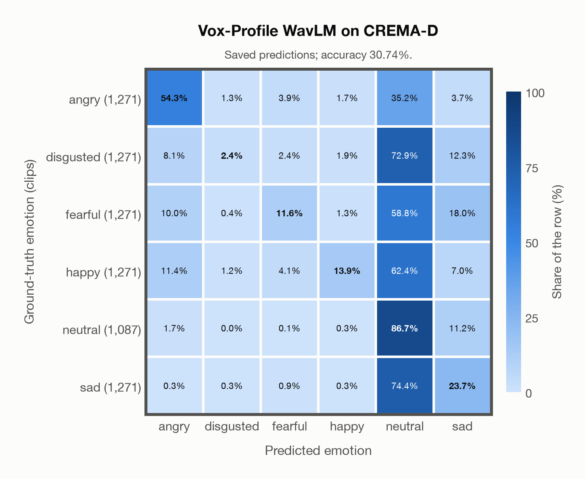
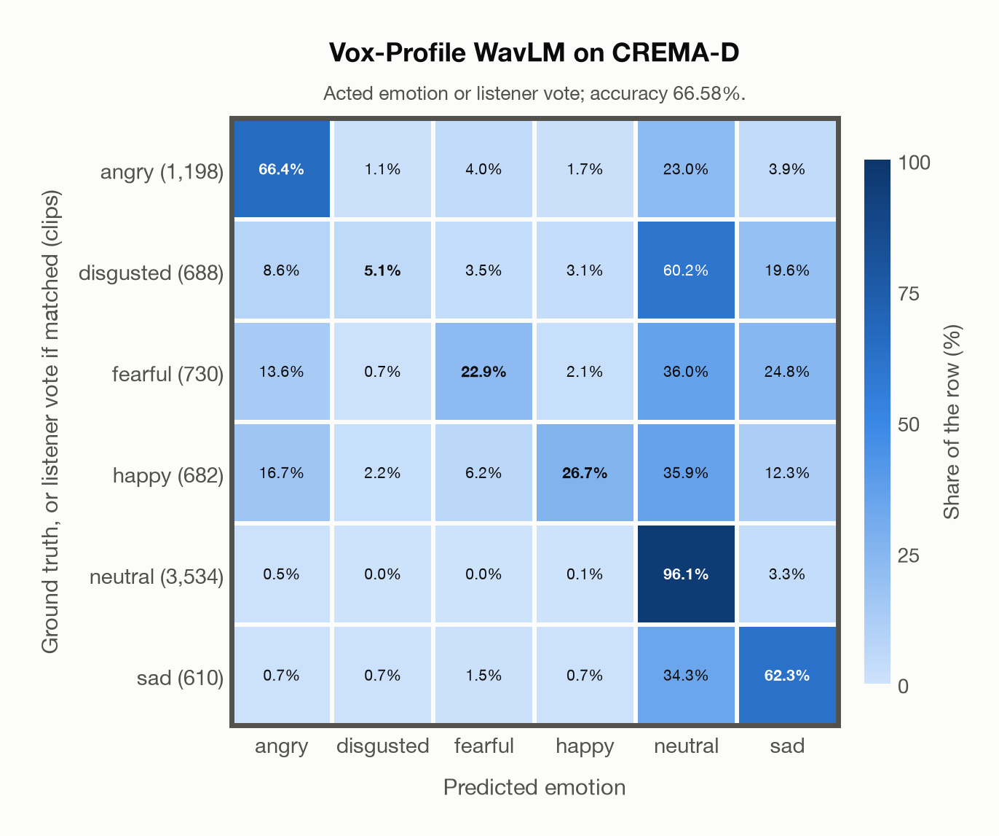

# Vox-Profile WavLM on CREMA-D

Regenerated offline from saved CSV/JSON by `scripts/evaluation/refresh_reports.py`. This refresh performs no model inference or API requests.

## Summary

| Metric | Recomputed value |
|---|---:|
| Clips | 7,442 |
| Accuracy: acted emotion | 30.74% |
| UAR: mean ground-truth-row recall | 32.09% |
| Macro F1 | 27.41% |
| Weighted F1: true-support weighted | 27.30% |
| Accuracy: all model classes | 28.37% |
| Accuracy: acted emotion or listener vote | 66.58% |
| Single listener vote vs acted emotion | 45.59% |
| Model vs single listener vote | 59.12% |

## Imported run and verification

- Source: [prediction CSV](../../outputs/vox_profile_wavlm/crema_d_predictions.csv) and [metadata JSON](../../outputs/vox_profile_wavlm/crema_d_predictions.json); both remain byte-for-byte unchanged.
- Original execution date recorded in JSON: `2026-10-29`.
- Dataset scope recorded in JSON: **CREMA-D**, English; 7,442 / 7,442 clips.
- Ground-truth column: `acted_emotion`. Candidate classes: angry, disgusted, fearful, happy, neutral, sad.
- Row counts, unique audio paths, correctness flags and saved metrics were checked against the CSV. Metric agreement tolerance is 0.000001 (six-decimal metadata).
- Weighted F1 weights each class's F1 by its true support, using the same resolved truth as macro F1; invalid answers remain errors. New metrics absent from the source JSON are recorded in the offline audit and summaries; the source JSON is preserved.
- Original execution/client runtime metadata (reported by the imported run, not measured by this refresh): `{"device": "mps", "hardware": "Apple M4 Max", "seconds": 260.8, "ms_per_clip": 35.0, "on_cpu": 0}`.

## Results per emotion

| Ground-truth emotion | Clips | Recall | Acted-or-listener recall |
|---|---:|---:|---:|
| angry | 1,271 | 54.29% | 68.29% |
| disgusted | 1,271 | 2.44% | 48.62% |
| fearful | 1,271 | 11.57% | 55.70% |
| happy | 1,271 | 13.93% | 60.66% |
| neutral | 1,087 | 86.66% | 87.30% |
| sad | 1,271 | 23.68% | 81.90% |

Precision/F1 use the same resolved-truth convention as the evaluation script. Weighted F1 uses the resolved-truth clip counts below as weights.

| Predicted emotion | Resolved-truth clips | Precision | Recall | F1 |
|---|---:|---:|---:|---:|
| angry | 1,271 | 63.42% | 54.29% | 58.50% |
| disgusted | 1,271 | 43.06% | 2.44% | 4.62% |
| fearful | 1,271 | 50.52% | 11.57% | 18.82% |
| happy | 1,271 | 72.24% | 13.93% | 23.35% |
| neutral | 1,087 | 19.62% | 86.66% | 31.99% |
| sad | 1,271 | 31.89% | 23.68% | 27.18% |

## Confusion matrix: acted emotion

| Ground truth \ Predicted | angry | disgusted | fearful | happy | neutral | sad |
|---|---|---|---|---|---|---|
| angry (1,271) | **54.3%** | 1.3% | 3.9% | 1.7% | 35.2% | 3.7% |
| disgusted (1,271) | 8.1% | **2.4%** | 2.4% | 1.9% | 72.9% | 12.3% |
| fearful (1,271) | 10.0% | 0.4% | **11.6%** | 1.3% | 58.8% | 18.0% |
| happy (1,271) | 11.4% | 1.2% | 4.1% | **13.9%** | 62.4% | 7.0% |
| neutral (1,087) | 1.7% | 0.0% | 0.1% | 0.3% | **86.7%** | 11.2% |
| sad (1,271) | 0.3% | 0.3% | 0.9% | 0.3% | 74.4% | **23.7%** |

## Confusion matrix: acted emotion or listener vote

A prediction accepted only through the listener vote is placed in that predicted emotion's row; other clips keep their original ground-truth row. Row supports can therefore change.

| Ground truth \ Predicted | angry | disgusted | fearful | happy | neutral | sad |
|---|---|---|---|---|---|---|
| angry (1,198) | **66.4%** | 1.1% | 4.0% | 1.7% | 23.0% | 3.9% |
| disgusted (688) | 8.6% | **5.1%** | 3.5% | 3.1% | 60.2% | 19.6% |
| fearful (730) | 13.6% | 0.7% | **22.9%** | 2.1% | 36.0% | 24.8% |
| happy (682) | 16.7% | 2.2% | 6.2% | **26.7%** | 35.9% | 12.3% |
| neutral (3,534) | 0.5% | 0.0% | 0.0% | 0.1% | **96.1%** | 3.3% |
| sad (610) | 0.7% | 0.7% | 1.5% | 0.7% | 34.3% | **62.3%** |

## Caveats

- **Training involvement for Vox-Profile WavLM: No corpus-specific evidence**. Source: SER adaptation on MSP-Podcast v1.12; WavLM-large backbone trained on Libri-Light, GigaSpeech and VoxPopuli; no clip-level overlap audit. Direct use and upstream teacher use both count as training involvement. No pattern: no corpus-specific evidence, not verified unseen. Corpus use is not test-clip leakage.
- The known empty CREMA-D recording 1076_MTI_SAD_XX.wav is retained in the saved predictions, matching the existing project evaluation scope.
- Internal CSV/JSON consistency does not authenticate the original model or remote request logs.

[Offline validation audit](crema_d_offline_audit.json)
