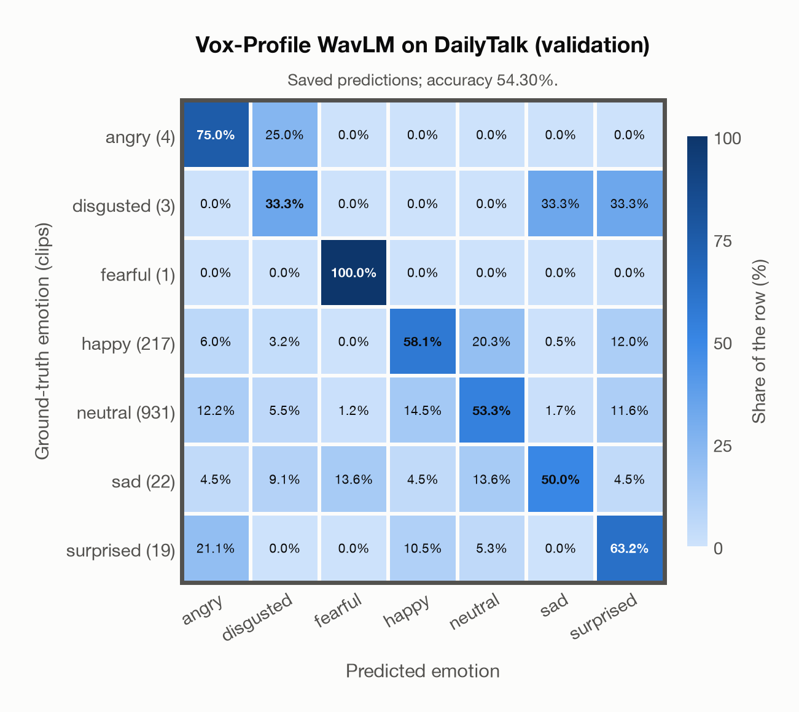

# Vox-Profile WavLM on DailyTalk (validation)

Regenerated offline from saved CSV/JSON by `scripts/evaluation/refresh_reports.py`. This refresh performs no model inference or API requests.

## Summary

| Metric | Recomputed value |
|---|---:|
| Clips | 1,197 |
| Accuracy: acted emotion | 54.30% |
| UAR: mean ground-truth-row recall | 61.83% |
| Macro F1 | 28.15% |
| Weighted F1: true-support weighted | 62.86% |
| Accuracy: all model classes | 50.29% |

## Imported run and verification

- Source: [prediction CSV](../../outputs/vox_profile_wavlm/dailytalk_predictions.csv) and [metadata JSON](../../outputs/vox_profile_wavlm/dailytalk_predictions.json); both remain byte-for-byte unchanged.
- Original execution date recorded in JSON: `2026-11-11`.
- Dataset scope recorded in JSON: **DailyTalk (validation)**, English; 1,197 / 1,197 clips.
- Ground-truth column: `acted_emotion`. Candidate classes: angry, disgusted, fearful, happy, neutral, sad, surprised.
- Row counts, unique audio paths, correctness flags and saved metrics were checked against the CSV. Metric agreement tolerance is 0.000001 (six-decimal metadata).
- Weighted F1 weights each class's F1 by its true support, using the same resolved truth as macro F1; invalid answers remain errors. New metrics absent from the source JSON are recorded in the offline audit and summaries; the source JSON is preserved.
- Original execution/client runtime metadata (reported by the imported run, not measured by this refresh): `{"device": "mps", "hardware": "Apple M3 Pro", "seconds": 529.3, "ms_per_clip": 442.2, "on_cpu": 0}`.

## Results per emotion

| Ground-truth emotion | Clips | Recall | Acted-or-listener recall |
|---|---:|---:|---:|
| angry | 4 | 75.00% | — |
| disgusted | 3 | 33.33% | — |
| fearful | 1 | 100.00% | — |
| happy | 217 | 58.06% | — |
| neutral | 931 | 53.28% | — |
| sad | 22 | 50.00% | — |
| surprised | 19 | 63.16% | — |

Precision/F1 use the same resolved-truth convention as the evaluation script. Weighted F1 uses the resolved-truth clip counts below as weights.

| Predicted emotion | Resolved-truth clips | Precision | Recall | F1 |
|---|---:|---:|---:|---:|
| angry | 4 | 2.22% | 75.00% | 4.32% |
| disgusted | 3 | 1.61% | 33.33% | 3.08% |
| fearful | 1 | 6.67% | 100.00% | 12.50% |
| happy | 217 | 47.73% | 58.06% | 52.39% |
| neutral | 931 | 91.18% | 53.28% | 67.25% |
| sad | 22 | 37.93% | 50.00% | 43.14% |
| surprised | 19 | 8.11% | 63.16% | 14.37% |

## Confusion matrix: acted emotion

| Ground truth \ Predicted | angry | disgusted | fearful | happy | neutral | sad | surprised |
|---|---|---|---|---|---|---|---|
| angry (4) | **75.0%** | 25.0% | 0.0% | 0.0% | 0.0% | 0.0% | 0.0% |
| disgusted (3) | 0.0% | **33.3%** | 0.0% | 0.0% | 0.0% | 33.3% | 33.3% |
| fearful (1) | 0.0% | 0.0% | **100.0%** | 0.0% | 0.0% | 0.0% | 0.0% |
| happy (217) | 6.0% | 3.2% | 0.0% | **58.1%** | 20.3% | 0.5% | 12.0% |
| neutral (931) | 12.2% | 5.5% | 1.2% | 14.5% | **53.3%** | 1.7% | 11.6% |
| sad (22) | 4.5% | 9.1% | 13.6% | 4.5% | 13.6% | **50.0%** | 4.5% |
| surprised (19) | 21.1% | 0.0% | 0.0% | 10.5% | 5.3% | 0.0% | **63.2%** |

## Caveats

- **Training involvement for Vox-Profile WavLM: No corpus-specific evidence**. Source: SER adaptation on MSP-Podcast v1.12; WavLM-large backbone trained on Libri-Light, GigaSpeech and VoxPopuli; no clip-level overlap audit. Direct use and upstream teacher use both count as training involvement. No pattern: no corpus-specific evidence, not verified unseen. Corpus use is not test-clip leakage.
- Internal CSV/JSON consistency does not authenticate the original model or remote request logs.

[Offline validation audit](dailytalk_offline_audit.json)
