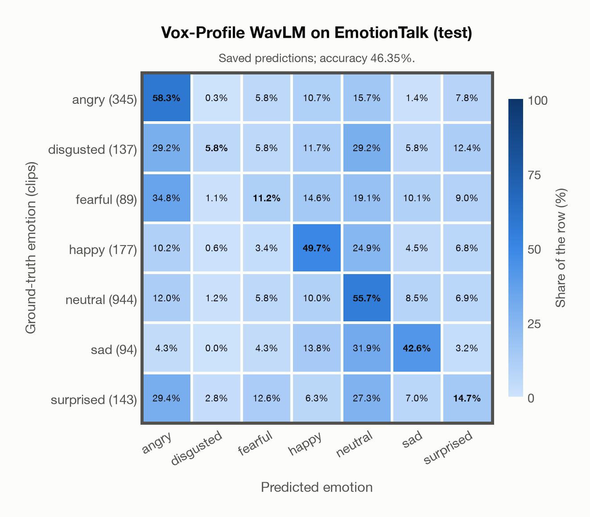

# Vox-Profile WavLM on EmotionTalk (test)

Regenerated offline from saved CSV/JSON by `scripts/evaluation/refresh_reports.py`. This refresh performs no model inference or API requests.

## Summary

| Metric | Recomputed value |
|---|---:|
| Clips | 1,929 |
| Accuracy: acted emotion | 46.35% |
| UAR: mean ground-truth-row recall | 34.00% |
| Macro F1 | 31.02% |
| Weighted F1: true-support weighted | 46.78% |
| Accuracy: all model classes | 46.03% |

## Imported run and verification

- Source: [prediction CSV](../../outputs/vox_profile_wavlm/emotiontalk_predictions.csv) and [metadata JSON](../../outputs/vox_profile_wavlm/emotiontalk_predictions.json); both remain byte-for-byte unchanged.
- Original execution date recorded in JSON: `2026-11-11`.
- Dataset scope recorded in JSON: **EmotionTalk (test)**, Mandarin; 1,929 / 1,929 clips.
- Ground-truth column: `acted_emotion`. Candidate classes: angry, disgusted, fearful, happy, neutral, sad, surprised.
- Row counts, unique audio paths, correctness flags and saved metrics were checked against the CSV. Metric agreement tolerance is 0.000001 (six-decimal metadata).
- Weighted F1 weights each class's F1 by its true support, using the same resolved truth as macro F1; invalid answers remain errors. New metrics absent from the source JSON are recorded in the offline audit and summaries; the source JSON is preserved.
- Original execution/client runtime metadata (reported by the imported run, not measured by this refresh): `{"device": "mps", "hardware": "Apple M3 Pro", "seconds": 1533.0, "ms_per_clip": 794.7, "on_cpu": 0}`.

## Results per emotion

| Ground-truth emotion | Clips | Recall | Acted-or-listener recall |
|---|---:|---:|---:|
| angry | 345 | 58.26% | — |
| disgusted | 137 | 5.84% | — |
| fearful | 89 | 11.24% | — |
| happy | 177 | 49.72% | — |
| neutral | 944 | 55.72% | — |
| sad | 94 | 42.55% | — |
| surprised | 143 | 14.69% | — |

Precision/F1 use the same resolved-truth convention as the evaluation script. Weighted F1 uses the resolved-truth clip counts below as weights.

| Predicted emotion | Resolved-truth clips | Precision | Recall | F1 |
|---|---:|---:|---:|---:|
| angry | 345 | 44.77% | 58.26% | 50.63% |
| disgusted | 137 | 30.77% | 5.84% | 9.82% |
| fearful | 89 | 8.26% | 11.24% | 9.52% |
| happy | 177 | 32.59% | 49.72% | 39.37% |
| neutral | 944 | 70.13% | 55.72% | 62.10% |
| sad | 94 | 25.00% | 42.55% | 31.50% |
| surprised | 143 | 13.73% | 14.69% | 14.19% |

## Confusion matrix: acted emotion

| Ground truth \ Predicted | angry | disgusted | fearful | happy | neutral | sad | surprised |
|---|---|---|---|---|---|---|---|
| angry (345) | **58.3%** | 0.3% | 5.8% | 10.7% | 15.7% | 1.4% | 7.8% |
| disgusted (137) | 29.2% | **5.8%** | 5.8% | 11.7% | 29.2% | 5.8% | 12.4% |
| fearful (89) | 34.8% | 1.1% | **11.2%** | 14.6% | 19.1% | 10.1% | 9.0% |
| happy (177) | 10.2% | 0.6% | 3.4% | **49.7%** | 24.9% | 4.5% | 6.8% |
| neutral (944) | 12.0% | 1.2% | 5.8% | 10.0% | **55.7%** | 8.5% | 6.9% |
| sad (94) | 4.3% | 0.0% | 4.3% | 13.8% | 31.9% | **42.6%** | 3.2% |
| surprised (143) | 29.4% | 2.8% | 12.6% | 6.3% | 27.3% | 7.0% | **14.7%** |

## Caveats

- **Training involvement for Vox-Profile WavLM: No corpus-specific evidence**. Source: SER adaptation on MSP-Podcast v1.12; WavLM-large backbone trained on Libri-Light, GigaSpeech and VoxPopuli; no clip-level overlap audit. Direct use and upstream teacher use both count as training involvement. No pattern: no corpus-specific evidence, not verified unseen. Corpus use is not test-clip leakage.
- Internal CSV/JSON consistency does not authenticate the original model or remote request logs.

[Offline validation audit](emotiontalk_offline_audit.json)
