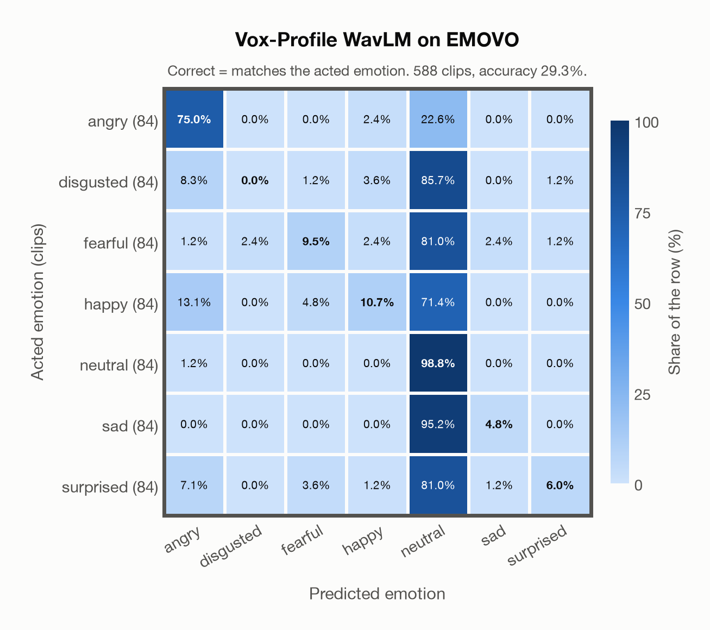

# Vox-Profile WavLM on EMOVO

Generated by `scripts/evaluation/evaluate.py` on 2026-11-07.

## Summary

| Metric | Value |
|---|---|
| Clips evaluated | 588 (Italian) |
| **Accuracy: prediction matches the acted emotion** | **29.3%** |
| Unweighted accuracy (mean recall of the 7 acted emotions) | 29.3% |
| Macro F1 (acted emotion) | 22.5% |
| Accuracy, all 9 model classes (acted emotion) | 29.3% |
| Chance level (7 emotions) | 14.3% |

## Setup

- **Model**: Vox-Profile WavLM (`tiantiaf/wavlm-large-categorical-emotion`) as released (no fine-tuning), transformers 5.18.0, loaded by `scripts/models/vox_profile.py`. Each clip (at most 15 s) is normalised to zero mean and unit variance and fed whole, without padding; the 25 hidden states are mixed with the model's learned layer weights and averaged over time, as in the official code. float32 on every device. The model card warns that clips shorter than 3 s give unreliable predictions (it was trained on clips of 3-15 s); clips are used as they are, not padded to 3 s.
- **Data**: 588 clips of EMOVO (Italian) from `data/emovo/`.
- **Ground truth (acted emotion)**: the emotion each actor was asked to portray, from the first part of the file name (`dis`gusto, `gio`ia, `neu`trale, `pau`ra, `rab`bia, `sor`presa, `tri`stezza).
- Label mapping: rabbia = angry, disgusto = disgusted, paura = fearful, gioia = happy, neutrale = neutral, tristezza = sad, sorpresa = surprised.
- 6 professional actors (3 female, 3 male) say the same 14 sentences (some of them nonsense sentences) in each of the 7 emotions: 588 clips.
- **7 emotions**: the prediction is the most probable of the 7 emotions in this dataset (angry, disgusted, fearful, happy, neutral, sad, surprised); the model has no other classes. **All 9 model classes**: the prediction is the most probable of all 9 model classes, so choosing a class that the dataset does not have counts as wrong.
- **Hardware**: Apple M4 Max, device `mps`, PyTorch 2.7.1. Inference took 1.2 min (127 ms per clip).
- **Per-clip predictions**: `outputs/vox_profile_wavlm/emovo_predictions.csv` (in git, so the results can be checked clip by clip). The JSON file next to it describes the columns.

## Results per emotion

Rows: acted emotion. Precision, recall and F1 compare the prediction with the acted emotion.

| Emotion | Clips | Precision | Recall | F1 |
|---|---|---|---|---|
| angry | 84 | 70.8% | 75.0% | 72.8% |
| disgusted | 84 | 0.0% | 0.0% | 0.0% |
| fearful | 84 | 50.0% | 9.5% | 16.0% |
| happy | 84 | 52.9% | 10.7% | 17.8% |
| neutral | 84 | 18.4% | 98.8% | 31.1% |
| sad | 84 | 57.1% | 4.8% | 8.8% |
| surprised | 84 | 71.4% | 6.0% | 11.0% |

## Confusion matrix: acted emotion

The same numbers as a table. Rows: acted emotion. Columns: predicted emotion. Each row adds up to 100%.

| Acted \ Predicted | angry | disgusted | fearful | happy | neutral | sad | surprised |
|---|---|---|---|---|---|---|---|
| angry (84) | **75.0%** | 0.0% | 0.0% | 2.4% | 22.6% | 0.0% | 0.0% |
| disgusted (84) | 8.3% | **0.0%** | 1.2% | 3.6% | 85.7% | 0.0% | 1.2% |
| fearful (84) | 1.2% | 2.4% | **9.5%** | 2.4% | 81.0% | 2.4% | 1.2% |
| happy (84) | 13.1% | 0.0% | 4.8% | **10.7%** | 71.4% | 0.0% | 0.0% |
| neutral (84) | 1.2% | 0.0% | 0.0% | 0.0% | **98.8%** | 0.0% | 0.0% |
| sad (84) | 0.0% | 0.0% | 0.0% | 0.0% | 95.2% | **4.8%** | 0.0% |
| surprised (84) | 7.1% | 0.0% | 3.6% | 1.2% | 81.0% | 1.2% | **6.0%** |

Most frequent confusions: sad predicted as neutral (95.2%), disgusted predicted as neutral (85.7%), surprised predicted as neutral (81.0%).

## Caveats

- **Not in Vox-Profile WavLM's training data** (MSP-Podcast).
- **Unofficial copy.** The official site (voice.fub.it) is gone and there is no official mirror; the files come from a copy on DagsHub (kingabzpro/EMOVO), checked only against the file names and count of the corpus.
- No listeners' labels per clip are published (the authors' listening test covered 2 sentences per actor). Only six speakers. Audio: 48 kHz WAV, stereo except one file (the channels are averaged), resampled to 16 kHz.
