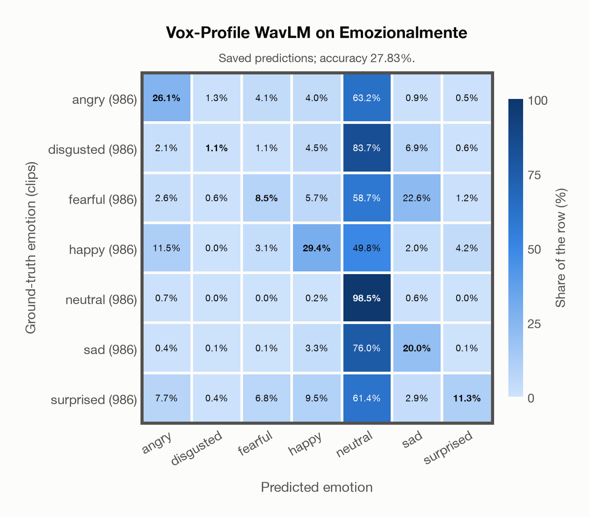
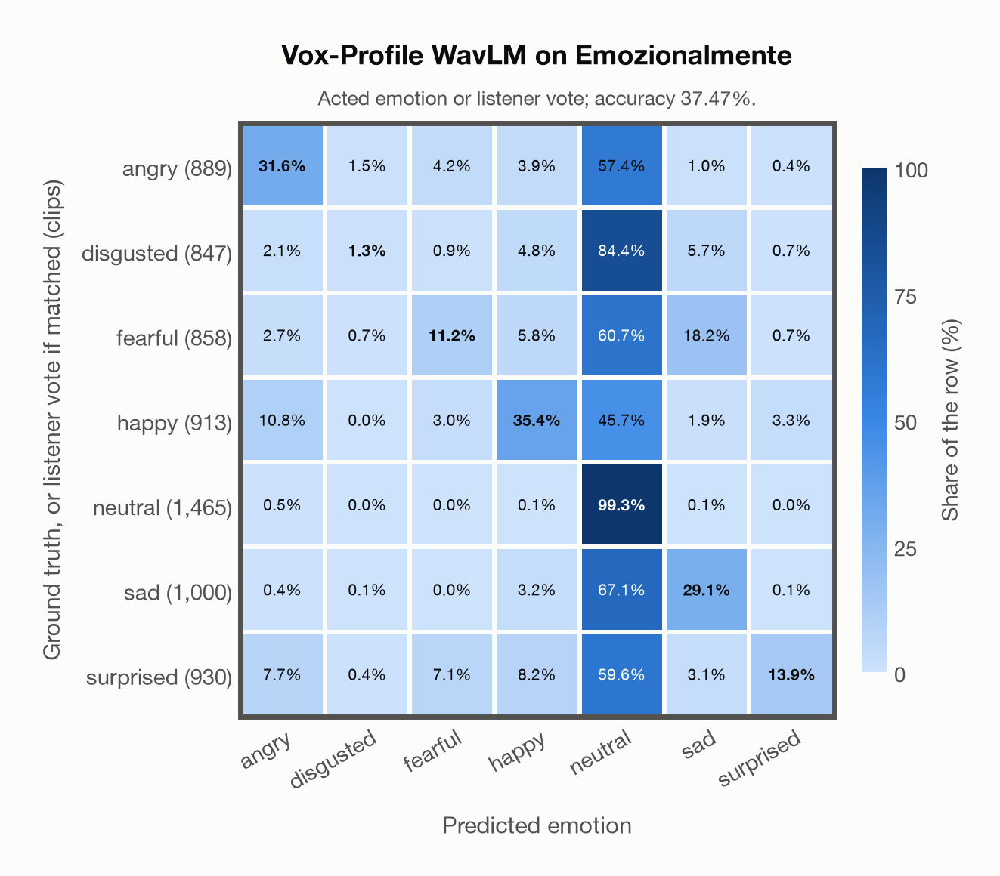

# Vox-Profile WavLM on Emozionalmente

Generated by `scripts/evaluation/evaluate.py` on 2026-11-07.

## Summary

| Metric | Value |
|---|---|
| Clips evaluated | 6,902 (Italian) |
| **Accuracy: prediction matches the acted emotion** | **27.8%** |
| **Accuracy: prediction matches the acted emotion or the listeners' vote** | **37.5%** |
| Unweighted accuracy (mean recall of the 7 acted emotions) | 27.8% |
| Macro F1 (acted emotion) | 23.7% |
| Accuracy, all 9 model classes (acted emotion) | 27.7% |
| Chance level (7 emotions) | 14.3% |
| Listeners' majority vote vs acted emotion | 81.2% |

## Setup

- **Model**: Vox-Profile WavLM (`tiantiaf/wavlm-large-categorical-emotion`) as released (no fine-tuning), transformers 5.18.0, loaded by `scripts/models/vox_profile.py`. Each clip (at most 15 s) is normalised to zero mean and unit variance and fed whole, without padding; the 25 hidden states are mixed with the model's learned layer weights and averaged over time, as in the official code. float32 on every device. The model card warns that clips shorter than 3 s give unreliable predictions (it was trained on clips of 3-15 s); clips are used as they are, not padded to 3 s.
- **Data**: 6,902 clips of Emozionalmente (Italian) from `data/emozionalmente/`.
- **Ground truth (acted emotion)**: the emotion each speaker meant to express (`emotion_expressed` in `metadata/samples.csv`).
- **Listeners' vote**: the majority vote of the 5 crowd-sourced listeners who rated each clip (`metadata/evaluations.csv`, `emotion_recognized`); a tie counts every tied emotion.
- Label mapping: anger = angry, disgust = disgusted, fear = fearful, joy = happy, neutrality = neutral, sadness = sad, surprise = surprised.
- 431 non-professional speakers recorded themselves through a web application, saying 18 sentences in the 7 emotions (986 clips per emotion). All 6,902 clips are evaluated (the authors' speaker-independent train/dev/test split is not used). Audio: 16 kHz mono WAV, the models' own sampling rate.
- **7 emotions**: the prediction is the most probable of the 7 emotions in this dataset (angry, disgusted, fearful, happy, neutral, sad, surprised); the model has no other classes. **All 9 model classes**: the prediction is the most probable of all 9 model classes, so choosing a class that the dataset does not have counts as wrong.
- **Two ways to count a prediction as correct.** *Acted emotion*: it must match the acted emotion. *Acted emotion or listeners' vote*: it also counts when it matches the listeners' majority vote (for a tied vote, any of the tied emotions). Both are reported.
- **Hardware**: Apple M4 Max, device `mps`, PyTorch 2.7.1. Inference took 13.6 min (118 ms per clip).
- **Per-clip predictions**: `outputs/vox_profile_wavlm/emozionalmente_predictions.csv` (in git, so the results can be checked clip by clip). The JSON file next to it describes the columns.

## Results per emotion

Rows: acted emotion. Precision, recall and F1 compare the prediction with the acted emotion; the last column also accepts the listeners' vote.

| Emotion | Clips | Precision | Recall | F1 | Correct, acted or listeners' vote |
|---|---|---|---|---|---|
| angry | 986 | 51.0% | 26.1% | 34.5% | 38.3% |
| disgusted | 986 | 31.4% | 1.1% | 2.2% | 15.2% |
| fearful | 986 | 35.9% | 8.5% | 13.8% | 22.7% |
| happy | 986 | 52.0% | 29.4% | 37.6% | 40.2% |
| neutral | 986 | 20.0% | 98.5% | 33.3% | 99.0% |
| sad | 986 | 35.7% | 20.0% | 25.6% | 28.1% |
| surprised | 986 | 63.1% | 11.3% | 19.1% | 18.8% |

## Confusion matrix: acted emotion

The same numbers as a table. Rows: acted emotion. Columns: predicted emotion. Each row adds up to 100%.

| Acted \ Predicted | angry | disgusted | fearful | happy | neutral | sad | surprised |
|---|---|---|---|---|---|---|---|
| angry (986) | **26.1%** | 1.3% | 4.1% | 4.0% | 63.2% | 0.9% | 0.5% |
| disgusted (986) | 2.1% | **1.1%** | 1.1% | 4.5% | 83.7% | 6.9% | 0.6% |
| fearful (986) | 2.6% | 0.6% | **8.5%** | 5.7% | 58.7% | 22.6% | 1.2% |
| happy (986) | 11.5% | 0.0% | 3.1% | **29.4%** | 49.8% | 2.0% | 4.2% |
| neutral (986) | 0.7% | 0.0% | 0.0% | 0.2% | **98.5%** | 0.6% | 0.0% |
| sad (986) | 0.4% | 0.1% | 0.1% | 3.3% | 76.0% | **20.0%** | 0.1% |
| surprised (986) | 7.7% | 0.4% | 6.8% | 9.5% | 61.4% | 2.9% | **11.3%** |

Most frequent confusions: disgusted predicted as neutral (83.7%), sad predicted as neutral (76.0%), angry predicted as neutral (63.2%).

## Confusion matrix: acted emotion or listeners' vote

Here a prediction is correct when it matches the acted emotion or the listeners' vote. A clip goes into the row of the label its prediction matched, otherwise into the row of its acted emotion. The diagonal therefore holds every correct prediction, and the rows differ in size from the matrix above. 665 clips (9.6%) count as correct only because of the listeners' vote; the most common are acted angry predicted as neutral (113), acted disgusted predicted as neutral (110), acted sad predicted as neutral (78).

| Ground truth \ Predicted | angry | disgusted | fearful | happy | neutral | sad | surprised |
|---|---|---|---|---|---|---|---|
| angry (889) | **31.6%** | 1.5% | 4.2% | 3.9% | 57.4% | 1.0% | 0.4% |
| disgusted (847) | 2.1% | **1.3%** | 0.9% | 4.8% | 84.4% | 5.7% | 0.7% |
| fearful (858) | 2.7% | 0.7% | **11.2%** | 5.8% | 60.7% | 18.2% | 0.7% |
| happy (913) | 10.8% | 0.0% | 3.0% | **35.4%** | 45.7% | 1.9% | 3.3% |
| neutral (1,465) | 0.5% | 0.0% | 0.0% | 0.1% | **99.3%** | 0.1% | 0.0% |
| sad (1,000) | 0.4% | 0.1% | 0.0% | 3.2% | 67.1% | **29.1%** | 0.1% |
| surprised (930) | 7.7% | 0.4% | 7.1% | 8.2% | 59.6% | 3.1% | **13.9%** |

Most frequent confusions: disgusted predicted as neutral (84.4%), sad predicted as neutral (67.1%), fearful predicted as neutral (60.7%).

## Comparison with human listeners

The listeners' majority vote matches the acted emotion for 81.2% of the 6,187 clips with a single (untied) vote. The model agrees with that vote for 33.6% of the same clips.

## Caveats

- **Training involvement for Vox-Profile WavLM: No corpus-specific evidence**. Source: SER adaptation on MSP-Podcast v1.12; WavLM-large backbone trained on Libri-Light, GigaSpeech and VoxPopuli; no clip-level overlap audit. Direct use and upstream teacher use both count as training involvement. No pattern: no corpus-specific evidence, not verified unseen. Corpus use is not test-clip leakage.
- **Amateur speakers and microphones.** The clips were crowd-sourced and mostly recorded with non-professional equipment; the listeners marked the audio quality as bad in 4% of their ratings. They recognised the intended emotion with a UAR of 66% (the authors' figure).
- Emozionalmente is in EmoBox, so it is in the training data of emotion2vec+, and in Melati's training data.
- **Acted labels are not perceived emotions.** The ground truth is what the actor intended; listeners sometimes heard something else, as the listeners' numbers above show.
