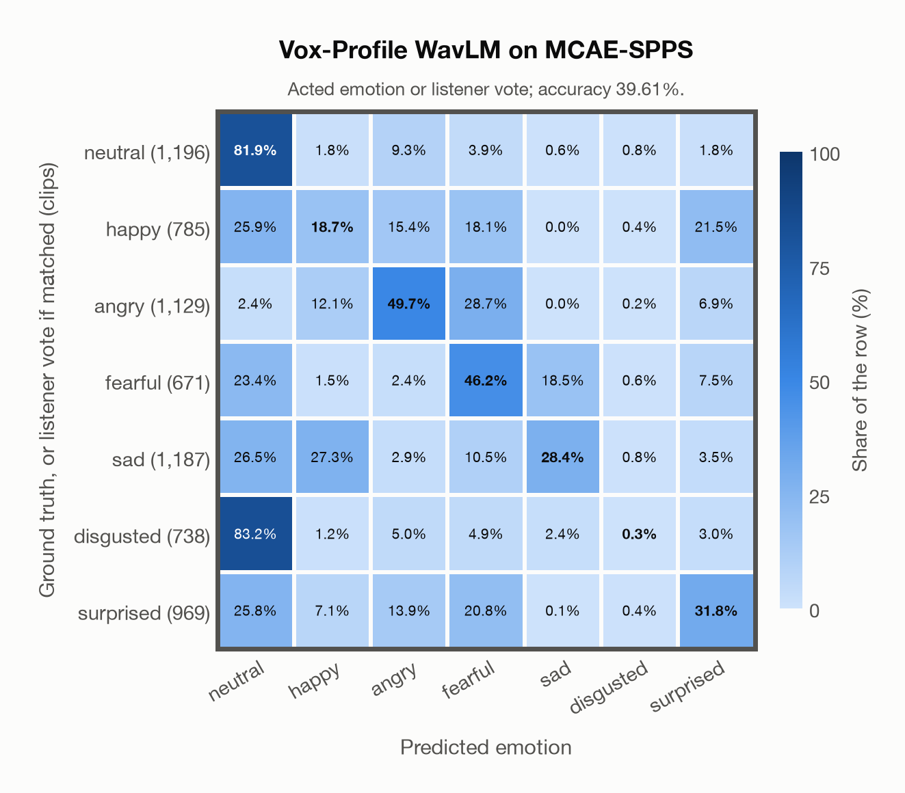

# Vox-Profile WavLM on MCAE-SPPS

Regenerated offline from saved CSV/JSON by `scripts/evaluation/refresh_reports.py`. This refresh performs no model inference or API requests.

## Summary

| Metric | Recomputed value |
|---|---:|
| Clips | 6,675 |
| Accuracy: acted emotion | 39.61% |
| UAR: mean ground-truth-row recall | 36.70% |
| Macro F1 | 33.64% |
| Weighted F1: true-support weighted | 36.49% |
| Accuracy: all model classes | 39.55% |
| Accuracy: acted emotion or listener vote | 39.61% |
| Single listener vote vs acted emotion | 100.00% |
| Model vs single listener vote | 39.61% |

## Imported run and verification

- Source: [prediction CSV](../../outputs/vox_profile_wavlm/mcae_spps_predictions.csv) and [metadata JSON](../../outputs/vox_profile_wavlm/mcae_spps_predictions.json); both remain byte-for-byte unchanged.
- Original execution date recorded in JSON: `2026-10-29`.
- Dataset scope recorded in JSON: **MCAE-SPPS**, Mandarin; 6,675 / 6,675 clips.
- Ground-truth column: `acted_emotion`. Candidate classes: neutral, happy, angry, fearful, sad, disgusted, surprised.
- Row counts, unique audio paths, correctness flags and saved metrics were checked against the CSV. Metric agreement tolerance is 0.000001 (six-decimal metadata).
- Weighted F1 weights each class's F1 by its true support, using the same resolved truth as macro F1; invalid answers remain errors. New metrics absent from the source JSON are recorded in the offline audit and summaries; the source JSON is preserved.
- Original execution/client runtime metadata (reported by the imported run, not measured by this refresh): `{"device": "mps", "hardware": "Apple M4 Max", "seconds": 848.4, "ms_per_clip": 127.1, "on_cpu": 0}`.

## Results per emotion

| Ground-truth emotion | Clips | Recall | Acted-or-listener recall |
|---|---:|---:|---:|
| neutral | 1,196 | 81.86% | 81.86% |
| happy | 785 | 18.73% | 18.73% |
| angry | 1,129 | 49.69% | 49.69% |
| fearful | 671 | 46.20% | 46.20% |
| sad | 1,187 | 28.39% | 28.39% |
| disgusted | 738 | 0.27% | 0.27% |
| surprised | 969 | 31.79% | 31.79% |

Precision/F1 use the same resolved-truth convention as the evaluation script. Weighted F1 uses the resolved-truth clip counts below as weights.

| Predicted emotion | Resolved-truth clips | Precision | Recall | F1 |
|---|---:|---:|---:|---:|
| neutral | 1,196 | 38.47% | 81.86% | 52.34% |
| happy | 785 | 20.47% | 18.73% | 19.56% |
| angry | 1,129 | 55.22% | 49.69% | 52.31% |
| fearful | 671 | 26.14% | 46.20% | 33.39% |
| sad | 1,187 | 69.20% | 28.39% | 40.26% |
| disgusted | 738 | 6.06% | 0.27% | 0.52% |
| surprised | 969 | 44.64% | 31.79% | 37.13% |

## Confusion matrix: acted emotion

| Ground truth \ Predicted | neutral | happy | angry | fearful | sad | disgusted | surprised |
|---|---|---|---|---|---|---|---|
| neutral (1,196) | **81.9%** | 1.8% | 9.3% | 3.9% | 0.6% | 0.8% | 1.8% |
| happy (785) | 25.9% | **18.7%** | 15.4% | 18.1% | 0.0% | 0.4% | 21.5% |
| angry (1,129) | 2.4% | 12.1% | **49.7%** | 28.7% | 0.0% | 0.2% | 6.9% |
| fearful (671) | 23.4% | 1.5% | 2.4% | **46.2%** | 18.5% | 0.6% | 7.5% |
| sad (1,187) | 26.5% | 27.3% | 2.9% | 10.5% | **28.4%** | 0.8% | 3.5% |
| disgusted (738) | 83.2% | 1.2% | 5.0% | 4.9% | 2.4% | **0.3%** | 3.0% |
| surprised (969) | 25.8% | 7.1% | 13.9% | 20.8% | 0.1% | 0.4% | **31.8%** |

## Confusion matrix: acted emotion or listener vote

A prediction accepted only through the listener vote is placed in that predicted emotion's row; other clips keep their original ground-truth row. Row supports can therefore change.

| Ground truth \ Predicted | neutral | happy | angry | fearful | sad | disgusted | surprised |
|---|---|---|---|---|---|---|---|
| neutral (1,196) | **81.9%** | 1.8% | 9.3% | 3.9% | 0.6% | 0.8% | 1.8% |
| happy (785) | 25.9% | **18.7%** | 15.4% | 18.1% | 0.0% | 0.4% | 21.5% |
| angry (1,129) | 2.4% | 12.1% | **49.7%** | 28.7% | 0.0% | 0.2% | 6.9% |
| fearful (671) | 23.4% | 1.5% | 2.4% | **46.2%** | 18.5% | 0.6% | 7.5% |
| sad (1,187) | 26.5% | 27.3% | 2.9% | 10.5% | **28.4%** | 0.8% | 3.5% |
| disgusted (738) | 83.2% | 1.2% | 5.0% | 4.9% | 2.4% | **0.3%** | 3.0% |
| surprised (969) | 25.8% | 7.1% | 13.9% | 20.8% | 0.1% | 0.4% | **31.8%** |

## Caveats

- **Training involvement for Vox-Profile WavLM: No corpus-specific evidence**. Source: SER adaptation on MSP-Podcast v1.12; WavLM-large backbone trained on Libri-Light, GigaSpeech and VoxPopuli; no clip-level overlap audit. Direct use and upstream teacher use both count as training involvement. No pattern: no corpus-specific evidence, not verified unseen. Corpus use is not test-clip leakage.
- Internal CSV/JSON consistency does not authenticate the original model or remote request logs.

[Offline validation audit](mcae_spps_offline_audit.json)
