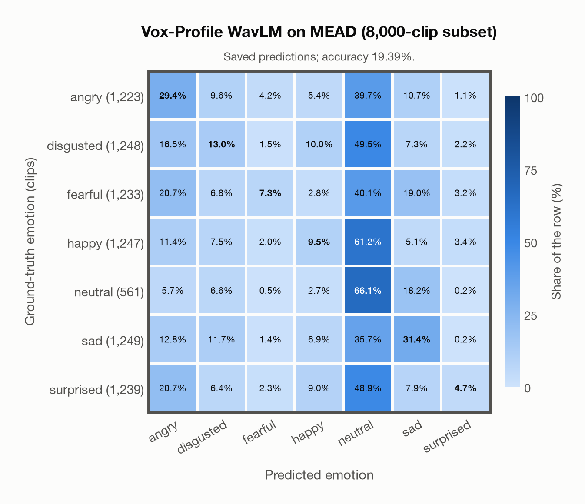

# Vox-Profile WavLM on MEAD (8,000-clip subset)

Regenerated offline from saved CSV/JSON by `scripts/evaluation/refresh_reports.py`. This refresh performs no model inference or API requests.

## Summary

| Metric | Recomputed value |
|---|---:|
| Clips | 8,000 |
| Accuracy: acted emotion | 19.39% |
| UAR: mean ground-truth-row recall | 23.05% |
| Macro F1 | 18.23% |
| Weighted F1: true-support weighted | 18.33% |
| Accuracy: all model classes | 18.62% |

## Imported run and verification

- Source: [prediction CSV](../../outputs/vox_profile_wavlm/mead_predictions.csv) and [metadata JSON](../../outputs/vox_profile_wavlm/mead_predictions.json); both remain byte-for-byte unchanged.
- Original execution date recorded in JSON: `2026-11-07`.
- Dataset scope recorded in JSON: **MEAD (8,000-clip subset)**, English; 8,000 / 8,000 clips.
- Ground-truth column: `acted_emotion`. Candidate classes: angry, disgusted, fearful, happy, neutral, sad, surprised.
- Row counts, unique audio paths, correctness flags and saved metrics were checked against the CSV. Metric agreement tolerance is 0.000001 (six-decimal metadata).
- Weighted F1 weights each class's F1 by its true support, using the same resolved truth as macro F1; invalid answers remain errors. New metrics absent from the source JSON are recorded in the offline audit and summaries; the source JSON is preserved.
- Original execution/client runtime metadata (reported by the imported run, not measured by this refresh): `{"device": "mps", "hardware": "Apple M4 Max", "seconds": 1658.3, "ms_per_clip": 207.3, "on_cpu": 0}`.

## Results per emotion

| Ground-truth emotion | Clips | Recall | Acted-or-listener recall |
|---|---:|---:|---:|
| angry | 1,223 | 29.35% | — |
| disgusted | 1,248 | 12.98% | — |
| fearful | 1,233 | 7.30% | — |
| happy | 1,247 | 9.54% | — |
| neutral | 561 | 66.13% | — |
| sad | 1,249 | 31.39% | — |
| surprised | 1,239 | 4.68% | — |

Precision/F1 use the same resolved-truth convention as the evaluation script. Weighted F1 uses the resolved-truth clip counts below as weights.

| Predicted emotion | Resolved-truth clips | Precision | Recall | F1 |
|---|---:|---:|---:|---:|
| angry | 1,223 | 25.44% | 29.35% | 27.26% |
| disgusted | 1,248 | 22.56% | 12.98% | 16.48% |
| fearful | 1,233 | 38.46% | 7.30% | 12.27% |
| happy | 1,247 | 21.33% | 9.54% | 13.19% |
| neutral | 561 | 9.80% | 66.13% | 17.08% |
| sad | 1,249 | 35.28% | 31.39% | 33.22% |
| surprised | 1,239 | 31.52% | 4.68% | 8.15% |

## Confusion matrix: acted emotion

| Ground truth \ Predicted | angry | disgusted | fearful | happy | neutral | sad | surprised |
|---|---|---|---|---|---|---|---|
| angry (1,223) | **29.4%** | 9.6% | 4.2% | 5.4% | 39.7% | 10.7% | 1.1% |
| disgusted (1,248) | 16.5% | **13.0%** | 1.5% | 10.0% | 49.5% | 7.3% | 2.2% |
| fearful (1,233) | 20.7% | 6.8% | **7.3%** | 2.8% | 40.1% | 19.0% | 3.2% |
| happy (1,247) | 11.4% | 7.5% | 2.0% | **9.5%** | 61.2% | 5.1% | 3.4% |
| neutral (561) | 5.7% | 6.6% | 0.5% | 2.7% | **66.1%** | 18.2% | 0.2% |
| sad (1,249) | 12.8% | 11.7% | 1.4% | 6.9% | 35.7% | **31.4%** | 0.2% |
| surprised (1,239) | 20.7% | 6.4% | 2.3% | 9.0% | 48.9% | 7.9% | **4.7%** |

## Caveats

- **Training involvement for Vox-Profile WavLM: No corpus-specific evidence**. Source: SER adaptation on MSP-Podcast v1.12; WavLM-large backbone trained on Libri-Light, GigaSpeech and VoxPopuli; no clip-level overlap audit. Direct use and upstream teacher use both count as training involvement. No pattern: no corpus-specific evidence, not verified unseen. Corpus use is not test-clip leakage.
- Internal CSV/JSON consistency does not authenticate the original model or remote request logs.

[Offline validation audit](mead_offline_audit.json)
