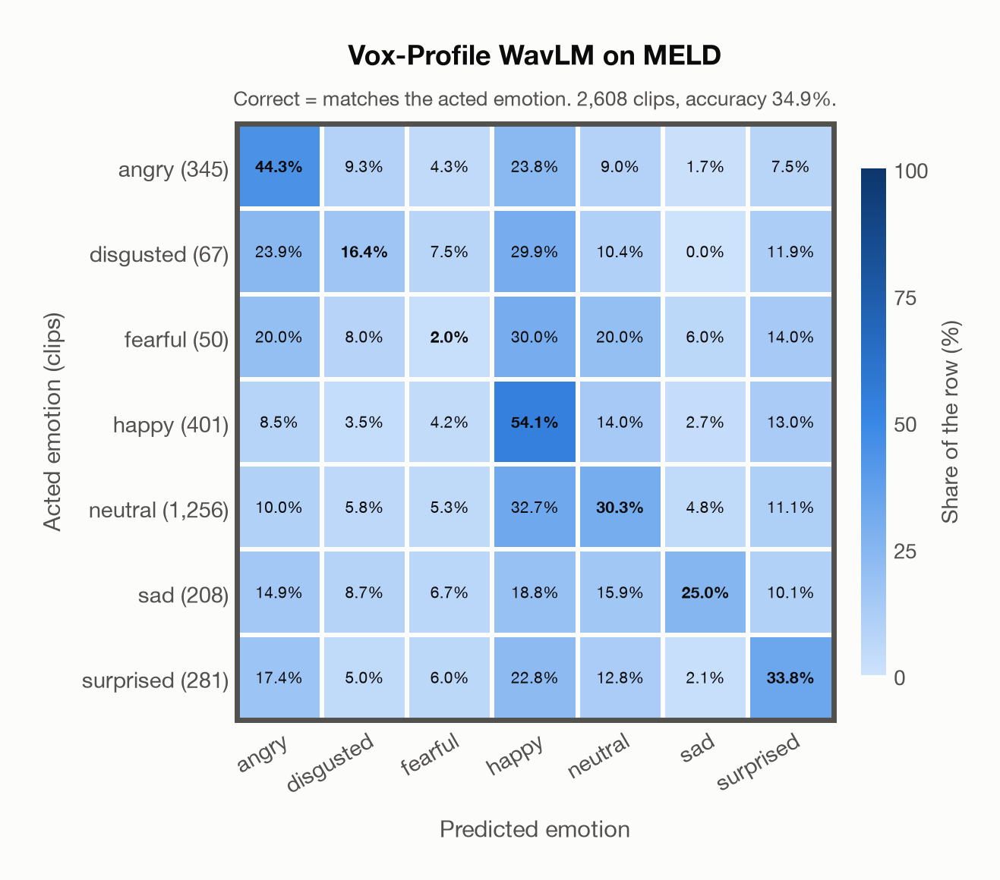

# Vox-Profile WavLM on MELD

Generated by `scripts/evaluation/evaluate.py` on 2026-11-07.

## Summary

| Metric | Value |
|---|---|
| Clips evaluated | 2,608 (English) |
| **Accuracy: prediction matches the acted emotion** | **34.9%** |
| Unweighted accuracy (mean recall of the 7 acted emotions) | 29.4% |
| Macro F1 (acted emotion) | 26.8% |
| Accuracy, all 9 model classes (acted emotion) | 33.9% |
| Chance level (7 emotions) | 14.3% |

## Setup

- **Model**: Vox-Profile WavLM (`tiantiaf/wavlm-large-categorical-emotion`) as released (no fine-tuning), transformers 5.18.0, loaded by `scripts/models/vox_profile.py`. Each clip (at most 15 s) is normalised to zero mean and unit variance and fed whole, without padding; the 25 hidden states are mixed with the model's learned layer weights and averaged over time, as in the official code. float32 on every device. The model card warns that clips shorter than 3 s give unreliable predictions (it was trained on clips of 3-15 s); clips are used as they are, not padded to 3 s.
- **Data**: 2,608 clips of MELD (English) from `data/meld/`.
- **Ground truth (acted emotion)**: the label of each utterance (`Emotion` in `test_sent_emo.csv`): the majority of three annotators who watched the video and read the transcript; the speakers were not asked to act an emotion.
- Label mapping: anger = angry, disgust = disgusted, fear = fearful, joy = happy, neutral = neutral, sadness = sad, surprise = surprised.
- Only the official **test split** (2,610 utterances of 280 dialogues): it is the standard split for reporting results, and the train and dev splits were used to train several of the models.
- Utterances from the TV series *Friends*, converted from the test videos to 16 kHz mono WAV by scripts/common/download_data.py. Left out: `dia38_utt4` (joy) and `dia220_utt0` (disgust), whose time stamps are wrong (each clip holds 4–5 minutes of the episode for one short line).
- **7 emotions**: the prediction is the most probable of the 7 emotions in this dataset (angry, disgusted, fearful, happy, neutral, sad, surprised); the model has no other classes. **All 9 model classes**: the prediction is the most probable of all 9 model classes, so choosing a class that the dataset does not have counts as wrong.
- **Hardware**: Apple M4 Max, device `mps`, PyTorch 2.7.1. Inference took 6.4 min (148 ms per clip).
- **Per-clip predictions**: `outputs/vox_profile_wavlm/meld_predictions.csv` (in git, so the results can be checked clip by clip). The JSON file next to it describes the columns.

## Results per emotion

Rows: acted emotion. Precision, recall and F1 compare the prediction with the acted emotion.

| Emotion | Clips | Precision | Recall | F1 |
|---|---|---|---|---|
| angry | 345 | 36.5% | 44.3% | 40.1% |
| disgusted | 67 | 6.6% | 16.4% | 9.4% |
| fearful | 50 | 0.7% | 2.0% | 1.1% |
| happy | 401 | 25.6% | 54.1% | 34.7% |
| neutral | 1,256 | 68.7% | 30.3% | 42.0% |
| sad | 208 | 37.7% | 25.0% | 30.1% |
| surprised | 281 | 27.3% | 33.8% | 30.2% |

## Confusion matrix: acted emotion

The same numbers as a table. Rows: acted emotion. Columns: predicted emotion. Each row adds up to 100%.

| Acted \ Predicted | angry | disgusted | fearful | happy | neutral | sad | surprised |
|---|---|---|---|---|---|---|---|
| angry (345) | **44.3%** | 9.3% | 4.3% | 23.8% | 9.0% | 1.7% | 7.5% |
| disgusted (67) | 23.9% | **16.4%** | 7.5% | 29.9% | 10.4% | 0.0% | 11.9% |
| fearful (50) | 20.0% | 8.0% | **2.0%** | 30.0% | 20.0% | 6.0% | 14.0% |
| happy (401) | 8.5% | 3.5% | 4.2% | **54.1%** | 14.0% | 2.7% | 13.0% |
| neutral (1,256) | 10.0% | 5.8% | 5.3% | 32.7% | **30.3%** | 4.8% | 11.1% |
| sad (208) | 14.9% | 8.7% | 6.7% | 18.8% | 15.9% | **25.0%** | 10.1% |
| surprised (281) | 17.4% | 5.0% | 6.0% | 22.8% | 12.8% | 2.1% | **33.8%** |

Most frequent confusions: neutral predicted as happy (32.7%), fearful predicted as happy (30.0%), disgusted predicted as happy (29.9%).

## Caveats

- **Not in Vox-Profile WavLM's training data** (MSP-Podcast).
- **In-the-wild speech with noisy labels.** The annotators saw the video and the transcript, not the voice alone, and agreed moderately (Fleiss' kappa 0.43); the classes are very unbalanced (48% neutral, 2% fear).
- Several speakers, laughter of the studio audience and background music can be heard in a clip; a third of the clips are shorter than 2 s.
- MELD's train split is in the training data of MERaLiON-SER-v1 and of EmoBox (emotion2vec+), so these models have heard the same speakers and show.
- The clips come from a copyrighted TV show (the authors rely on fair use); the repository is GPL-3.0.
