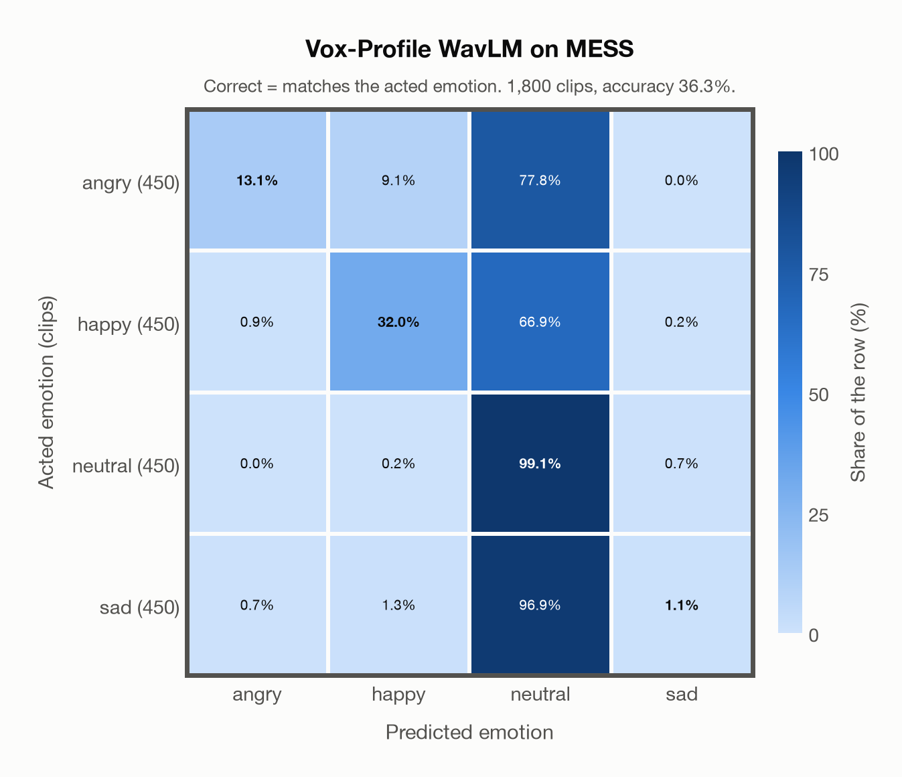

# Vox-Profile WavLM on MESS

Generated by `scripts/evaluation/evaluate.py` on 2026-10-29.

## Summary

| Metric | Value |
|---|---|
| Clips evaluated | 1,800 (English) |
| **Accuracy: prediction matches the acted emotion** | **36.3%** |
| Unweighted accuracy (mean recall of the 4 acted emotions) | 36.3% |
| Macro F1 (acted emotion) | 28.7% |
| Accuracy, all 9 model classes (acted emotion) | 33.0% |
| Chance level (4 emotions) | 25.0% |

## Setup

- **Model**: Vox-Profile WavLM (`tiantiaf/wavlm-large-categorical-emotion`) as released (no fine-tuning), transformers 5.18.0, loaded by `scripts/models/vox_profile.py`. Each clip (at most 15 s) is normalised to zero mean and unit variance and fed whole, without padding; the 25 hidden states are mixed with the model's learned layer weights and averaged over time, as in the official code. float32 on every device. The model card warns that clips shorter than 3 s give unreliable predictions (it was trained on clips of 3-15 s); clips are used as they are, not padded to 3 s.
- **Data**: 1,800 clips of MESS (English) from `data/mess/`.
- **Ground truth (acted emotion)**: the emotion each speaker was asked to portray, from the first letter of the file name (`A`ngry, `C`alm, `H`appy, `S`ad).
- Label mapping: angry = angry, happy = happy, sad = sad, and **calm = neutral** (the project's emotions have no *calm*).
- **4 emotions**: the prediction is the most probable of the 4 emotions in this dataset (angry, happy, neutral, sad); the model's other classes (`contempt`, `disgusted`, `fearful`, `surprised`, `other`) are ignored. **All 9 model classes**: the prediction is the most probable of all 9 model classes, so choosing a class that the dataset does not have counts as wrong.
- **Hardware**: Apple M4 Max, device `mps`, PyTorch 2.5.1. Inference took 7.7 min (255 ms per clip).
- **Per-clip predictions**: `outputs/vox_profile_wavlm/mess_predictions.csv` (not in git; re-run the script to recreate it). The JSON file next to it describes the columns.

## Results per emotion

Rows: acted emotion. Precision, recall and F1 compare the prediction with the acted emotion.

| Emotion | Clips | Precision | Recall | F1 |
|---|---|---|---|---|
| angry | 450 | 89.4% | 13.1% | 22.9% |
| happy | 450 | 75.0% | 32.0% | 44.9% |
| neutral | 450 | 29.1% | 99.1% | 45.0% |
| sad | 450 | 55.6% | 1.1% | 2.2% |

## Confusion matrix: acted emotion

The same numbers as a table. Rows: acted emotion. Columns: predicted emotion. Each row adds up to 100%.

| Acted \ Predicted | angry | happy | neutral | sad |
|---|---|---|---|---|
| angry (450) | **13.1%** | 9.1% | 77.8% | 0.0% |
| happy (450) | 0.9% | **32.0%** | 66.9% | 0.2% |
| neutral (450) | 0.0% | 0.2% | **99.1%** | 0.7% |
| sad (450) | 0.7% | 1.3% | 96.9% | **1.1%** |

Most frequent confusions: sad predicted as neutral (96.9%), angry predicted as neutral (77.8%), happy predicted as neutral (66.9%).

## Predictions outside the 4 emotions

With all 9 model classes, the model chose a class that this dataset does not have for 138 clips (7.7%): `contempt` 79, `disgusted` 27, `fearful` 3, `surprised` 29, `other` 0.

## Caveats

- **Not in Vox-Profile WavLM's training data** (MSP-Podcast).
- *Calm* is not quite *neutral*: calm clips predicted as neutral count as correct.
- The public version has 1,800 clips and acted labels only; the listeners' ratings are available from the author on request. Audio is sampled at 24,414 Hz, resampled to 16 kHz.
