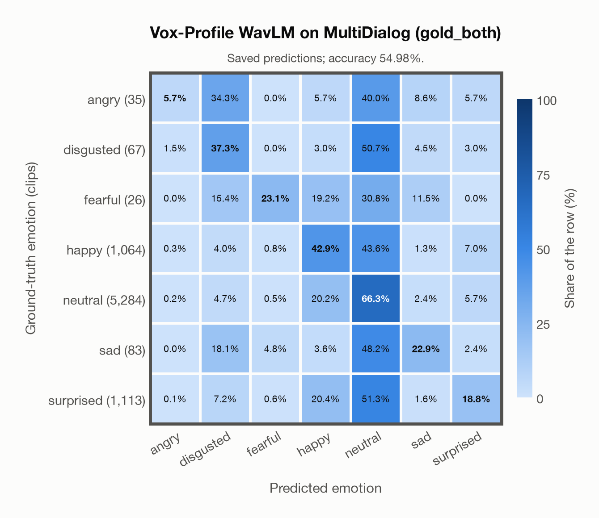

# Vox-Profile WavLM on MultiDialog (gold_both)

Regenerated offline from saved CSV/JSON by `scripts/evaluation/refresh_reports.py`. This refresh performs no model inference or API requests.

## Summary

| Metric | Recomputed value |
|---|---:|
| Clips | 7,672 |
| Accuracy: acted emotion | 54.98% |
| UAR: mean ground-truth-row recall | 30.98% |
| Macro F1 | 24.88% |
| Weighted F1: true-support weighted | 56.99% |
| Accuracy: all model classes | 54.31% |

## Imported run and verification

- Source: [prediction CSV](../../outputs/vox_profile_wavlm/multidialog_predictions.csv) and [metadata JSON](../../outputs/vox_profile_wavlm/multidialog_predictions.json); both remain byte-for-byte unchanged.
- Original execution date recorded in JSON: `2026-11-11`.
- Dataset scope recorded in JSON: **MultiDialog (gold_both)**, English; 7,672 / 7,672 clips.
- Ground-truth column: `acted_emotion`. Candidate classes: angry, disgusted, fearful, happy, neutral, sad, surprised.
- Row counts, unique audio paths, correctness flags and saved metrics were checked against the CSV. Metric agreement tolerance is 0.000001 (six-decimal metadata).
- Weighted F1 weights each class's F1 by its true support, using the same resolved truth as macro F1; invalid answers remain errors. New metrics absent from the source JSON are recorded in the offline audit and summaries; the source JSON is preserved.
- Original execution/client runtime metadata (reported by the imported run, not measured by this refresh): `{"device": "mps", "hardware": "Apple M3 Pro", "seconds": 1584.4, "ms_per_clip": 206.5, "on_cpu": 0}`.

## Results per emotion

| Ground-truth emotion | Clips | Recall | Acted-or-listener recall |
|---|---:|---:|---:|
| angry | 35 | 5.71% | — |
| disgusted | 67 | 37.31% | — |
| fearful | 26 | 23.08% | — |
| happy | 1,064 | 42.86% | — |
| neutral | 5,284 | 66.26% | — |
| sad | 83 | 22.89% | — |
| surprised | 1,113 | 18.78% | — |

Precision/F1 use the same resolved-truth convention as the evaluation script. Weighted F1 uses the resolved-truth clip counts below as weights.

| Predicted emotion | Resolved-truth clips | Precision | Recall | F1 |
|---|---:|---:|---:|---:|
| angry | 35 | 11.11% | 5.71% | 7.55% |
| disgusted | 67 | 5.87% | 37.31% | 10.14% |
| fearful | 26 | 11.11% | 23.08% | 15.00% |
| happy | 1,064 | 25.84% | 42.86% | 32.24% |
| neutral | 5,284 | 75.58% | 66.26% | 70.61% |
| sad | 83 | 10.16% | 22.89% | 14.07% |
| surprised | 1,113 | 35.42% | 18.78% | 24.54% |

## Confusion matrix: acted emotion

| Ground truth \ Predicted | angry | disgusted | fearful | happy | neutral | sad | surprised |
|---|---|---|---|---|---|---|---|
| angry (35) | **5.7%** | 34.3% | 0.0% | 5.7% | 40.0% | 8.6% | 5.7% |
| disgusted (67) | 1.5% | **37.3%** | 0.0% | 3.0% | 50.7% | 4.5% | 3.0% |
| fearful (26) | 0.0% | 15.4% | **23.1%** | 19.2% | 30.8% | 11.5% | 0.0% |
| happy (1,064) | 0.3% | 4.0% | 0.8% | **42.9%** | 43.6% | 1.3% | 7.0% |
| neutral (5,284) | 0.2% | 4.7% | 0.5% | 20.2% | **66.3%** | 2.4% | 5.7% |
| sad (83) | 0.0% | 18.1% | 4.8% | 3.6% | 48.2% | **22.9%** | 2.4% |
| surprised (1,113) | 0.1% | 7.2% | 0.6% | 20.4% | 51.3% | 1.6% | **18.8%** |

## Caveats

- **Training involvement for Vox-Profile WavLM: No corpus-specific evidence**. Source: SER adaptation on MSP-Podcast v1.12; WavLM-large backbone trained on Libri-Light, GigaSpeech and VoxPopuli; no clip-level overlap audit. Direct use and upstream teacher use both count as training involvement. No pattern: no corpus-specific evidence, not verified unseen. Corpus use is not test-clip leakage.
- Internal CSV/JSON consistency does not authenticate the original model or remote request logs.

[Offline validation audit](multidialog_offline_audit.json)
