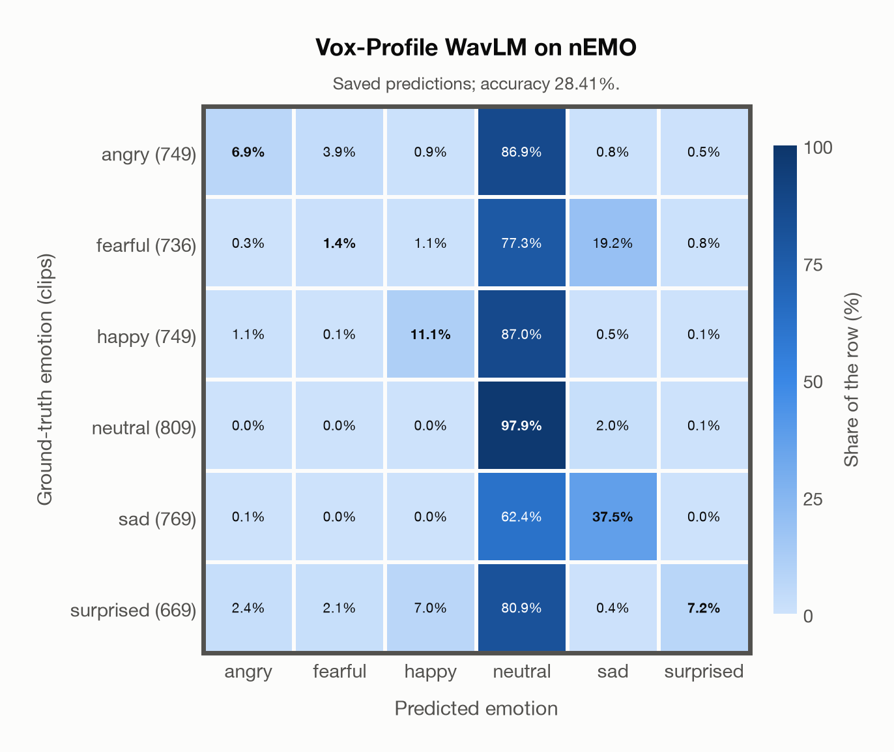

# Vox-Profile WavLM on nEMO

Regenerated offline from saved CSV/JSON by `scripts/evaluation/refresh_reports.py`. This refresh performs no model inference or API requests.

## Summary

| Metric | Recomputed value |
|---|---:|
| Clips | 4,481 |
| Accuracy: acted emotion | 28.41% |
| UAR: mean ground-truth-row recall | 26.98% |
| Macro F1 | 21.50% |
| Weighted F1: true-support weighted | 22.00% |
| Accuracy: all model classes | 28.14% |

## Imported run and verification

- Source: [prediction CSV](../../outputs/vox_profile_wavlm/nemo_predictions.csv) and [metadata JSON](../../outputs/vox_profile_wavlm/nemo_predictions.json); both remain byte-for-byte unchanged.
- Original execution date recorded in JSON: `2026-11-07`.
- Dataset scope recorded in JSON: **nEMO**, Polish; 4,481 / 4,481 clips.
- Ground-truth column: `acted_emotion`. Candidate classes: angry, fearful, happy, neutral, sad, surprised.
- Row counts, unique audio paths, correctness flags and saved metrics were checked against the CSV. Metric agreement tolerance is 0.000001 (six-decimal metadata).
- Weighted F1 weights each class's F1 by its true support, using the same resolved truth as macro F1; invalid answers remain errors. New metrics absent from the source JSON are recorded in the offline audit and summaries; the source JSON is preserved.
- Original execution/client runtime metadata (reported by the imported run, not measured by this refresh): `{"device": "mps", "hardware": "Apple M4 Max", "seconds": 389.4, "ms_per_clip": 86.9, "on_cpu": 0}`.

## Results per emotion

| Ground-truth emotion | Clips | Recall | Acted-or-listener recall |
|---|---:|---:|---:|
| angry | 749 | 6.94% | — |
| fearful | 736 | 1.36% | — |
| happy | 749 | 11.08% | — |
| neutral | 809 | 97.90% | — |
| sad | 769 | 37.45% | — |
| surprised | 669 | 7.17% | — |

Precision/F1 use the same resolved-truth convention as the evaluation script. Weighted F1 uses the resolved-truth clip counts below as weights.

| Predicted emotion | Resolved-truth clips | Precision | Recall | F1 |
|---|---:|---:|---:|---:|
| angry | 749 | 65.82% | 6.94% | 12.56% |
| fearful | 736 | 18.52% | 1.36% | 2.53% |
| happy | 749 | 57.24% | 11.08% | 18.57% |
| neutral | 809 | 21.49% | 97.90% | 35.25% |
| sad | 769 | 62.88% | 37.45% | 46.94% |
| surprised | 669 | 80.00% | 7.17% | 13.17% |

## Confusion matrix: acted emotion

| Ground truth \ Predicted | angry | fearful | happy | neutral | sad | surprised |
|---|---|---|---|---|---|---|
| angry (749) | **6.9%** | 3.9% | 0.9% | 86.9% | 0.8% | 0.5% |
| fearful (736) | 0.3% | **1.4%** | 1.1% | 77.3% | 19.2% | 0.8% |
| happy (749) | 1.1% | 0.1% | **11.1%** | 87.0% | 0.5% | 0.1% |
| neutral (809) | 0.0% | 0.0% | 0.0% | **97.9%** | 2.0% | 0.1% |
| sad (769) | 0.1% | 0.0% | 0.0% | 62.4% | **37.5%** | 0.0% |
| surprised (669) | 2.4% | 2.1% | 7.0% | 80.9% | 0.4% | **7.2%** |

## Caveats

- **Training involvement for Vox-Profile WavLM: No corpus-specific evidence**. Source: SER adaptation on MSP-Podcast v1.12; WavLM-large backbone trained on Libri-Light, GigaSpeech and VoxPopuli; no clip-level overlap audit. Direct use and upstream teacher use both count as training involvement. No pattern: no corpus-specific evidence, not verified unseen. Corpus use is not test-clip leakage.
- Internal CSV/JSON consistency does not authenticate the original model or remote request logs.

[Offline validation audit](nemo_offline_audit.json)
