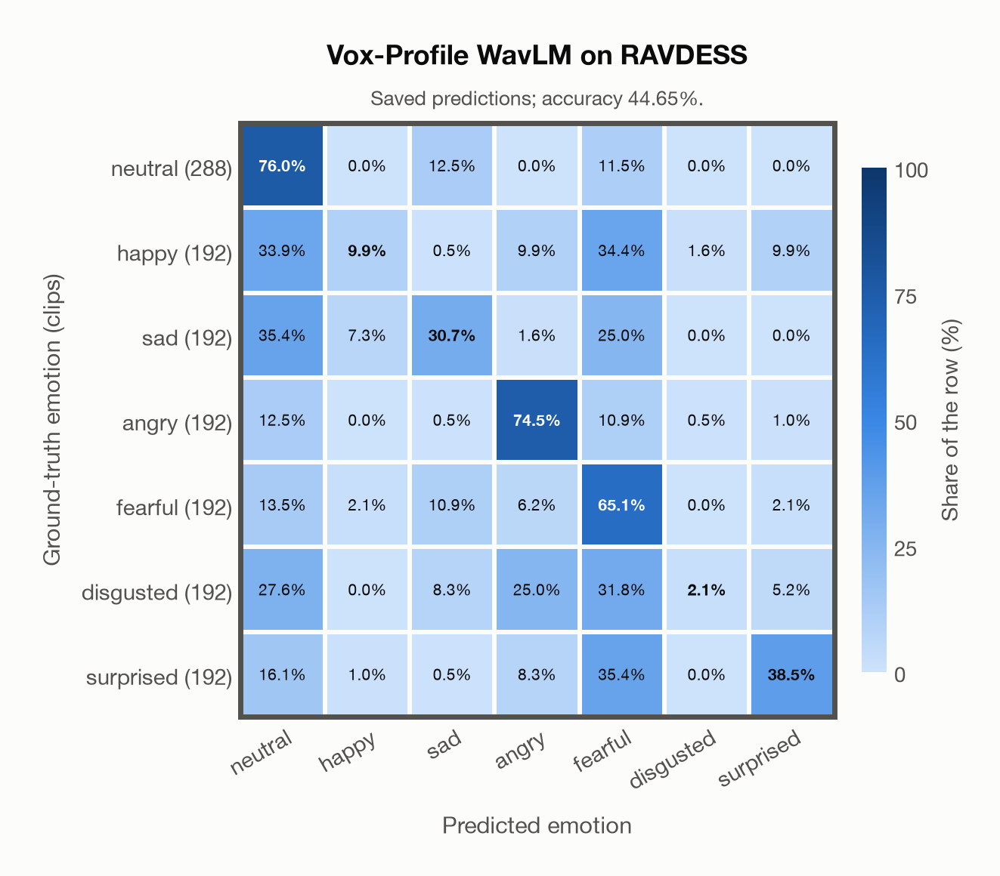

# Vox-Profile WavLM on RAVDESS

Regenerated offline from saved CSV/JSON by `scripts/evaluation/refresh_reports.py`. This refresh performs no model inference or API requests.

## Summary

| Metric | Recomputed value |
|---|---:|
| Clips | 1,440 |
| Accuracy: acted emotion | 44.65% |
| UAR: mean ground-truth-row recall | 42.41% |
| Macro F1 | 38.44% |
| Weighted F1: true-support weighted | 39.65% |
| Accuracy: all model classes | 44.58% |

## Imported run and verification

- Source: [prediction CSV](../../outputs/vox_profile_wavlm/ravdess_predictions.csv) and [metadata JSON](../../outputs/vox_profile_wavlm/ravdess_predictions.json); both remain byte-for-byte unchanged.
- Original execution date recorded in JSON: `2026-10-29`.
- Dataset scope recorded in JSON: **RAVDESS**, English; 1,440 / 1,440 clips.
- Ground-truth column: `acted_emotion`. Candidate classes: neutral, happy, sad, angry, fearful, disgusted, surprised.
- Row counts, unique audio paths, correctness flags and saved metrics were checked against the CSV. Metric agreement tolerance is 0.000001 (six-decimal metadata).
- Weighted F1 weights each class's F1 by its true support, using the same resolved truth as macro F1; invalid answers remain errors. New metrics absent from the source JSON are recorded in the offline audit and summaries; the source JSON is preserved.
- Original execution/client runtime metadata (reported by the imported run, not measured by this refresh): `{"device": "mps", "hardware": "Apple M4 Max", "seconds": 87.0, "ms_per_clip": 60.4, "on_cpu": 0}`.

## Results per emotion

| Ground-truth emotion | Clips | Recall | Acted-or-listener recall |
|---|---:|---:|---:|
| neutral | 288 | 76.04% | — |
| happy | 192 | 9.90% | — |
| sad | 192 | 30.73% | — |
| angry | 192 | 74.48% | — |
| fearful | 192 | 65.10% | — |
| disgusted | 192 | 2.08% | — |
| surprised | 192 | 38.54% | — |

Precision/F1 use the same resolved-truth convention as the evaluation script. Weighted F1 uses the resolved-truth clip counts below as weights.

| Predicted emotion | Resolved-truth clips | Precision | Recall | F1 |
|---|---:|---:|---:|---:|
| neutral | 288 | 45.06% | 76.04% | 56.59% |
| happy | 192 | 48.72% | 9.90% | 16.45% |
| sad | 192 | 43.70% | 30.73% | 36.09% |
| angry | 192 | 59.34% | 74.48% | 66.05% |
| fearful | 192 | 29.62% | 65.10% | 40.72% |
| disgusted | 192 | 50.00% | 2.08% | 4.00% |
| surprised | 192 | 67.89% | 38.54% | 49.17% |

## Confusion matrix: acted emotion

| Ground truth \ Predicted | neutral | happy | sad | angry | fearful | disgusted | surprised |
|---|---|---|---|---|---|---|---|
| neutral (288) | **76.0%** | 0.0% | 12.5% | 0.0% | 11.5% | 0.0% | 0.0% |
| happy (192) | 33.9% | **9.9%** | 0.5% | 9.9% | 34.4% | 1.6% | 9.9% |
| sad (192) | 35.4% | 7.3% | **30.7%** | 1.6% | 25.0% | 0.0% | 0.0% |
| angry (192) | 12.5% | 0.0% | 0.5% | **74.5%** | 10.9% | 0.5% | 1.0% |
| fearful (192) | 13.5% | 2.1% | 10.9% | 6.2% | **65.1%** | 0.0% | 2.1% |
| disgusted (192) | 27.6% | 0.0% | 8.3% | 25.0% | 31.8% | **2.1%** | 5.2% |
| surprised (192) | 16.1% | 1.0% | 0.5% | 8.3% | 35.4% | 0.0% | **38.5%** |

## Caveats

- **Training involvement for Vox-Profile WavLM: No corpus-specific evidence**. Source: SER adaptation on MSP-Podcast v1.12; WavLM-large backbone trained on Libri-Light, GigaSpeech and VoxPopuli; no clip-level overlap audit. Direct use and upstream teacher use both count as training involvement. No pattern: no corpus-specific evidence, not verified unseen. Corpus use is not test-clip leakage.
- Internal CSV/JSON consistency does not authenticate the original model or remote request logs.

[Offline validation audit](ravdess_offline_audit.json)
