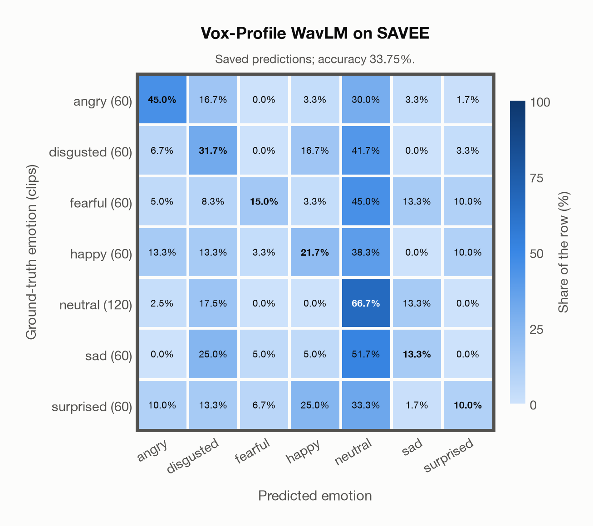

# Vox-Profile WavLM on SAVEE

Regenerated offline from saved CSV/JSON by `scripts/evaluation/refresh_reports.py`. This refresh performs no model inference or API requests.

## Summary

| Metric | Recomputed value |
|---|---:|
| Clips | 480 |
| Accuracy: acted emotion | 33.75% |
| UAR: mean ground-truth-row recall | 29.05% |
| Macro F1 | 28.67% |
| Weighted F1: true-support weighted | 30.90% |
| Accuracy: all model classes | 32.92% |

## Imported run and verification

- Source: [prediction CSV](../../outputs/vox_profile_wavlm/savee_predictions.csv) and [metadata JSON](../../outputs/vox_profile_wavlm/savee_predictions.json); both remain byte-for-byte unchanged.
- Original execution date recorded in JSON: `2026-11-07`.
- Dataset scope recorded in JSON: **SAVEE**, English (British); 480 / 480 clips.
- Ground-truth column: `acted_emotion`. Candidate classes: angry, disgusted, fearful, happy, neutral, sad, surprised.
- Row counts, unique audio paths, correctness flags and saved metrics were checked against the CSV. Metric agreement tolerance is 0.000001 (six-decimal metadata).
- Weighted F1 weights each class's F1 by its true support, using the same resolved truth as macro F1; invalid answers remain errors. New metrics absent from the source JSON are recorded in the offline audit and summaries; the source JSON is preserved.
- Original execution/client runtime metadata (reported by the imported run, not measured by this refresh): `{"device": "mps", "hardware": "Apple M4 Max", "seconds": 135.6, "ms_per_clip": 282.6, "on_cpu": 0}`.

## Results per emotion

| Ground-truth emotion | Clips | Recall | Acted-or-listener recall |
|---|---:|---:|---:|
| angry | 60 | 45.00% | — |
| disgusted | 60 | 31.67% | — |
| fearful | 60 | 15.00% | — |
| happy | 60 | 21.67% | — |
| neutral | 120 | 66.67% | — |
| sad | 60 | 13.33% | — |
| surprised | 60 | 10.00% | — |

Precision/F1 use the same resolved-truth convention as the evaluation script. Weighted F1 uses the resolved-truth clip counts below as weights.

| Predicted emotion | Resolved-truth clips | Precision | Recall | F1 |
|---|---:|---:|---:|---:|
| angry | 60 | 52.94% | 45.00% | 48.65% |
| disgusted | 60 | 22.09% | 31.67% | 26.03% |
| fearful | 60 | 50.00% | 15.00% | 23.08% |
| happy | 60 | 28.89% | 21.67% | 24.76% |
| neutral | 120 | 35.71% | 66.67% | 46.51% |
| sad | 60 | 22.86% | 13.33% | 16.84% |
| surprised | 60 | 28.57% | 10.00% | 14.81% |

## Confusion matrix: acted emotion

| Ground truth \ Predicted | angry | disgusted | fearful | happy | neutral | sad | surprised |
|---|---|---|---|---|---|---|---|
| angry (60) | **45.0%** | 16.7% | 0.0% | 3.3% | 30.0% | 3.3% | 1.7% |
| disgusted (60) | 6.7% | **31.7%** | 0.0% | 16.7% | 41.7% | 0.0% | 3.3% |
| fearful (60) | 5.0% | 8.3% | **15.0%** | 3.3% | 45.0% | 13.3% | 10.0% |
| happy (60) | 13.3% | 13.3% | 3.3% | **21.7%** | 38.3% | 0.0% | 10.0% |
| neutral (120) | 2.5% | 17.5% | 0.0% | 0.0% | **66.7%** | 13.3% | 0.0% |
| sad (60) | 0.0% | 25.0% | 5.0% | 5.0% | 51.7% | **13.3%** | 0.0% |
| surprised (60) | 10.0% | 13.3% | 6.7% | 25.0% | 33.3% | 1.7% | **10.0%** |

## Caveats

- **Training involvement for Vox-Profile WavLM: No corpus-specific evidence**. Source: SER adaptation on MSP-Podcast v1.12; WavLM-large backbone trained on Libri-Light, GigaSpeech and VoxPopuli; no clip-level overlap audit. Direct use and upstream teacher use both count as training involvement. No pattern: no corpus-specific evidence, not verified unseen. Corpus use is not test-clip leakage.
- Internal CSV/JSON consistency does not authenticate the original model or remote request logs.

[Offline validation audit](savee_offline_audit.json)
