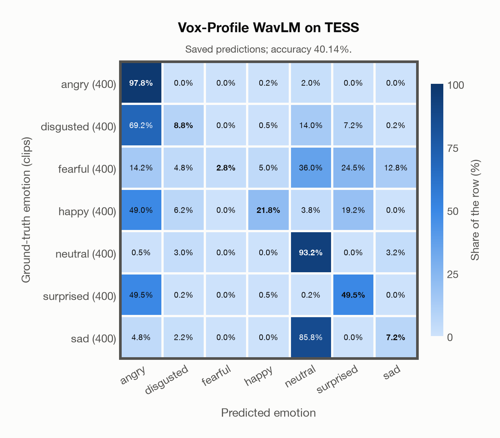

# Vox-Profile WavLM on TESS

Regenerated offline from saved CSV/JSON by `scripts/evaluation/refresh_reports.py`. This refresh performs no model inference or API requests.

## Summary

| Metric | Recomputed value |
|---|---:|
| Clips | 2,800 |
| Accuracy: acted emotion | 40.14% |
| UAR: mean ground-truth-row recall | 40.14% |
| Macro F1 | 31.55% |
| Weighted F1: true-support weighted | 31.55% |
| Accuracy: all model classes | 38.79% |

## Imported run and verification

- Source: [prediction CSV](../../outputs/vox_profile_wavlm/tess_predictions.csv) and [metadata JSON](../../outputs/vox_profile_wavlm/tess_predictions.json); both remain byte-for-byte unchanged.
- Original execution date recorded in JSON: `2026-10-29`.
- Dataset scope recorded in JSON: **TESS**, English; 2,800 / 2,800 clips.
- Ground-truth column: `acted_emotion`. Candidate classes: angry, disgusted, fearful, happy, neutral, surprised, sad.
- Row counts, unique audio paths, correctness flags and saved metrics were checked against the CSV. Metric agreement tolerance is 0.000001 (six-decimal metadata).
- Weighted F1 weights each class's F1 by its true support, using the same resolved truth as macro F1; invalid answers remain errors. New metrics absent from the source JSON are recorded in the offline audit and summaries; the source JSON is preserved.
- Original execution/client runtime metadata (reported by the imported run, not measured by this refresh): `{"device": "mps", "hardware": "Apple M4 Max", "seconds": 456.1, "ms_per_clip": 162.9, "on_cpu": 0}`.

## Results per emotion

| Ground-truth emotion | Clips | Recall | Acted-or-listener recall |
|---|---:|---:|---:|
| angry | 400 | 97.75% | — |
| disgusted | 400 | 8.75% | — |
| fearful | 400 | 2.75% | — |
| happy | 400 | 21.75% | — |
| neutral | 400 | 93.25% | — |
| surprised | 400 | 49.50% | — |
| sad | 400 | 7.25% | — |

Precision/F1 use the same resolved-truth convention as the evaluation script. Weighted F1 uses the resolved-truth clip counts below as weights.

| Predicted emotion | Resolved-truth clips | Precision | Recall | F1 |
|---|---:|---:|---:|---:|
| angry | 400 | 34.30% | 97.75% | 50.78% |
| disgusted | 400 | 34.65% | 8.75% | 13.97% |
| fearful | 400 | 100.00% | 2.75% | 5.35% |
| happy | 400 | 77.68% | 21.75% | 33.98% |
| neutral | 400 | 39.68% | 93.25% | 55.67% |
| surprised | 400 | 49.25% | 49.50% | 49.38% |
| sad | 400 | 30.85% | 7.25% | 11.74% |

## Confusion matrix: acted emotion

| Ground truth \ Predicted | angry | disgusted | fearful | happy | neutral | surprised | sad |
|---|---|---|---|---|---|---|---|
| angry (400) | **97.8%** | 0.0% | 0.0% | 0.2% | 2.0% | 0.0% | 0.0% |
| disgusted (400) | 69.2% | **8.8%** | 0.0% | 0.5% | 14.0% | 7.2% | 0.2% |
| fearful (400) | 14.2% | 4.8% | **2.8%** | 5.0% | 36.0% | 24.5% | 12.8% |
| happy (400) | 49.0% | 6.2% | 0.0% | **21.8%** | 3.8% | 19.2% | 0.0% |
| neutral (400) | 0.5% | 3.0% | 0.0% | 0.0% | **93.2%** | 0.0% | 3.2% |
| surprised (400) | 49.5% | 0.2% | 0.0% | 0.5% | 0.2% | **49.5%** | 0.0% |
| sad (400) | 4.8% | 2.2% | 0.0% | 0.0% | 85.8% | 0.0% | **7.2%** |

## Caveats

- **Training involvement for Vox-Profile WavLM: No corpus-specific evidence**. Source: SER adaptation on MSP-Podcast v1.12; WavLM-large backbone trained on Libri-Light, GigaSpeech and VoxPopuli; no clip-level overlap audit. Direct use and upstream teacher use both count as training involvement. No pattern: no corpus-specific evidence, not verified unseen. Corpus use is not test-clip leakage.
- Internal CSV/JSON consistency does not authenticate the original model or remote request logs.

[Offline validation audit](tess_offline_audit.json)
