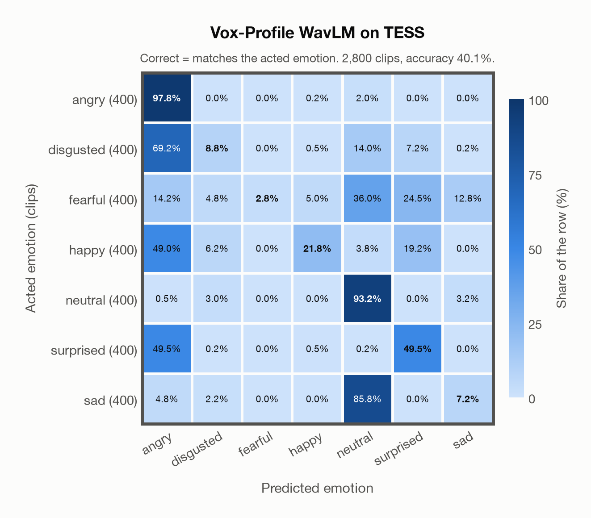

# Vox-Profile WavLM on TESS

Generated by `scripts/evaluation/evaluate.py` on 2026-10-29.

## Summary

| Metric | Value |
|---|---|
| Clips evaluated | 2,800 (English) |
| **Accuracy: prediction matches the acted emotion** | **40.1%** |
| Unweighted accuracy (mean recall of the 7 acted emotions) | 40.1% |
| Macro F1 (acted emotion) | 31.6% |
| Accuracy, all 9 model classes (acted emotion) | 38.8% |
| Chance level (7 emotions) | 14.3% |

## Setup

- **Model**: Vox-Profile WavLM (`tiantiaf/wavlm-large-categorical-emotion`) as released (no fine-tuning), transformers 5.18.0, loaded by `scripts/models/vox_profile.py`. Each clip (at most 15 s) is normalised to zero mean and unit variance and fed whole, without padding; the 25 hidden states are mixed with the model's learned layer weights and averaged over time, as in the official code. float32 on every device. The model card warns that clips shorter than 3 s give unreliable predictions (it was trained on clips of 3-15 s); clips are used as they are, not padded to 3 s.
- **Data**: 2,800 clips of TESS (English) from `data/tess/`.
- **Ground truth (acted emotion)**: the emotion each actress was asked to portray, from the last word of the file name (`angry`, `disgust`, `fear`, `happy`, `neutral`, `ps` for pleasant surprise, `sad`).
- Label mapping: angry, happy, neutral and sad keep their names; disgust = disgusted, fear = fearful, **pleasant surprise = surprised**.
- Two actresses, aged 26 and 64, say "Say the word ..." with the same 200 target words in each of the seven emotions.
- **7 emotions**: the prediction is the most probable of the 7 emotions in this dataset (angry, disgusted, fearful, happy, neutral, surprised, sad); the model's other classes (`contempt`, `other`) are ignored. **All 9 model classes**: the prediction is the most probable of all 9 model classes, so choosing a class that the dataset does not have counts as wrong.
- **Hardware**: Apple M4 Max, device `mps`, PyTorch 2.5.1. Inference took 7.6 min (163 ms per clip).
- **Per-clip predictions**: `outputs/vox_profile_wavlm/tess_predictions.csv` (in git, so the results can be checked clip by clip). The JSON file next to it describes the columns.

## Results per emotion

Rows: acted emotion. Precision, recall and F1 compare the prediction with the acted emotion.

| Emotion | Clips | Precision | Recall | F1 |
|---|---|---|---|---|
| angry | 400 | 34.3% | 97.8% | 50.8% |
| disgusted | 400 | 34.7% | 8.8% | 14.0% |
| fearful | 400 | 100.0% | 2.8% | 5.4% |
| happy | 400 | 77.7% | 21.8% | 34.0% |
| neutral | 400 | 39.7% | 93.2% | 55.7% |
| surprised | 400 | 49.3% | 49.5% | 49.4% |
| sad | 400 | 30.9% | 7.2% | 11.7% |

## Confusion matrix: acted emotion

The same numbers as a table. Rows: acted emotion. Columns: predicted emotion. Each row adds up to 100%.

| Acted \ Predicted | angry | disgusted | fearful | happy | neutral | surprised | sad |
|---|---|---|---|---|---|---|---|
| angry (400) | **97.8%** | 0.0% | 0.0% | 0.2% | 2.0% | 0.0% | 0.0% |
| disgusted (400) | 69.2% | **8.8%** | 0.0% | 0.5% | 14.0% | 7.2% | 0.2% |
| fearful (400) | 14.2% | 4.8% | **2.8%** | 5.0% | 36.0% | 24.5% | 12.8% |
| happy (400) | 49.0% | 6.2% | 0.0% | **21.8%** | 3.8% | 19.2% | 0.0% |
| neutral (400) | 0.5% | 3.0% | 0.0% | 0.0% | **93.2%** | 0.0% | 3.2% |
| surprised (400) | 49.5% | 0.2% | 0.0% | 0.5% | 0.2% | **49.5%** | 0.0% |
| sad (400) | 4.8% | 2.2% | 0.0% | 0.0% | 85.8% | 0.0% | **7.2%** |

Most frequent confusions: sad predicted as neutral (85.8%), disgusted predicted as angry (69.2%), surprised predicted as angry (49.5%).

## Predictions outside the 7 emotions

With all 9 model classes, the model chose a class that this dataset does not have for 321 clips (11.5%): `contempt` 153, `other` 168.

## Caveats

- **Not in Vox-Profile WavLM's training data** (MSP-Podcast).
- Only two speakers, so the result says little about other voices; models often score close to 100% on TESS.
- No listeners' labels are published with the dataset. Audio: 24,414 Hz WAV (one file, `OAF_food_fear.wav`, is 96 kHz), resampled to 16 kHz.
